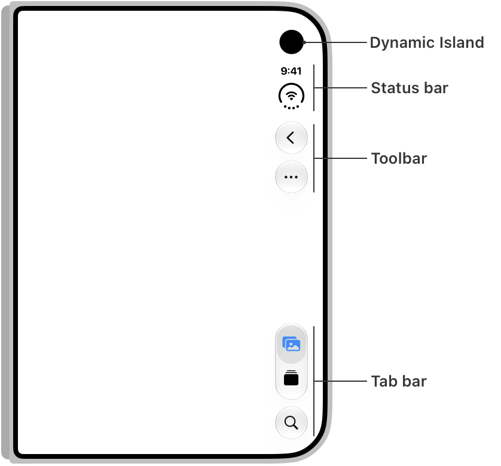
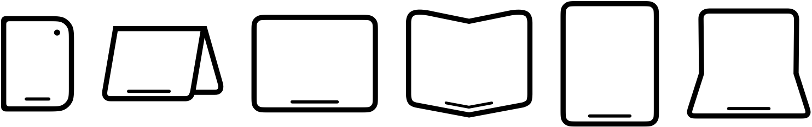
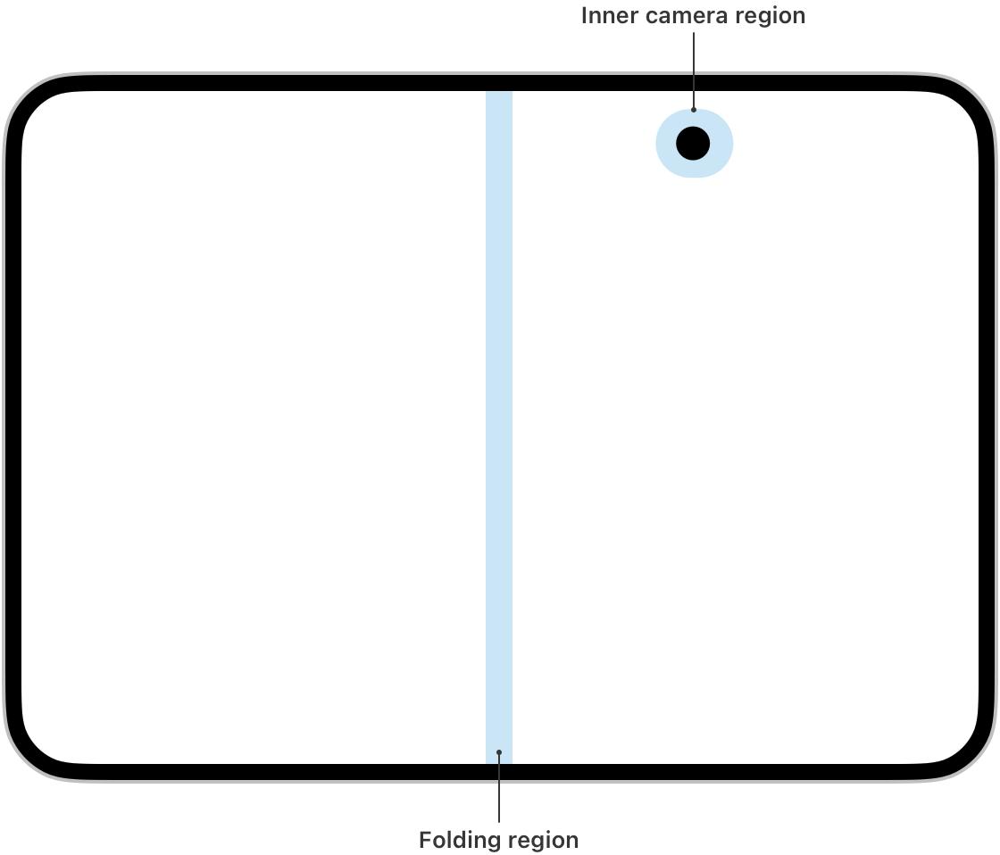
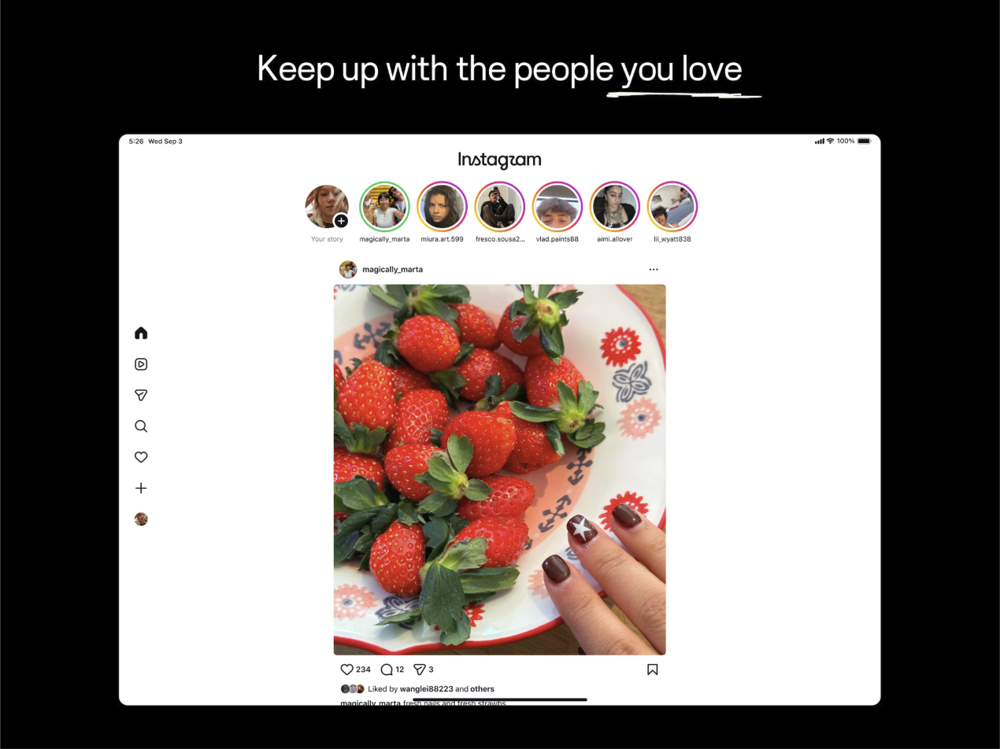
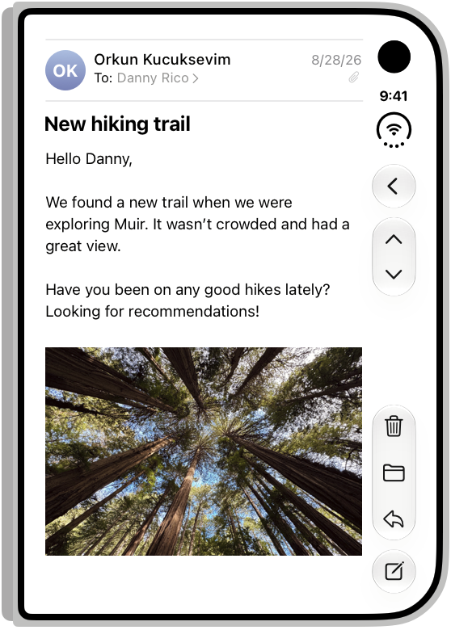
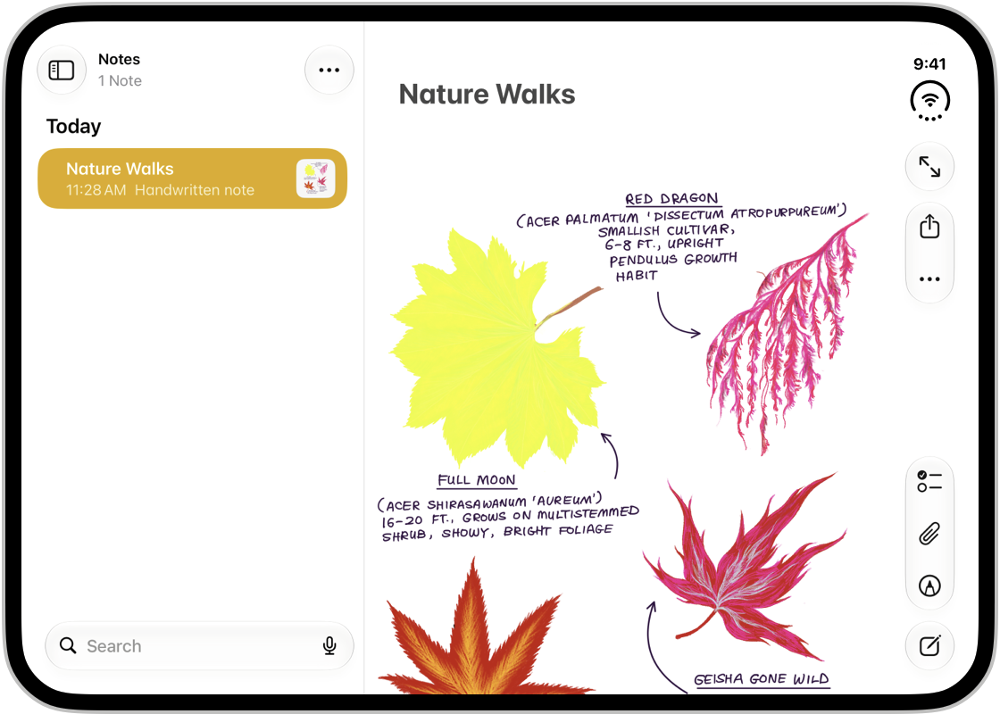
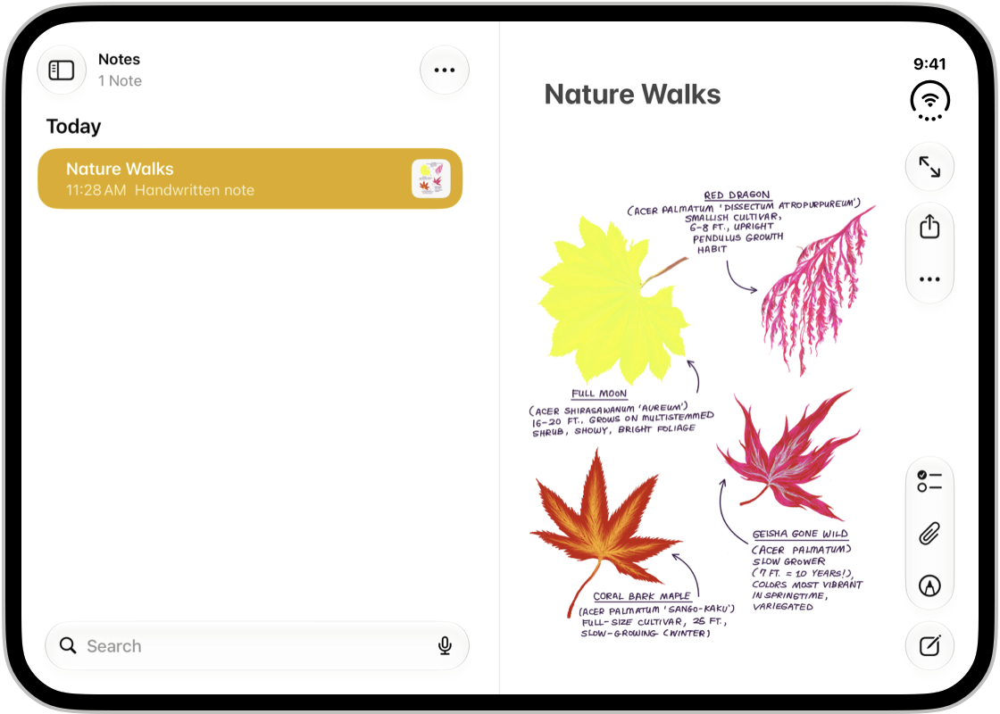

폭으로 나눈 분기를 전부 통과한 화면이 폴더블 앞에서는 사용할 수 없는 화면이 되었다.

올여름 갤럭시 Z 폴드 8이 나온 뒤, 제가 맡은 다른 서비스에서 보안 키패드가 화면 밖으로 잘리고 모달 하단의 버튼을 누를 수 없다는 QA 이슈가 올라왔습니다. 두 화면 모두 브레이크포인트는 문제없이 통과한 상태였습니다. 그리고 9월에 아이폰 듀오의 사양이 공개됐습니다. 접힌 화면의 논리 해상도를 구해 제가 운영하는 서비스를 그 크기로 띄워 보니, 폭은 이미 대응하던 범위였는데 헤더와 하단 탭바 사이에 보이는 목록이 평소보다 한 줄 적었습니다.

---

## 466px이면 모바일 레이아웃으로 충분하지 않을까

애플이 공개한 아이폰 듀오의 [디스플레이 사양](https://www.apple.com/iphone-duo/specs/)은 내부 7.6인치가 1878 × 2670px에 430ppi, 외부 5.4인치가 1398 × 2034px에 460ppi입니다.

픽셀 밀도를 보면 3배수(@3x)로 보여서 네 값을 3으로 나눠봤더니 전부 정수로 떨어졌습니다. 접었을 때 466 × 678, 펼쳤을 때 626 × 890(가로로 들면 890 × 626)이 나왔고, 같은 값을 사용한 글도 있었습니다.

제가 운영하는 서비스는 폭 600px 이하 전체에 모바일 레이아웃을 적용하도록 만들어두었습니다. 그래서 466px은 이미 대응 범위 안이고, 창을 그 폭으로 줄여도 무너지는 곳이 없었습니다. 그런데 뭔가 어색했습니다.

### 정수로 나눠떨어지지 않는 배율

어색한 이유를 따지기 전에 숫자부터 고쳐야 했습니다. 애플 [App Store Connect의 스크린샷 규격](https://developer.apple.com/help/app-store-connect/reference/app-information/screenshot-specifications)에는 듀오 내부 화면이 2007 × 2853px로 올라와 있습니다. 실제 패널 해상도인 1878 × 2670과 다른 값이고, 이 규격을 3으로 나누면 669 × 951이 됩니다. Xcode 27.1 시뮬레이터에서 잰 값과 애플의 Figma 키트도 669 × 951과 같았습니다. 626 × 890을 사용하던 [다른 글](https://blakecrosley.com/blog/iphone-duo-for-developers)도 9월 10일에 App Store Connect 규격을 근거로 이 값을 고쳤습니다.

내부 화면은 **다운샘플링(downsampling)** 을 거치는 것으로 보입니다. 다운샘플링은 패널보다 큰 해상도로 먼저 그린 뒤 패널 해상도에 맞춰 줄여서 표시하는 방식입니다. 듀오 내부 화면은 2007 × 2853으로 그린 화면을 1878 × 2670 패널에 약 93.6% 크기로 줄이므로, 1pt에 물리 픽셀이 3개가 아니라 약 2.81개 들어갑니다. 아이폰 6 플러스가 1242 × 2208로 그려서 1080 × 1920 패널에 줄여 넣던 것과 같은 구조입니다.

외부 화면은 패널 해상도가 3배수로 그린 크기와 정확히 같아서 466 × 678이 맞았습니다. 내부 화면만 패널 픽셀을 3으로 나눈 값이 논리 해상도와 달랐습니다. 정수로 나눠떨어진다고 믿으면 안 되는 거였습니다.

### 466px도 아니었던 실제 폭

외부 화면의 466px도 웹이 그대로 받는 값은 아니었습니다. 듀오는 외부 화면에서 다이내믹 아일랜드, 상태 표시줄, 툴바, 탭바를 화면 오른쪽 세로 열에 모읍니다. [Xcode 27.1 시뮬레이터로 잰 값](https://github.com/Ahmed-Badr00/render-harness/pull/2)에 따르면 이 열의 폭은 84pt입니다. 사파리도 툴바는 이 열에 두지만, 주소창은 화면 아래쪽에 띄웁니다. 그래서 외부 화면의 사파리에서 웹 페이지가 받는 크기는 오른쪽 열 84와 아래쪽 주소창 영역 98을 뺀 382 × 580(466 − 84, 678 − 98)입니다. [WebKit 팀도 10월 23일 글](https://webkit.org/blog/18486/webkit-features-for-safari-27-1/)에서 외부 화면 세로의 웹 페이지 폭을 382, 작은 뷰포트 높이를 580으로 밝혔습니다.



출처: [Apple, Designing for iPhone Duo](https://developer.apple.com/design/human-interface-guidelines/designing-for-iphone-duo)

27.1 SDK로 빌드한 앱도 오른쪽 **세이프에어리어(safe area)** 인셋으로 84pt를 받습니다. 세이프에어리어는 노치나 시스템 UI에 가리지 않고 콘텐츠를 놓을 수 있는 영역입니다. 그래서 앱을 WebView로 감쌌다면 웹뷰를 화면 끝까지 넓혀도, 가리지 않고 콘텐츠를 놓을 수 있는 폭은 466에서 84를 뺀 382가 됩니다. 제가 서비스하고 있는 "쿠랑"의 웹뷰와 같은 조건으로 만든 테스트 앱을 Xcode 27.1 시뮬레이터에 띄워 재보니, 화면 끝까지 넓힌 WKWebView에서 `env(safe-area-inset-right)`는 84, `env(safe-area-inset-bottom)`은 34였습니다. 같은 382라도 사파리에서는 뷰포트 자체가 382이고, 화면 끝까지 넓힌 웹뷰에서는 뷰포트가 466이고 그중 오른쪽 84를 웹이 직접 비워야 한다는 차이가 있습니다.


### 폭은 그대로이고 높이만 줄어든 화면

흔히 기준으로 삼는 390 × 844 아이폰과 앱이 콘텐츠를 놓을 수 있는 영역을 비교하면 차이가 분명해집니다. 기준 아이폰은 상단 47과 하단 34를 뺐고, 듀오는 오른쪽 84와 하단 34를 뺐습니다.

| 구분 | 화면 | 콘텐츠 영역 | 화면비 |
|---|---|---|---|
| 흔히 기준으로 삼는 아이폰 세로 | 390 × 844 | 390 × 763 | 1 : 1.96 |
| 듀오 접힘, 27.1 SDK 앱 | 466 × 678 | 382 × 644 | 1 : 1.69 |
| 듀오 접힘, 사파리 | 466 × 678 | 382 × 580 | 1 : 1.52 |

화면 폭은 약 20% 넓어졌지만(466 ÷ 390 = 약 1.19) 콘텐츠가 받는 폭은 오히려 2% 좁아졌고(382 ÷ 390 = 약 0.98), 높이는 16% 줄었습니다(644 ÷ 763 = 약 0.84). 사파리에서는 580 ÷ 763 = 약 0.76이라 높이가 24%나 줄어듭니다. 상단 헤더와 하단 탭바를 합쳐 112px을 사용한다면 고정 요소가 차지하는 비율은 15%에서 17%로 올라갑니다. 88px짜리 목록 항목을 놓으면 한 화면에 온전히 보이는 개수가 7개에서 6개로 줄어듭니다.

그런데 폭을 기준으로 삼는 분기는 이 변화를 감지하지 못합니다. 382px이든 466px이든 600px 미만이니 모바일 레이아웃이 그대로 나가게 됩니다.

애플은 같은 문제를 자사 앱에서 직접 처리했습니다. [휴먼 인터페이스 가이드라인(HIG)](https://developer.apple.com/design/human-interface-guidelines/designing-for-iphone-duo)의 계산기 예시를 보면, 일반 아이폰에서 4열 5행이던 버튼 배열을 듀오 외부 화면에서는 5열 4행으로 눕혔습니다. 외부 화면이 일반 아이폰보다 넓고 짧아서 버튼 그리드의 축을 바꾼 것입니다.


출처: [Apple, Designing for iPhone Duo](https://developer.apple.com/design/human-interface-guidelines/designing-for-iphone-duo)

펼침 화면도 같은 구조로 틀어집니다. 951px은 폭으로만 보면 태블릿 구간에 들어가지만 높이는 669px입니다. 태블릿 레이아웃은 일반적으로 768 × 1024처럼 세로로 긴 화면을 전제로 만들어졌으니, 이 높이와 비율을 가정한 배치는 맞지 않게 됩니다.

### 태블릿과 PC에서는 왜 문제가 되지 않았나

사실 가로로 넓은 화면은 이미 오래전부터 있었습니다. 아이패드를 눕히면 1024 × 768이고 작은 노트북은 1280 × 800입니다. 그런데도 폴더블에서 새로 문제가 되는 것이 다섯 가지 있습니다.

**높이가 폰보다 짧습니다**: 태블릿에서는 폭이 넓다는 것이 공간이 많다는 뜻이었습니다. 아이패드는 세로로 들면 높이가 1024px이라 폰보다 깁니다. 그런데 펼친 듀오를 가로로 들면 높이가 669px이라, 일반적인 폰의 844px보다도 175px 짧습니다. 폭만 태블릿이고, 세로 공간은 폰보다 작습니다.

**손에 쥔 채로 넓어집니다**: 노트북에서 폭 1280px에 탭바를 가로로 놓아도 괜찮은 이유는 커서 이동 비용이 거의 없기 때문입니다. 태블릿은 두 손으로 들거나 거치해서 사용합니다. 그런데 폴더블은 951px이 되어도 손에 쥔 채 엄지로 조작하므로, 폭이 넓어진 만큼 도달 거리가 훨씬 큰 부담으로 다가옵니다.

**한 세션 안에서 크기가 자꾸 바뀝니다**: 태블릿과 PC는 사용 중에 화면 크기가 잘 바뀌지 않고, 창 크기를 바꾸더라도 사용자가 정확히 원하는 만큼만 바뀝니다. 반면 접었다 펴는 동작, 기기를 이리저리 돌리는 동작은 기기의 기본 사용 방식이라 한 작업 중에도 여러 번 일어납니다. 그래서 전환 자체를 설계해야 하고, 스크롤 위치, 입력 중인 값, 포커스가 전환 뒤에도 유지되어야 합니다.

**두 레이아웃이 이어져야 합니다**: 태블릿 레이아웃과 PC 레이아웃은 서로 다른 기기에서 보이므로 달라도 됩니다. 하지만 접힘과 펼침은 같은 기기의 같은 세션입니다. 펼쳤을 때 조금 전까지 보던 것이 사라지거나 다른 위치로 가면 사용자는 혼란에 빠지고 말 것입니다.

**물리적 경계가 있습니다**: 태블릿과 PC 화면에는 가운데를 가르는 선이 없지만, 반쯤 접은 폴더블은 접힘선이 화면을 둘로 나눕니다.

---

## 90도 돌아간 긴 축

스마트폰 화면은 20년 동안 한 방향으로만 바뀌어 왔습니다. 초기 아이폰은 3:2였고, 아이폰 5에서 16:9가 되었고, 아이폰 X 이후로 19.5:9에 정착했습니다. 올해 나온 아이폰 18 프로도 2622 × 1206으로 같은 계열입니다.

갤럭시 폴드의 커버 화면도 같은 방향이었습니다. 1세대 커버는 1680 × 720이었고, 7세대까지 긴 변이 짧은 변의 2.3배에서 2.8배 사이를 오갔습니다.

2026년에는 결국 iOS 진영에서까지 그 방향이 뒤집혔습니다.

![화면비 변화를 나타낸 꺾은선 그래프. 범례는 파란 선의 아이폰과 주황 선의 갤럭시 폴드 커버 화면. 세로축 제목은 긴 변 ÷ 짧은 변이고 1.5, 2.0, 2.5에 격자선. 가로축은 연도이고 2007, 2012, 2017, 2022, 2026에 눈금. 파란 계단선은 2007년 3:2인 1.50에서 2012년 16:9인 1.78, 2017년 19.5:9인 2.17로 올라간 뒤 2026년까지 2.17을 유지하고, 끝점에 18 프로 2.17 라벨. 주황 꺾은선은 2019년 2.33, 2020년 2.77, 2021년 2.73, 2022년 2.56, 2023년 2.56, 2024년 2.45, 2025년 2.33을 지나 2026년 1.58로 급락하고, 끝점에 폴드 8 커버 1.58 라벨. 2026년에는 빈 원 세 개가 있으며 파란 빈 원은 듀오 외부 1.45와 듀오 내부 1.42, 주황 빈 원은 폴드 8 메인 1.32 라벨. 하단 각주는 제조사 사양 기준이며 폴드 8은 기본형입니다, 빈 원은 2026년 폴더블의 다른 화면입니다라는 두 문장.](fv-04-aspect-ratio-timeline.svg)

아이폰 듀오의 내부 화면은 긴 변이 짧은 변의 약 1.42배이고, 외부 화면도 약 1.45배입니다. [갤럭시 Z 폴드 8](https://www.samsung.com/sec/smartphones/galaxy-z-fold8/) 기본형은 메인 화면이 2448 × 1848로 4:3이고, 커버 화면도 1972 × 1248로 16:10을 택했습니다. 일반적인 스마트폰이 19.5:9 근처인 것과 비교하면 훨씬 넓적합니다. 폴드 8 울트라는 21:9 커버를 유지했으니, 삼성은 라인업을 나눠서 방향을 바꾼 것입니다.

두 회사는 같은 해에 같은 방향을 택했습니다. 폴드 8은 직전 세대까지 유지하던 10:9 메인 화면을 버렸고, 애플은 첫 폴더블부터 넓은 비율로 들어왔습니다. [폰아레나](https://www.phonearena.com/news/PhoneArena-Reacts-The-Best-and-Worst-of-the-iPhone-Duo_id183202)의 Victor Hristov는 삼성을 뺀 다른 안드로이드 제조사들이 이제야 정사각형으로 펼쳐지는 폰은 실용적이지 않다는 사실을 깨닫고 있다고 적었습니다. 그리고 7년 넘는 시간이 있었는데도 폴더블 아이폰이 나오고서야 다들 넓은 쪽으로 옮겨가는 것이 씁쓸하다고 덧붙였습니다.

### 접힘과 펼침을 부르는 방식

제조사 사양표는 세로를 기준으로 적고, 듀오 내부 화면은 사양표의 패널 해상도와 실제로 그리는 해상도가 다릅니다. 그래서 숫자 순서와 실제 사용 방향이 자주 맞지 않습니다.

| 상태 | 사양표 패널 | 그리는 해상도 | 실제 사용 방향 | 논리 해상도 | 화면비 |
|---|---|---|---|---|---|
| 접힘 | 1398 × 2034 | 1398 × 2034 | 세로 | 466 × 678 | 1 : 1.45 |
| 펼침 | 1878 × 2670 | 2007 × 2853 | 가로 | 951 × 669 | 1.42 : 1 |

접었을 때는 세로가 긴 화면이고, 펼치면 가로가 긴 화면이 됩니다. 비율의 크기는 비슷하지만 긴 축이 90도 돌아갑니다. 펼친 채로 세워 들면 669 × 951이 되는데, 아래부터는 466 × 678을 접힘, 951 × 669를 펼침이라고 부르겠습니다.

### 화면비가 같다는 말

애플은 [두 화면의 화면비가 같아서 콘텐츠가 비례적으로 조정된다고](https://www.apple.com/newsroom/2026/09/apple-unveils-iphone-duo/) 설명했습니다. 그런데 공개된 해상도로 직접 나눠보면 내부는 2670 ÷ 1878 = 약 1.422이고, 외부는 2034 ÷ 1398 = 약 1.455라서 2.3% 차이가 납니다. 그리는 해상도로 계산해도 2853 ÷ 2007 = 약 1.422로 같습니다. 애플은 공식 사양에 숫자로 된 비율 표기를 넣지 않았습니다.

실사용에서 체감될 차이는 아닙니다. 다만 화면비가 같다는 표현은 마케팅 문구이지 설계 제약이 아니므로, 두 화면의 비율이 정확히 같다고 가정하고 레이아웃을 짜면 안 됩니다.

---

## 768은 어디서 왔습니까

지금 국내 실무에서 통용되는 분기는 대략 모바일 360\~767, 태블릿 768\~1023, 데스크톱 1024 이상입니다. 768은 2010년에 나온 [아이패드](https://support.apple.com/en-us/112438)의 세로 폭이고, 이 숫자를 사용한 지 16년이 됐습니다. 아이패드의 1024 × 768은 IBM이 1990년에 내놓은 [XGA](https://en.wikipedia.org/wiki/Extended_Graphics_Array) 그래픽 카드의 이름으로 불리던 해상도였는데, 아이패드가 이 화면을 세로로 세우면서 높이였던 768이 폭이 됐습니다. PC 화면 해상도의 높이가 기기 한 대를 거쳐 태블릿 폭의 업계 표준이 된 것입니다.

그때는 레이아웃을 짜기 전에 분기부터 나눠야 했습니다. 태블릿에 m 도메인을 줄 것인지, PC 사이트를 줄 것인지를 정해야 했습니다. PC 사이트는 터치 타깃이 작아서 사용하기 어려웠고, 모바일 사이트는 화면이 텅 비었습니다. 그래서 새 구간을 하나 만들어 넣고, 그 시작점을 아이패드의 폭으로 잡았습니다.

곧 7인치 안드로이드 태블릿이 나오면서 그 구분이 흔들렸습니다. 7인치 기기는 기기 분류로는 태블릿인데, 한 손으로 쥐고 세로로 사용하는 방식은 폰에 가까웠습니다. 폭만 보고 내린 판단과 실제 사용 방식이 맞지 않게 된 첫 사례였습니다. 그런데 실무에서는 구간을 더 잘게 쪼개는 쪽으로 대응했고, 폭 말고 다른 것을 묻는 방법은 거의 논의되지 않았습니다.

디바이스 픽셀 비율은 2010년 아이폰 4의 레티나 디스플레이부터 디자이너의 어휘로 들어왔고, 2012년에는 아이패드도 레티나 디스플레이를 달았습니다. 이미지는 보통 2\~3배수로 준비합니다. 그런데 듀오 내부 화면은 3배수로 그린 뒤 줄여서 표시하므로, 1pt에 물리 픽셀이 약 2.81개 들어가는 화면이 3배수 에셋을 받게 됩니다. 한 기기 안에서 외부 화면은 정확한 3배수이고, 내부 화면은 3배수로 그린 뒤 약간 줄인 화면입니다.

### 이미 맞지 않던 관행과 실측 분포

[StatCounter의 2026년 9월 국내 태블릿 해상도 통계](https://gs.statcounter.com/screen-resolution-stats/tablet/south-korea)를 보면, 세로 방향 해상도 중에서는 820 × 1180이 4.11%로 768 × 1024의 3.59%보다 많습니다. [국내 가이드](https://wikidocs.net/327938) 중에는 태블릿 작업 사이즈로 820px을 권하는 곳도 있습니다.

768은 이미 대표값이 아닌데도 브레이크포인트로는 여전히 768을 사용합니다. 관행이 데이터보다 오래 살아남은 것입니다.

이 시기를 돌아보면 큰 화면 대응은 기술 문제였던 적이 없습니다. 인스타그램은 아이폰 앱을 2010년 10월에 내고 [아이패드 앱을 2025년 9월에 냈으니](https://techcrunch.com/2025/09/03/instagram-is-finally-launching-an-ipad-app/) 15년이 걸렸습니다. 아담 모세리는 2022년 초에 유튜버 마르케스 브라운리에게 [아이패드 사용자는 우선순위를 줄 만큼 큰 집단이 아니라고](https://9to5mac.com/2022/02/27/instagram-app-ipad-nope/) 말했습니다. 만들 수 없어서가 아니라 만들지 않기로 한 것이었습니다.

### 다시 돌아온 2010년의 질문

m 도메인을 줄 것인지 묻던 질문은 아직 끝나지 않았습니다. [9to5Mac의 듀오 리뷰](https://9to5mac.com/2026/10/21/iphone-duo-review/)는 펼친 화면에서 일부 사이트가 데스크톱급 레이아웃 대신 모바일 레이아웃을 보여준다고 지적했습니다.

원인 중 하나는 **사용자 에이전트(user agent)** 입니다. 사용자 에이전트는 브라우저가 요청마다 서버에 보내는 문자열로, 기기와 브라우저 종류가 담겨 있습니다. 듀오는 아이폰으로 식별되므로, 사용자 에이전트로 기기를 구분하는 사이트는 951px 화면에도 모바일 사이트를 내보내게 됩니다. Xcode 27.1 시뮬레이터에서 듀오를 펼친 채 사파리로 열어봐도 사용자 에이전트에는 `iPhone`이 들어가고, `screen.width`도 외부 화면 폭인 466을 돌려줍니다. 2010년에 기기 종류로 사이트를 나누던 방식이 2026년에도 같은 문제를 만들고 있는 것입니다.

---

## 280이냐 320이냐를 따지던 시절

2019년에 갤럭시 폴드 1세대가 나왔을 때 한국 웹 개발 커뮤니티에는 커버 화면 폭이 280px이라는 이야기가 상식처럼 돌았습니다. 최소 폭 방어선을 320에서 280으로 내려야 한다는 말도 따라다녔습니다.

그런데 실제로 재보면 320이 나왔습니다. 어느 국내 프론트엔드 개발자가 [삼성 개발자 포럼](https://forum.developer.samsung.com/t/detail?id=16427-Galaxy-Fold-1-cover-screen%27s-width-%28280px-vs-320px%29)에 280과 320 중 무엇이 맞느냐고 물었고, 삼성 개발자 지원에도 같은 질문을 했지만 명확한 답을 받지 못했다고 적었습니다. 몇 년을 사용하던 숫자의 출처가 불분명했던 것입니다.

앞서 언급했던 626 × 890도 같은 경로로 퍼졌습니다. 그럴듯한 계산이 먼저 돌고, 실측은 나중에 이루어졌습니다.

같은 폴드 1세대의 내부 화면 CSS 뷰포트는 768 × 1076이었습니다. 펼치면 아이패드 브레이크포인트와 비슷한 숫자가 나왔고, 그래서 화면을 펼친 폴더블은 태블릿 레이아웃을 받았습니다. 기기, 파지 방식, 사용 맥락이 모두 달랐지만 폭이 같아서 같은 레이아웃이 나갔습니다.

### 창을 더 줄이는 사람들

갤럭시 폴드에서 화면이 깨진다는 제보가 들어온 적이 있습니다. 그런데 팀 내에서는 재현이 되지 않았습니다. 확인해보니 제보자는 폰 안에서 멀티태스킹을 하려고 창 크기를 최소 폭보다 더 작게 줄여놓은 상태였습니다.

안드로이드에서는 액티비티의 최소 폭과 높이를 선언할 수 있습니다. 그런데 [공식 문서](https://developer.android.com/develop/adaptive-apps/guides/support-multi-window-mode)에는 사용자가 분할 화면에서 분할선을 움직여 액티비티를 선언된 최소보다 작게 만들면, 시스템이 사용자가 요청한 크기로 액티비티를 잘라낸다고 적혀 있습니다. 시스템은 선언값보다 작아지는 요청도 거부하지 않습니다. 게다가 WebView 안의 웹 계층에는 그 최솟값을 선언할 수단조차 없습니다.

**320px은 합의였지 강제되는 값이 아니었고, 심지어 사용자는 창의 크기를 자유자재로 조절할 수 있었습니다.**

기기 쪽 사정도 가정보다 복잡했습니다. 삼성 인터넷의 [Diego González가 2020년에 정리한](https://developer.samsung.com/internet/blog/en-us/2020/01/27/current-web-on-galaxy-fold) 바로는, 폴드는 앱을 최대 세 개까지 동시에 띄울 수 있고 분할선이 세 위치 중 하나에 놓입니다. 여기에 내비게이션 바 방식, 브라우저 탭 유무, 화면 줌 설정이 모두 뷰포트에 영향을 줍니다. 이 조건들을 다 따지면 기기 한 대가 만들어내는 뷰포트가 수십 가지가 됩니다.

### 어떻게 해결했나

전면 재설계를 하진 않았습니다. 왼쪽에 붙어 있던 요소의 위치를 조금 조정해서 넘어갔습니다.

좁은 폭에서 생기는 문제는 대개 구조가 아니라 한두 요소의 고정된 위치에서 나오기 때문에, 그 요소만 옮기면 증상이 사라집니다. 근본적으로 해결하려면 요소들의 너비를 다시 설계해야 했고, 그건 레이아웃 전체를 다시 짜는 일이었습니다. 제보 한 건으로 그 일정을 잡을 수는 없었으니 숫자만 약간 고쳤습니다.

그 판단이 틀렸다고 지금도 생각하지 않습니다. 다만 그 뒤로 비슷한 제보가 올 때마다 같은 방식으로 처리해왔고, 466이라는 숫자를 보고 또 같은 방식으로 처리할까 고민하던 참이었습니다.

---

## 뷰포트는 언제부터 여러 축이 되었나

**뷰포트(viewport)** 는 브라우저나 앱이 콘텐츠를 그릴 수 있는 영역입니다. 실무에서는 오래 뷰포트를 폭 하나의 숫자로 다뤄왔습니다. [반응형 웹 디자인이 처음 제안될 때](https://alistapart.com/article/responsive-web-design/)의 구성 요소가 유동 그리드, 유연한 이미지, 미디어 쿼리였고, 그중 분기를 담당한 미디어 쿼리가 주로 폭을 사용했기 때문입니다.

태블릿, 폴드 1세대, 창 크기 제보를 모아보면 뷰포트는 오래전에 이미 여러 개의 축을 가진 값이 되어 있었습니다.

| 축 | 언제 문제가 됐나 | 지금 상태 |
|---|---|---|
| 폭 | 2007 | 여전히 주요한 분기 기준 |
| 높이 | 2012년 이후 화면이 길어지며 | `dvh`, `svh`, `lvh`로 분리 |
| 화면비 | 2017 노치, 2026 폴더블 | 긴 축의 방향까지 바뀜 |
| 세이프에어리어 | 2017 노치 | 듀오에서 한쪽에 84pt 세로 열이 생김 |
| 자세 | 2019 폴더블 | 크롬은 2025년부터 지원, 사파리에서는 관측 불가 |
| 연속성 | 2019 폴더블 | 접힘선이 콘텐츠를 가름 |
| 창 크기 | 2016 안드로이드 멀티윈도우 | 사용자가 마음대로 조절 가능 |
| 밀도 | 2010 레티나 | 한 기기 안에 3배수와 다운샘플링이 공존 |

여덟 개 축 중 폭 하나만 물어보고 레이아웃을 결정해왔습니다. 나머지 일곱 개는 폭과 상관관계가 있다고 가정했고, 그 가정이 대체로 맞았기 때문에 오래 버텼습니다. 그런데 듀오 접힘 화면에서는 그 상관관계가 끊깁니다. 폭은 모바일 구간 안인데 높이는 일반적인 모바일 화면보다 짧습니다.

### 애플이 정리한 방식

[아이폰 듀오용 HIG](https://developer.apple.com/design/human-interface-guidelines/designing-for-iphone-duo)에서 애플은 자세마다 레이아웃을 따로 만들지 말고 사이즈 클래스로 대응하라고 정리했습니다.

**사이즈 클래스(size class)** 는 앱 인터페이스가 쓸 수 있는 가로·세로 공간을 컴팩트와 레귤러 두 단계로만 구분해 알려주는 iOS의 분류입니다. 듀오에서는 외부 화면이 컴팩트 폭, 내부 화면이 레귤러 폭으로 보고됩니다. HIG는 고정 폭이나 특정 화면에 묶인 의존성을 피하고, 사이즈 클래스, 레이아웃 여백, 세이프에어리어 인셋으로 배치하라고 안내합니다.

[개발 문서](https://developer.apple.com/documentation/technologyoverviews/preparing-your-app-for-iphone-duo)에서는 두 가지를 더 막았습니다. 하나는 기기 종류(`userInterfaceIdiom`)나 인터페이스 방향(`UIInterfaceOrientation`)으로 레이아웃을 정하는 방식입니다. 인터페이스 방향은 화면이 세로인지 가로인지를 뜻하는데, 듀오에서는 접었다 펴면 이 값이 바뀌어도 앱에 실제로 주어진 공간은 이 값으로 알 수 없습니다.

다른 하나는 화면 크기로 레이아웃을 계산하는 방식입니다. 애플은 화면 크기 대신 씬이나 뷰를 담은 컨테이너의 크기로 계산하라고 하고 있습니다. 그리고 [첫 테크 토크](https://developer.apple.com/videos/play/tech-talks/111461/)에서는 듀오에서 주 화면을 가리키는 코드가 모호하다며 피하라고 안내했습니다. 화면이 두 개라 어느 쪽이 주 화면인지 정할 수 없고, 스플릿 뷰에서는 앱이 화면 전체를 사용하지도 않습니다.

**자세(pose)** 는 기기를 얼마나 접고 어느 방향으로 들었는지를 나타내는 상태로, HIG는 닫힘, 텐트처럼 접힘, 가로로 펼침, 책처럼 접힘, 세로로 펼침, 노트북처럼 접힘의 여섯 가지를 그림으로 보여줍니다. 자세가 바뀌면 화면 요소가 놓일 자리도 달라집니다. [테크 토크](https://developer.apple.com/videos/play/tech-talks/111463/)에 따르면 책처럼 반쯤 펼쳐 든 북 자세에서는 경고창 같은 요소가 끝 쪽(trailing, 가로쓰기 기준 오른쪽) 화면으로 옮겨갑니다. 기기를 닫으면 사용자는 외부 화면에서 이어서 보게 되는데, 경고창이 그 자리 가까이에 미리 가 있는 셈입니다. 반쯤 접어 탁자 위에 세워 둔 테이블 자세에서는 위아래 두 화면의 역할이 나뉩니다. 위쪽은 멀리서도 잘 보여야 하는 콘텐츠를 맡아서 경고창도 이쪽으로 올라갑니다. 아래쪽은 손으로 누르는 컨트롤을 맡아서, 미디어 컨트롤처럼 탭하는 요소는 바닥에 닿아 흔들림이 적은 이쪽으로 내려옵니다.



출처: [Apple, Designing for iPhone Duo](https://developer.apple.com/design/human-interface-guidelines/designing-for-iphone-duo)

다만 HIG는 자세마다 레이아웃을 따로 만들라는 뜻이 아니라고 밝혔습니다. 외부 화면용 컴팩트 레이아웃과 내부 화면용 레귤러 레이아웃만 갖추면 모든 자세의 기본이 마련되고, 나머지는 사용 가능한 공간에 맞춰 늘어나게 두라는 것입니다.

**예약 영역(reserved region)** 은 콘텐츠가 피해야 하는 하드웨어 영역으로, 듀오에는 외부 카메라, 내부 카메라, 접힘부의 세 가지가 있습니다. 외부 카메라는 항상 있고, 내부 카메라는 카메라가 동작할 때만 생깁니다. 접힘부는 기기를 반쯤 접었을 때만 활성화되고, 평평하게 펴면 폭이 0인 비활성 영역이 됩니다. 알림, 메뉴, 시트 같은 시스템 컴포넌트는 접힘부를 알아서 피하지만, 직접 배치한 요소는 피하지 않습니다.



출처: [Apple, Designing for iPhone Duo](https://developer.apple.com/design/human-interface-guidelines/designing-for-iphone-duo)

**격자형 레이아웃에서는 접힘부가 있으면 열 개수를 짝수로 두는 편이 좋습니다.** HIG는 콘텐츠가 깔끔하게 나뉘도록 짝수 열을 권하고, [테크 토크](https://developer.apple.com/videos/play/tech-talks/111463/)는 접힘부가 활성이든 아니든 짝수 열을 고르는 방법을 예로 듭니다. 홀수 열이면 반쯤 접었을 때 가운데 열이 접힘선 위에 놓이게 됩니다.

시스템 UI도 같은 방향으로 바뀌었습니다. 외부 화면은 일반 아이폰보다 넓고 짧아서, 시스템이 다이내믹 아일랜드, 상태 표시줄, 툴바, 탭바를 오른쪽 세로 열로 옮겼습니다. 펼친 화면을 가로로 들어도 같은 높이에서 이어지도록 세로 배치를 유지하고, 펼쳐서 세로로 들 때만 세로 공간이 충분하므로 가로 막대로 돌아옵니다. [9to5Mac 리뷰](https://9to5mac.com/2026/10/21/iphone-duo-review/)도 홈 화면의 독이 오른쪽으로 옮겨가고, 펼쳐서 세로로 들면 독과 내비게이션 바가 아래로 돌아온다고 확인했습니다.


---

## 옮기지 않는 쪽을 고른 사람들

뷰포트 폭이 넓어지면 하단에 가로로 놓인 탭바가 문제가 됩니다. 폭 390px에서 탭 다섯 개를 균등 배치하면 항목 중심 사이가 78px이지만, 951px에서는 190px, 1920px 데스크톱에서는 384px이 됩니다. 손가락이든 커서든 이동 거리가 길어지고, 가로로 길고 세로로 얇은 막대로는 항목 사이의 관계도 드러내기 어렵습니다.

탭 간격은 폭의 문제라서 화면비와는 별개로 생깁니다. 데스크톱 브라우저에서 모바일 레이아웃을 그대로 늘려도 같은 일이 벌어집니다. 그래서 폭이 넓어지면 제어를 측면으로 보내야 한다는 판단이 나옵니다. 애플이 이번에 독을 옮긴 것도 펼친 화면에서는 이 계산과 맞지만, 외부 화면에서는 넓고 짧은 화면의 높이를 아끼려는 이유가 더 커 보입니다.

그런데 이 변경은 CSS 몇 줄로 끝나지 않습니다. 탭 전환은 라우트 전환이고, 각 탭은 자기 스크롤 위치와 히스토리 스택을 들고 있습니다. 하단에 고정할 때는 하단 세이프에어리어 하나만 다루면 되지만, 측면으로 가면 좌우 인셋, 논리 속성, 포커스 순서를 모두 다시 따져야 합니다.

디자인 시스템 컴포넌트도 탭바 높이 토큰, 스크롤 패딩, 키보드 회피를 전제로 짜여 있습니다. 분석 이벤트와 A/B 테스트도 그 위치에 묶여 있습니다. 앱을 WebView로 감싸고 있다면 네이티브 셸의 내비게이션과 웹 내비게이션이 겹치는 문제까지 더해집니다. 게다가 GNB(전역 내비게이션)로 사용하는 탭바는 사용자가 '근육 기억'으로 사용하는 요소라서, 잘못 옮기면 되돌리는 비용도 큽니다.

그래서 대부분은 옮기지 않습니다. 실무에서 실제로 택하는 방법은 대개 셋 중 하나입니다.

- **비우기**: 가운데에 고정 폭 컨테이너를 두고 양옆을 여백으로 둡니다. 가장 흔한 선택이고 위험도 적습니다.
- **채우기**: 여백이 아깝다는 압력에 밀려 양옆에 추천, 랭킹, 배너 같은 컨텐츠를 넣습니다.
- **덮기**: 넓은 화면 레이아웃 자체를 없애고 모바일 레이아웃으로 통일합니다.

셋 다 정당한 선택이지만 영원히 땜빵으로 처리할 수는 없습니다.

### 무신사의 10개월

2024년 6월 3일에 무신사가 PC 전용 웹을 종료하고, PC에서도 모바일 웹과 같은 형태로 서비스하기 시작했습니다. 덮기의 가장 극단적인 형태입니다. 회사는 PC와 모바일에서 [일관된 사용자 경험과 안정적인 서비스 환경을 제공하기 위한 조치](https://biz.heraldcorp.com/view.php?ud=20240607050195)라고 설명했지만, 업계에서는 비용 효율 판단이라는 시각이 우세했습니다.

[요즘IT의 분석](https://yozm.wishket.com/magazine/detail/2659/)이 이 결정의 배경을 잘 짚었습니다. 서비스가 성장할수록 시스템 전환의 시간과 비용이 기하급수적으로 커지는데, 무신사는 성장 속도가 빨라서 그 비용이 이미 감당하기 어려운 수준이었다는 것입니다. 필자는 자신에게 선택권이 있었어도 같은 선택을 했을 거라고 덧붙였습니다.

[디자인 나침반](https://designcompass.org/2024/07/09/musinsa-desktop-quit/)은 기존 PC 사이트가 PHP 기반이라 앱 쪽의 Java, React 스택과 맞지 않아 관리 비용이 계속 늘었다고 설명했습니다. 그리고 사용자 경험 쪽 손실도 지적했습니다. 커뮤니티 커머스를 대표하던 첫 화면의 랭킹과 스냅샷이 사라지고, 프로모션 배너와 퀵링크가 그 위치를 차지했다는 것입니다. 그래서 다른 웹을 쓰다가 모바일을 그대로 옮긴 웹으로 넘어오면 이음새가 크게 느껴진다고 했습니다.


출처: [디자인 나침반, 무신사 PC 버전 종료: 넘쳐 버린 개발 부채](https://designcompass.org/2024/07/09/musinsa-desktop-quit/)

결국 2025년 3월 31일, [무신사의 PC 웹사이트가 다시 열렸습니다](https://designcompass.org/2025/03/18/musinsa-desktop-resurrection/). 종료한 지 약 10개월 만이었습니다.


출처: [무신사](https://www.musinsa.com/), 2026년 10월 22일 캡처

덮기는 당장의 비용을 아껴주지만 되돌아올 수 있습니다. 무신사의 경우 10개월이었고, 되돌릴 때는 PC 경험을 다시 만드는 비용이 따로 들게 됩니다.

### 인스타그램의 3년

같은 문제를 오래 미뤄온 인스타그램은 결국 탭바를 옮겼습니다.

| 시점 | 인스타그램 이력 |
|---|---|
| 2010.10 | 아이폰 앱 출시 |
| 2022 초 | 아이패드는 우선순위를 줄 만큼 큰 집단이 아니라고 공개 발언 |
| 2023.08 | 안드로이드 큰 화면 UI에 좌측 내비게이션 레일 도입 |
| 2025.09 | 네이티브 아이패드 앱 출시, 주요 메뉴를 좌측 사이드바에 배치 |
| 2026.04 | 안드로이드 태블릿 네이티브 지원 |
| 2026.09 | 애플이 아이폰 듀오의 iOS 27.1에서 독과 앱 바를 측면으로 이동 |

인스타그램은 2023년 8월, 갤럭시 Z 폴드 5 발표 며칠 뒤에 [안드로이드 큰 화면용 UI를 내놨습니다](https://9to5google.com/2023/09/01/instagram-tablet-foldable-layout-android/). 홈, 검색, 새 게시물, 릴스, 프로필이 하단 바에서 좌측 내비게이션 레일로 옮겨갔고, 알림과 DM이 레일에 추가됐습니다. 이 UI는 처음에는 폴드 시리즈에서만 확인됐고, 계정 단위로 천천히 풀렸습니다. 9월 1일에는 픽셀 태블릿을 세로로 들었을 때도 같은 UI가 확인됐습니다.



출처: [Instagram, App Store 아이패드 스크린샷](https://apps.apple.com/kr/app/instagram/id389801252?platform=ipad)

애플이 독을 옮기기 3년 전에 인스타그램이 먼저 옮겼습니다. 널리 사용되는데 큰 화면 대응을 정말 오랫동안 미룬 회사가 결국 옮긴 것입니다.

당시 커뮤니티에서는 UI를 좀 확대하고 하단 바를 옆으로 옮긴 것뿐인데 이렇게 오래 걸렸고, 아직도 모든 기기에 풀리지 않았다는 반응이 나왔습니다. 맞는 지적이지만, 하단 바를 옮기는 일은 앞서 언급했던 이유들로 대공사라서 그만큼 오래 걸리기도 합니다.

참고로 아이패드 앱이 15년 걸린 이유로 [보도된 내용](https://www.businesstoday.in/technology/news/story/instagram-app-for-ipad-is-coming-soon-478622-2025-06-02)도 있습니다. 정사각형 사진과 저해상도 이미지가 큰 화면에서 어떻게 보일지 우려했다는 것입니다. 메타가 직접 확인해준 설명은 아니지만, 사실이라면 15년을 미룬 이유 중 하나가 화면비였던 셈입니다.

### 출시에 맞춰 대응을 예고한 국내 앱들

10월 23일 듀오 출시에 맞춰 국내 앱들도 대응을 예고했고, 그중 몇은 이틀 전 애플이 연 앱 쇼케이스에서 하단 바를 옮긴 화면을 공개했습니다. [뉴시스 보도](https://www.newsis.com/view/NISX20261021_0003835122)에 따르면 네이버웹툰은 홈 화면의 하단 메뉴를 측면으로 옮겨 작품 목록이 덜 가려지게 했습니다. [아이티데일리 보도](https://www.itdaily.kr/news/articleView.html?idxno=242352)를 보면 네이버 밴드도 주요 탭을 화면 가장자리로 옮겨서 피드가 세로로 더 길게 보입니다.

[카카오톡은 목록과 대화방의 배치를 바꿨고](https://www.itdaily.kr/news/articleView.html?idxno=242352), 출시 당일 [이 업데이트를 배포했습니다](https://apps.apple.com/kr/app/id362057947). 펼치면 한쪽에 채팅 목록, 다른 쪽에 대화방이 나란히 놓이는데, 대화방에 더 넓은 폭을 주고 분할선을 끌어 비율을 바꿀 수 있게 했습니다. 반쯤 접으면 두 화면이 같은 폭으로 나뉘고, 완전히 접으면 목록이 사라지고 대화방 중심으로 돌아갑니다. 카카오톡 개발진은 이 화면에서 가장 중요한 건 채팅방이라고 설명했습니다.

카카오페이지는 [같은 뉴시스 보도](https://www.newsis.com/view/NISX20261021_0003835122)에서 작품을 탐색할 때는 세이프에어리어를 지키고, 읽을 때는 화면 전체를 사용하는 방식을 선보였습니다. 같은 앱 안에서도 화면의 목적에 따라 세이프에어리어를 다르게 다룬 것입니다.

다만 쇼케이스에서 선보인 화면이 출시 당일에 모두 배포되지는 않았습니다. [테크M](https://www.techm.kr/news/articleView.html?idxno=156358)의 쇼케이스 사진 설명에는 이 화면들이 데모 앱으로 적혀 있었고, [뉴시스가 출시 당일 실제 기기로 점검했을 때](https://www.newsis.com/view/NISX20261023_0003838611)는 네이버와 네이버웹툰이 펼친 화면 양옆에 검은 여백을 남긴 채 떠 있었습니다. 카카오톡, 카카오페이지, 인스타그램은 내부 화면에 맞춰 확장됐습니다.

### 결론: 옮기지 않는 선택은 왜 미루기인가

무신사는 10개월 뒤에 돌아왔습니다. 인스타그램은 약 3년에 걸쳐 결국 옮겼고, 애플은 19년 만에 옮겼습니다. 국내 앱 중에도 듀오 출시에 맞춰 하단 바를 옮긴 화면을 선보인 곳이 있었지만, 출시 당일의 배포판 중에는 펼친 화면을 다 채우지 못한 앱도 많았습니다.

애플이 한 일을 다시 보면, 개별 앱이 하기 어려운 일을 플랫폼이 대신 한 구조입니다. 독, 잠금화면 제어, 앱의 바를 OS 차원에서 측면으로 보내고, 순정 컴포넌트를 사용하는 앱은 자동으로 따라가게 만들었습니다. 옮기는 비용이 높다는 걸 애플도 알고 있었다는 뜻입니다.

[Muzli의 Petras Baukys](https://muz.li/blog/apple-event-2026-iphone-duo-designers/)는 애플이 대부분의 사람은 사지도 않을 기기를 위해 19년 된 독을 90도로 돌려놓았다고 적었습니다. 그리고 어떤 관습이 아직 바꿀 수 있는 것인지를 애플이 보여준 것이라고 해석했습니다.

저도 이번에 옮기기로 했습니다. 쿠랑의 하단 탭바를 오른쪽으로 옮기는 개편을 진행하면서, iOS 래퍼도 27.1 SDK로 다시 빌드했습니다.

---

## 오른손잡이를 위한 기본값

측면 배치로 얻는 것이 있으면 잃는 것도 있습니다.

[Steven Hoober가 2013년에 1,333건의 관찰을 정리한 연구](https://www.uxmatters.com/mt/archives/2013/02/how-do-users-really-hold-mobile-devices.php)가 이 분야의 기준점입니다. 화면을 만지던 780명 중 49%가 한 손으로, 36%가 다른 손으로 받쳐 쥐고, 15%가 양손으로 사용했다는 결과였습니다. 그리고 [2020년에 발표된 메타 분석](https://doi.org/10.1037/bul0000229)에 따르면 왼손잡이 비율은 약 10.6%입니다.

아이폰 듀오는 접었을 때 폭이 84.1mm라서 아이폰 18 프로 맥스의 78mm보다도 넓습니다. 여기에 Touch ID가 오른쪽 버튼에 들어갔고, 독, 잠금화면 제어, 앱의 바가 오른쪽으로 갔습니다. 화면과 손이 모두 오른쪽을 향하는 것입니다.

발표 직후 왼손잡이 사용자들의 문제 제기가 나왔습니다. [MacRumors 포럼의 한 사용자](https://forums.macrumors.com/threads/lefties-unite-iphone-duo-for-a-left-handed-person.2488812/)는 홍보 이미지에서 버튼과 독이 안쪽 화면 오른쪽에 몰려 있는 것을 보고, 왼손으로 쥐면 쓸모가 없을 것이라고 적었습니다. [9to5Mac이 소개한 영상](https://9to5mac.com/2026/09/25/iphone-duo-video-shows-left-handed-use-for-new-model/)에서는 오른손잡이 리뷰어가 왼손으로 사용해보고 그럭저럭 사용할 만하다고 평가했지만, 손 크기에 따라 다를 수 있다는 단서가 붙었습니다.

[10월 21일에 나온 9to5Mac의 리뷰](https://9to5mac.com/2026/10/21/iphone-duo-review/)는 오른손잡이에게는 한 손 조작이 편하지만, 왼손으로는 오른쪽 위의 제어 센터까지 닿기 어렵다고 정리했습니다. [Gadget Review](https://www.gadgetreview.com/the-southpaw-oversight-how-apple-forgot-left-handed-users-with-the-iphone-duo)는 소프트웨어 업데이트로 독을 미러링하고 내비게이션을 왼쪽으로 옮기는 것은 가능하고 애플이 해야 할 일이지만, Touch ID 버튼, 카메라, 힌지는 옮길 수 없다고 지적했습니다.

리뷰가 한꺼번에 공개된 뒤에도 평가는 비슷했습니다. 마르케스 브라운리는 독과 앱 제어가 오른쪽에 몰려 있다며 듀오를 [아주 오른손잡이용 폰](https://www.macstories.net/roundups/iphone-duo-review-roundup-great-hinge-messy-apps-and-everybody-misses-face-id/)이라고 불렀고, [CNET의 Abrar Al-Heeti](https://www.cnet.com/tech/mobile/iphone-duo-review/)는 왼손잡이가 제어를 반대쪽으로 옮길 방법이 없다고 지적했습니다.

큰 화면에서 도달 범위가 문제가 되는 건 폴더블만의 일이 아닙니다. 9월 2일에 One UI 9.0 베타로 올린 폴드 사용자가 내부 화면 하단 앱 아이콘이 작아졌다며 [올린 글](https://r1.community.samsung.com/t5/galaxy-z/x/m-p/39301716)에도, 저기까지 손가락을 가져가기가 너무 힘들다는 하소연이 있었습니다.

### 어느 손인지 감지할 수 있을까

제어를 어느 쪽에 놓을지 결정하려면 사용자가 어느 손으로 쥐는지 알아야 하는데, 지금은 알아낼 방법이 없습니다. iOS에도 안드로이드에도 시스템 수준의 손잡이 설정이 없고, 웹 표준에도 어느 손잡이인지를 묻는 미디어 기능이나 API가 없습니다.

MacRumors 포럼에서는 가장자리에 정전식 센서를 두면 쥔 손을 감지해 UI가 자동으로 바뀔 수 있었을 거라는 제안이 나왔습니다. 뒤집어 말하면 그런 센서가 없다는 뜻입니다. 터치 좌표 분포나 스와이프 곡률로 추정하는 방법도 있지만, 추정이 틀렸을 때 레이아웃이 제멋대로 뒤집히면 사용자가 통제할 수 없게 됩니다. 그래서 정확도가 높지 않으면 자동으로 적용하지 않는 편이 낫습니다.

더 근본적인 문제는 손잡이와 폰을 쥐는 손이 일치하지 않는다는 것입니다. 같은 포럼에는 왼손잡이인데 항상 오른손으로 폰을 쥔다는 사용자도, 오른쪽 귀가 들리지 않아서 오른손잡이인데도 왼손으로 폰을 사용한다는 사용자도 있었습니다. 손잡이를 정확히 알아내도 파지하는 손은 알 수 없고, 같은 사용자도 상황에 따라 쥐는 손을 바꿉니다.

그래서 손잡이를 반영하려면 감지하지 말고 설정으로 받아야 합니다.

### 하드웨어 쪽에 맞춘 애플

애플의 선택은 감지도 설정도 아니었습니다. [HIG](https://developer.apple.com/design/human-interface-guidelines/designing-for-iphone-duo)는 세로 바가 하드웨어에 맞춰 정렬되므로 외부 카메라와의 상대 위치가 유지되고, 오른쪽에서 왼쪽으로 읽는 RTL 언어에서도 같은 쪽에 남는다고 설명합니다. 읽기 방향은 논리적인 축이고 하드웨어의 오른쪽은 물리적인 축인데, 애플은 둘을 분리하고 바를 물리적인 축에 묶었습니다.

대신 애플은 다른 해결책을 예고했습니다. [Wired의 리뷰](https://www.wired.com/review/apple-iphone-duo/)에 따르면 애플은 올해 안에 소프트웨어 업데이트로 듀오에 **간편 접근(Reachability)** 을 넣을 계획입니다. 간편 접근은 화면 하단을 쓸어내리면 화면 위쪽을 엄지 근처로 내려주는 손쉬운 사용 기능입니다. 듀오에서는 이 기능을 [가로 방향으로 바꿔](https://9to5mac.com/2026/10/21/iphone-duo-will-add-reachability-feature-later-this-year/), 왼쪽이나 오른쪽 가장자리의 요소를 탭 한 번으로 가까이 가져오는 방식이 될 것으로 알려졌습니다. 바의 위치는 그대로 두고, 필요할 때만 먼 쪽을 당겨오겠다는 것입니다.

### 시스템이 알려주는 창 위치

손잡이와 달리 기기가 확실히 아는 정보도 있는데, 분할 화면에서 앱이 어느 쪽 조각에 놓였는지가 그렇습니다. HIG는 두 앱이 내부 화면을 나눠 사용할 때 각 앱이 바깥 가장자리에 제어를 둔다고 정했습니다. 왼쪽 앱은 왼쪽에, 오른쪽 앱은 오른쪽에 제어가 붙습니다.


출처: [Apple, Designing for iPhone Duo](https://developer.apple.com/design/human-interface-guidelines/designing-for-iphone-duo)

이 규칙은 엄지의 도달 범위와도 맞습니다. 그리고 접힘선 쪽에 제어를 두면 반대편 앱의 요소와 붙어 보여서, 어느 앱의 버튼인지 구분하기도 어려워집니다.

그래서 손잡이와 창 위치를 같은 문제로 묶으면 안 됩니다. 손잡이는 사용자의 속성이라 기기가 알 수 없지만, 창 위치는 시스템의 상태라 알 수 있습니다. 손잡이를 반영하려면 설정으로 받아야 하고, 창 위치는 감지해서 처리해야 합니다.

### 웹에서 뒤집을 때는 물리 속성으로

웹에서 좌우를 뒤집을 때 먼저 떠올리는 도구는 **논리 속성(logical properties)** 입니다. 논리 속성은 `left`, `right` 대신 `inline-start`, `inline-end`처럼 읽기 방향을 기준으로 위치를 정하는 CSS 속성입니다. 그런데 손잡이 설정을 논리 속성으로 구현하면 RTL 언어에서 레일이 반대쪽으로 넘어가서, 애플이 일부러 분리한 두 축을 다시 섞게 됩니다. 그래서 손잡이 설정은 물리 속성으로 짜야 합니다.

아래 코드는 손잡이 설정을 `data-handedness` 속성으로 받아 레일을 좌우로 옮기는 예시입니다.

```css
/* 기본값은 오른손 기준으로, 레일을 오른쪽에 붙입니다 */
.app-rail {
  right: 0;
  padding-right: env(safe-area-inset-right, 0);
}

/* 손잡이는 읽기 방향과 별개인 물리 축이라 left/right로 뒤집습니다 */
[data-handedness="left"] .app-rail {
  right: auto;
  left: 0;
  padding-right: 0;
  padding-left: env(safe-area-inset-left, 0);
}
```

다만 듀오 외부 화면에서는 뒤집는 데 비용이 듭니다. 오른쪽 84pt 열은 상태 표시줄과 다이내믹 아일랜드가 차지하는 세로 열이라, 세이프에어리어를 지키는 레이아웃이면 레일을 왼쪽으로 옮겨도 이 열은 비워두게 됩니다. 그래서 왼쪽에 48pt 레일을 두면 콘텐츠 폭은 382에서 334로 줄고, 64pt 레일이면 318이 되어, 바로 다음에 다룰 리플로 기준 폭 320보다도 좁아집니다. 320 폭에서만 검수한 화면이라면 이 폭에서 깨질 수 있습니다.

---

## 320px만 가지고는 볼 수 없는 최소 폭 기준

[WCAG 1.4.10 리플로](https://www.w3.org/WAI/WCAG22/Understanding/reflow.html)는 콘텐츠가 320 CSS px 폭에서 2차원 스크롤 없이 동작할 것을 요구합니다. 1280px 화면을 400% 확대한 상태와 같은 폭으로 잡은 숫자이고, 세로로 쥔 소형 폰의 폭을 상정한 값입니다. AA 등급이지만, 국내 웹 접근성 인증 기준인 [KWCAG 2.2의 33개 검사항목](https://www.wa.or.kr/m1/sub3.asp)에는 이에 대응하는 항목이 없습니다.

폴더블은 이 기준을 320px보다 좁은 쪽과 넓은 쪽 모두에서 흔듭니다.

- **320px보다 좁은 폭**: 사용자가 창을 320px보다 좁게 만들 수 있습니다. 안드로이드는 선언된 최솟값보다 작게 줄이는 요청도 거부하지 않습니다.
- **320px보다 넓은 폭**: 같은 기기 안에서 웹이 받는 폭이 외부 사파리의 382px부터 펼친 화면의 951px까지 바뀝니다. 320 한 점을 통과했다고 끝나지 않고 그 사이 전 구간에서 가로 스크롤이 생기지 않아야 하므로, 리플로 테스트가 점이 아니라 구간이 됩니다.

화면 확대를 사용하는 저시력 사용자에게는 이 구간이 320px보다 더 좁은 쪽까지 넓어집니다. 브라우저의 페이지 확대는 글자와 요소를 키운 만큼 웹이 받는 폭을 줄이기 때문입니다.

기준 자체를 문제 삼는 의견도 이미 있습니다. [W3C 깃허브 토론](https://github.com/w3c/wcag/discussions/4364)에는 현재 기기들이 실효 320px 폭을 지원하지 않고, 화면 해상도와 독립적으로 뷰포트 폭을 조절할 방법도 없다는 지적이 올라와 있습니다. 이 토론에 답한 한 참여자는 문구대로라면 1.4.10을 충족할 수 없어 보인다며, 네이티브 모바일 앱은 준수한다고 볼 수 없느냐고 물었습니다. [WCAG2ICT](https://www.w3.org/TR/wcag2ict-22/)도 플랫폼이 그 치수를 지원하지 않는 경우에는 리플로를 권장하는 수준으로 물러서 있습니다.

### 방향과 순서

[1.3.4 방향 기준](https://www.w3.org/WAI/WCAG22/Understanding/orientation.html)은 콘텐츠를 특정 방향으로 고정하지 말 것을 요구합니다. 듀오에서는 접었다 펴면 긴 축 자체가 바뀌므로, 방향을 고정한다는 개념이 사실상 성립하지 않습니다. [HIG](https://developer.apple.com/design/human-interface-guidelines/designing-for-iphone-duo)도 게임은 세로나 가로로 고정할 수 있지만, 자세가 바뀌면 화면을 채우도록 맞추라고 안내합니다.

레이아웃이 재배치되면 DOM 순서와 시각 순서가 어긋날 수도 있습니다. 1열을 2열로 바꿀 때 CSS Grid나 Flexbox의 `order`로 시각 위치만 옮기면 탭 순서는 그대로 남습니다. 일반적인 반응형에서도 있는 문제지만, 폴더블은 같은 세션 안에서 이 전환이 수시로 일어나므로 사용자가 순서가 어긋난 것을 훨씬 자주 겪게 됩니다.

---

## 순정을 쓰라는 압력

듀오 개발 문서가 공개된 직후 국내 개발 커뮤니티의 반응은 폭발적이었습니다. 순정 탭바와 내비게이션 바는 시스템이 알아서 세로로 배치하지만, 기업용 앱 대부분이 사용하는 커스텀 내비게이션 바는 직접 다시 짜야 한다는 지적이었습니다. 결국 순정을 쓰라는 얘기 아니냐는 반응도 이어졌습니다.

애플 자료를 보면 그 반응이 맞습니다. [테크 토크](https://developer.apple.com/videos/play/tech-talks/111462/)는 `UIToolbar`, `UINavigationBar`, `UITabBar`로 직접 만든 커스텀 바의 내용은 세로 배치에 포함되지 않는다고 설명합니다. [HIG](https://developer.apple.com/design/human-interface-guidelines/designing-for-iphone-duo)는 기본 바 위치를 덮어쓰지 말라고 하고, [개발 문서](https://developer.apple.com/documentation/technologyoverviews/preparing-your-app-for-iphone-duo)는 커스텀 바를 만드는 대신 내비게이션 컨테이너가 제공하는 바에 항목을 넣으라고 권합니다. [애플 개발자 포럼](https://developer.apple.com/forums/thread/847912)에서도 듀오의 `UITabBarController`는 기본으로 세로 또는 가로 탭바를 보여주고, 사이드바는 iOS 27 API로 직접 선택해야 한다는 애플 엔지니어의 답변이 나왔습니다.

반대쪽 의견도 있습니다. 아이패드 대응을 이미 해둔 앱이라면 듀오 대응은 몇 시간이면 끝난다는 것입니다. 폴더블이 불리한 건 폰 모델 크기에 맞춰 고정해 둔 레이아웃뿐이고, 사용 가능한 공간을 기준으로 설계한 앱에는 오히려 유리하다는 주장입니다.

두 이야기는 같은 사실의 양면입니다. 플랫폼이 적응형으로 바뀔 때마다 순정 컴포넌트는 그대로 따라가고, 커스텀 컴포넌트는 유지 비용을 내게 됩니다. 이런 비용은 폴더블에서 처음 생긴 것이 아닙니다. 다크 모드, 동적 글자 크기, 노치 때도 똑같이 있었던 이슈입니다.

디자이너에게 이건 어디까지 커스텀할 것인가의 문제입니다. 저는 브랜드가 실제로 걸려 있는 부분만 커스텀하고 나머지는 순정에 맡기는 것을 선호합니다. 내비게이션 바의 시각 스타일에는 브랜드가 걸려 있지만, 내비게이션 바가 화면 어느 가장자리에 붙느냐는 대개 브랜드와 무관합니다. 후자까지 직접 관리하기로 하면 플랫폼에 변경이 있을 때마다 비용을 다시 내게 됩니다.

WebView 앱은 이 압력을 가장 크게 받습니다. 웹으로 그린 탭바는 시스템이 존재 자체를 모르는 커스텀 바이므로, 세로 열에 들어갈지 비켜설지를 웹이 전부 스스로 계산해야 합니다.

---

## 접혔다는 것은 어떻게 알 수 있을까

예약 영역과 창 위치는 폭과 높이로 알 수 없습니다. 951px이라는 값만으로는 그 화면이 한 덩어리인지, 가운데가 갈라진 두 조각인지 판단할 수 없습니다. 짝수 열 규칙도 접힘선의 위치를 알아야 지킬 수 있습니다.

그래서 웹에는 CSS 뷰포트 세그먼트와 [기기 자세](https://github.com/w3c/device-posture) 미디어 기능처럼 그 정보를 직접 묻는 표준이 제안되어 있습니다. 아래는 화면이 좌우로 나뉘었을 때 열을 접힘선에 맞추고, 반쯤 접혔을 때 조작부를 아래로 내리는 예시입니다.

```css
/* 접힘선이 세로로 서서 화면이 좌우로 나뉜 경우 */
@media (horizontal-viewport-segments: 2) {
  .layout {
    grid-template-columns:
      env(viewport-segment-width 0 0)
      env(viewport-segment-width 1 0);
  }
}

/* 반쯤 접힌 상태 */
@media (device-posture: folded) {
  .controls { align-self: end; }
}
```

문제는 지원 현황입니다. [뷰포트 세그먼트](https://developer.mozilla.org/en-US/docs/Web/API/Viewport_Segments_API)는 2025년 6월 크롬 138과 엣지 138에 들어갔고, 파이어폭스는 지원하지 않으며 사파리는 기본으로 켜 두지 않았습니다. [기기 자세](https://developer.mozilla.org/en-US/docs/Web/API/Device_Posture_API)는 2025년 1월 크롬 132에 들어갔지만, 사파리와 파이어폭스처럼 주요 브라우저 일부에서는 동작하지 않아 사용하기가 곤란합니다.

9월 14일에 나온 [사파리 27](https://developer.apple.com/documentation/safari-release-notes/safari-27-release-notes)과 10월 13일에 나온 [사파리 27.2 베타의 릴리스 노트](https://developer.apple.com/documentation/safari-release-notes/safari-27_2-release-notes)에는 두 기능이 없습니다. WebKit의 표준 입장 이슈([뷰포트 세그먼트](https://github.com/WebKit/standards-positions/issues/327), [기기 자세](https://github.com/WebKit/standards-positions/issues/328))에서도 아직 해결된 게 없습니다.

다만 듀오와 함께 나온 사파리 27.1에는 두 기능이 실험 플래그로 들어갔습니다. [WebKit의 사파리 27.1 소개 글](https://webkit.org/blog/18486/webkit-features-for-safari-27-1/)은 이를 개발자 미리보기라고 부르며, 기기의 설정 > 앱 > Safari > 고급 > Feature Flags에서 두 항목을 켜라고 안내합니다. [Video.js의 Darius Cepulis는 10월 6일 글](https://videojs.org/blog/iphone-duo-web-development)에서, Xcode 27.1 베타 시뮬레이터의 사파리 설정에 있는 Feature Flags에서 두 기능을 켜고 테스트했다고 적었습니다. 그런데 정식 배포된 Xcode 27.1 시뮬레이터의 사파리 설정에는 Feature Flags가 보이지 않았습니다. [WebKit 기능 목록](https://github.com/WebKit/WebKit/blob/0da0fd6d3a6b98e6b57010070e3a54ddb6865591/Source/WTF/Scripts/Preferences/UnifiedWebPreferences.yaml)에는 Viewport Segments API와 Device Posture API가 남아 있지만 기본값은 꺼져 있습니다. 그래서 기본 설정의 사파리에서 열면 `navigator.devicePosture`가 없고, 두 기능의 미디어 쿼리를 걸어도 스타일이 적용되지 않습니다. 정식 버전에서도 사용자가 설정에 직접 들어가서 켜야 하는 기능이니 서비스가 기댈 수는 없습니다. 결국 사파리를 실행하는 첫 폴더블 기기는 접힘을 감지하는 API를 기본으로 켜지 않은 채 출시됐습니다. 그래서 웹에서는 자세로 분기할 수 없고, 남는 것은 폭, 화면비, 컨테이너뿐입니다.

### 자세로 레이아웃을 짜지 말라는 네이티브 지침

네이티브에는 자세를 읽는 API가 생겼습니다. iOS 27.1의 [`UIHingeInteraction`](https://developer.apple.com/documentation/uikit/uihingeinteraction)과 SwiftUI의 `onHingeChange`로 힌지 각도와 상태를 실시간으로 받을 수 있습니다.

그런데 애플은 [테크 토크](https://developer.apple.com/videos/play/tech-talks/111464)에서 힌지 데이터를 인터랙션과 효과에 사용하라고 하고, 레이아웃 결정은 사이즈 클래스, 씬 기하, 예약 영역 API에 맡기라고 안내했습니다. 예시로 든 코드도 힌지 각도로 기타 소리의 음높이를 바꾸는 것이었습니다. 자세를 알 수 있는 플랫폼에서도 자세로 레이아웃을 나누지 말라고 한 것입니다.

### 같은 답에 도착한 두 진영

웹 CSS 진영은 폴더블과 무관하게 지난 몇 년 동안 같은 결론에 도착해 있었습니다. **컨테이너 쿼리(container query)** 는 요소가 뷰포트 대신 자신이 속한 컨테이너의 크기를 묻는 방식입니다. 2025년 8월에는 주요 브라우저가 모두 지원한 지 30개월이 지나, 웹 기능의 지원 현황을 나타내는 [Baseline 기준에서 Widely available 단계](https://web.dev/blog/baseline-digest-aug-2025)가 됐습니다. [caniuse](https://caniuse.com/css-container-queries) 집계로 지원률은 95.8%입니다.

여기에 [`clamp()` 유체 타이포그래피와 `auto-fit`, `minmax()` 기반 인트린식 그리드](https://frontendmasters.com/blog/building-a-ui-without-breakpoints/)가 더해졌습니다. 그러면서 브레이크포인트는 레이아웃의 주 엔진 역할에서 내려와, 컴포넌트가 동작을 실제로 바꿔야 할 때만 사용하는 선택적 도구가 됐습니다.

애플의 듀오 지침도 고정 폭과 화면에 묶인 의존성을 피하고, 화면 대신 컨테이너의 크기로 계산하라고 말합니다.

한쪽은 컴포넌트 재사용 문제에서 출발했고 다른 쪽은 폼팩터 문제에서 출발했는데 결론이 같습니다. 두 문제가 같은 원인을 공유하고 있었다고 보면 설명이 됩니다. 요소가 자기가 놓인 공간을 모른 채 화면 전체의 크기를 보고 판단해왔다는 것입니다.

사파리가 기기 자세 API를 기본으로 켜지 않은 건 웹 개발자에게 손해처럼 보입니다. 그런데 그 API가 있었다면 많은 팀이 자세별 분기를 짜기 시작했을 겁니다. API가 알려주는 값은 평평한 상태(`continuous`)와 접힌 상태(`folded`) 둘뿐이지만, HIG가 그림으로 보여준 자세는 여섯 가지이고 앞으로 더 늘어날 수 있습니다. 관측할 수 없어서 분기할 수 없고, 분기할 수 없으니 폭과 컨테이너로 푸는 것 말고는 방법이 없습니다.

### 그래도 알아야 하는 창의 위치

자세를 여섯 가지로 나눠 각각 레이아웃을 짜는 일은 과잉입니다. 그런데 창 위치는 사정이 다릅니다. 분할 화면에서 앱이 어느 쪽 조각에 있는지에 따라 제어를 보낼 가장자리가 정해지고, 네이티브는 창의 위치 정보를 받습니다. 애플은 `verticalBarEdge` 트레이트로 시스템 바가 세로로 놓였는지, 어느 가장자리에 놓였는지를 커스텀 뷰에 알려줍니다.

사파리의 웹 페이지는 그 정보를 받지 못합니다. Mac·iPhone 앱 개발자 [Mike Piontek](https://mikepiontek.com/journal/iphone-duo-safari.html)은 사파리가 오른쪽 툴바를 세이프에어리어로 다루지 않아서, 웹 페이지의 상단 바나 배경을 그 툴바 뒤까지 넓힐 방법이 없다고 지적했습니다. 그리고 애플이 세이프에어리어 인셋을 썼다면 간단했을 것이라며 이 동작이 바뀌기를 바랐습니다. 그러니 사파리에서는 제어를 한쪽에 고정해두는 것 말고는 방법이 없습니다.

WebView 앱은 사정이 다릅니다. 네이티브 셸이 `verticalBarEdge`와 예약 영역을 읽어 웹에 CSS 변수나 메시지로 넘겨주면, 웹 계층도 창 위치와 접힘선 위치에 맞출 수 있습니다. 웹뷰가 브라우저와 다르게 동작한다는 점이 여기서는 이점이 됩니다.

관측 불가능성이 도움이 된다는 건 자세 분기에 한정된 이야기입니다. 뷰포트 세그먼트는 자세가 아니라 접힘선이 화면을 어디서 나누는지 알려주는 API라서, 이 기능이 꺼져 있으면 웹은 접힘선의 위치를 알 방법을 잃습니다. 그래서 WebView 앱은 접힘부의 위치를 래퍼에서 받아야 합니다.

---

## 폭만 보고 짠 화면은 왜 높이에서 걸렸나

폴드 8이 출시되면서 제가 맡은 다른 서비스에 실제 QA 이슈가 올라오기 시작했고, 그중 두 건은 폭 기준 분기를 전부 통과한 화면에서 나왔습니다.

### 잘린 보안 키패드

인증 화면의 보안 키패드가 가로로 100%를 채우면서 위나 아래 일부가 잘려, 입력을 제대로 할 수 없는 문제였습니다.

원인은 키패드가 종횡비가 고정된 콘텐츠라는 데 있었습니다. 키 배열이 정해져 있어서 폭이 늘면 높이도 따라 늘어납니다. 폭 100%를 주는 규칙은 일반적인 폰에서는 잘 동작했지만, 내부 화면에서는 폭이 넓어진 만큼 키패드 높이가 커졌습니다. 정작 뷰포트 높이는 줄어 있어서 키패드가 들어갈 공간이 없어졌습니다.

**폭을 넓게 줄수록 문제가 커지는 구조**라서, 폭만 보는 규칙으로는 어느 방향으로 고쳐야 할지조차 판단하기 어렵습니다. 폭이 늘어난 것이 원인인데 증상은 높이에서 나타납니다.

결국 너비와 높이를 함께 기준으로 삼는 브레이크포인트를 잡아 비율을 조정하는 것으로 해결했습니다. 구간은 일반적인 폰 화면과 넓고 짧은 화면의 두 가지로 나눴습니다. 키패드는 외부 솔루션이라 내부를 건드릴 수 없어서, 감싸는 컨테이너의 비율을 키 배열과 같은 4:3으로 맞추고 크기를 제한했습니다.

그래서 앞서 언급했던 컨테이너 쿼리 이야기에는 단서가 필요합니다. **컨테이너 쿼리가 브레이크포인트를 전부 대체하지는 않습니다.** 컨테이너 쿼리는 요소가 자기 컨테이너의 크기를 묻는 방식이라 컴포넌트 재사용 문제에는 잘 맞습니다. 하지만 고정 비율 콘텐츠가 뷰포트 높이 안에 들어가야 하는 문제는 뷰포트 자체를 물어야 풀립니다. 브레이크포인트는 주 엔진 역할에서 내려올 뿐 없어지지는 않습니다.

같은 문제를 다시 만난다면 분기를 늘리는 대신 값 자체를 묶는 쪽으로 가볼 생각입니다. 아래 코드는 키패드 높이를 뷰포트 높이의 45%로 묶고, 그 높이에서 나오는 폭과 컨테이너 폭 중 작은 쪽을 고르면 됩니다.

```css
/* 키 배열이 4:3으로 고정된 키패드는 폭을 100%로 주면 높이가 따라 커집니다.
   폭과 높이 중 더 빡빡한 쪽에 맞추면 분기 없이 들어갑니다 */
.secure-keypad {
  aspect-ratio: 4 / 3;
  /* 뷰포트 높이의 45%를 넘지 않게 묶고 */
  max-height: 45dvh;
  /* 그 높이에서 나오는 폭과 컨테이너 폭 중 작은 쪽을 사용 */
  width: min(100%, calc(45dvh * 4 / 3));
  margin-inline: auto;
}
```

일반 폰과 폴드 8 메인에 같은 규칙을 적용해 보면 차이가 분명합니다. 폭 100%를 주면 일반 폰에서는 키패드가 390 × 292.5로 넉넉히 들어갑니다. 그런데 폴드 8 메인에서는 816 × 612로 커져서, 헤더와 입력 영역 아래에 놓으면 아래 172가 화면 밖으로 밀려납니다. 높이를 45dvh로 묶으면 폴드 8 메인의 키패드는 369.6 × 277.2로 줄어 화면 안에 들어오고, 일반 폰은 그대로입니다.


다만 듀오 외부 화면의 사파리에서는 높이 678인 화면에서 `100vh`가 598로 잡히고, 보이는 높이와 일치하는 CSS 단위가 없었다는 [측정 보고](https://dev.to/clydaralab/the-iphone-duo-web-checklist-9-things-to-verify-before-october-23-54mk)가 있습니다. 그래서 Xcode 27.1 시뮬레이터에서 직접 재봤더니, 키보드가 없을 때는 `dvh`가 웹 페이지 높이와 같은 580이었고 `100vh`는 597.7이었습니다. [WebKit 팀이 10월 23일에 공개한 표](https://webkit.org/blog/18486/webkit-features-for-safari-27-1/)에서도 이 화면의 작은 뷰포트 높이(`svh`)는 580으로 같았지만, 큰 뷰포트 높이(`lvh`)는 618로 나와 있어 `100vh`를 잰 값과는 약 20 차이가 있습니다. 외부 화면에서는 키보드가 화면의 절반 가까이를 차지한다는 [리뷰](https://www.cnet.com/tech/mobile/iphone-duo-review/)도 있었습니다. 실제로 키보드를 올리자 보이는 높이는 580에서 약 275로 줄었지만, `dvh`는 580 그대로였습니다. 그래서 키보드와 함께 사용하는 화면이면 `dvh`로 묶은 높이와 별개로 `visualViewport`의 높이를 확인해야 합니다.

보안 키패드를 외부 솔루션으로 가져다 사용하는 경우에는 내부 스타일을 건드릴 수 없으므로, 감싸는 컨테이너의 크기를 제한하는 데까지만 적용할 수 있습니다.

### 아래가 잘린 모달과 바텀시트

두 번째 이슈는 영향 범위가 더 컸습니다. 높이가 줄면서 모달 팝업과 바텀시트의 위아래가 잘렸고, 레이어 하단에 고정해둔 CTA 버튼을 누를 수 없게 됐습니다. 본문 내용도 잘려서 보였습니다.

CTA를 누를 수 없다는 건 미관 문제가 아니라 기능이 멈춘 것입니다. 동의나 확인이 필요한 화면이면 사용자가 다음 단계로 넘어갈 방법이 사라집니다.

듀오 리뷰에서도 비슷한 장면이 나왔습니다. [9to5Mac의 Chance Miller](https://9to5mac.com/2026/10/21/iphone-duo-review/)는 웹이 이 폼팩터에 맞춰져 있지 않다고 정리하면서, 쿠키 팝업이나 뉴스레터 배너만 화면을 채운 페이지도 있었다고 적었습니다.

구조를 보면 잘리는 순서가 뒤집혀 있었습니다. 레이어 안에서 가장 나중까지 남아야 하는 요소가 하단 고정 CTA인데, 높이가 줄면 화면 가장자리에 붙은 CTA부터 잘려나갑니다. 화면이 짧아질 때 무엇을 먼저 포기할지 정해두지 않으면, 우선순위가 가장 높은 요소가 가장 먼저 사라지게 됩니다.

폴드 8 메인 높이에 예시 모달을 놓아 보면 이 순서가 그대로 드러납니다. 모달이 화면보다 길면 가운데 정렬된 채로 위아래가 함께 잘려서, 헤더와 CTA가 먼저 화면 밖으로 나갑니다. 모달의 최대 높이를 화면 안으로 묶고 본문만 스크롤하게 두면, 높이가 모자라도 헤더와 CTA를 화면에 남길 수 있습니다.


해결에는 리디자인이 필요했고 공수가 들었습니다. 비용은 그 화면들에서 끝나지 않았습니다. 레이어의 최대·최소 너비와 높이, 내부 스크롤 영역을 어디에 둘지 같은 공통 컴포넌트의 규약이 바뀌면서, 그 컴포넌트를 사용하는 화면 전체에 QA를 다시 돌려야 했습니다. 기존 작업과 병행하다 보니 리디자인에 3주, 공통 컴포넌트 수정과 전면 QA에 4주가 걸려, 이슈를 받고 마무리하기까지 두 달 가까이 들었습니다.

하단 탭바처럼 레이어도 공통 컴포넌트라서, 규약을 건드리면 비용이 컴포넌트 하나가 아니라 그 컴포넌트를 사용하는 화면 수만큼 붙습니다.

### 두 건에서 확인한 것

둘 다 폭 기준 분기로는 감지되지 않았습니다. 브레이크포인트는 전부 통과하는데 화면은 사용할 수 없는 상태였습니다.

그리고 둘 다 폴더블에서만 생기는 문제가 아닙니다. 화면 아래쪽을 덮는 키패드에서도, 데스크톱에서 사용자가 세로로 크기를 줄인 창에서도 같은 방식으로 잘릴 수 있고, 레이어는 가로로 돌린 일반 폰에서도 아래부터 사라지는 경우가 있습니다. 폴드 8에서는 그 조건이 기본 상태였기 때문에 문제가 바로 드러난 것입니다.

---

## 여섯 가지 크기에 넣어본 쿠랑

제가 운영하는 캠퍼스 커뮤니티 서비스 쿠랑은 Next.js로 만든 웹을 안드로이드와 iOS의 WebView로 감싼 구조입니다. 그래서 웹 계층은 네이티브가 받는 사이즈 클래스와 예약 영역 정보를 직접 받지 못하고, 폭, 화면비, 컨테이너만으로 풀어야 합니다. 네이티브 셸이 그 정보를 넘겨주기 전까지는 그렇습니다.

이번 개편에서 하단 탭바를 오른쪽으로 옮기기로 하면서, iOS 래퍼도 27.1 SDK로 다시 빌드했습니다. 듀오에서 앱이 받는 화면은 빌드한 SDK에 따라 세 단계로 나뉘기 때문입니다.

| 빌드 SDK | 접었을 때 | 펼쳤을 때(가로) |
|---|---|---|
| iOS 26 이하 | 375 × 667, 한쪽 옆에 검은 띠가 남음 | 375 × 667이 가운데에 뜨고 양옆이 검게 남음 |
| iOS 27 | 386 × 678, 상태 표시줄이 있는 쪽에 검은 띠가 남음 | 871 × 669, 상태 표시줄 영역의 왼쪽까지만 확장 |
| iOS 27.1 | 466 × 678, 화면 끝까지 확장 | 951 × 669, 화면 끝까지 확장 |

펼쳤을 때의 단계는 애플이 [첫 테크 토크](https://developer.apple.com/videos/play/tech-talks/111461/)에서 설명한 내용이고, 접었을 때의 모습은 [Android Headlines](https://www.androidheadlines.com/2026/10/iphone-duo-apps-are-getting-a-badge-so-you-know-which-ones-actually-fit.html)가 정리한 내용입니다. 표의 크기는 시뮬레이터에서 직접 잰 웹뷰 크기입니다. 웹뷰 크기와 세이프에어리어를 화면에 그리는 테스트 앱을 만들고, 실행 파일에 기록된 SDK 버전과 최소 OS 버전만 26.0, 27.0, 27.1로 바꿔 세 벌을 Xcode 27.1 시뮬레이터에 설치했습니다. 코드는 같고 빌드 기록만 다른데도 세 단계가 그대로 재현됐습니다.

![빌드 SDK별로 테스트 앱이 받는 화면을 아이폰 듀오 시뮬레이터에서 캡처해 세 줄로 놓은 그림. 각 줄은 왼쪽이 접힘, 오른쪽이 펼침 가로이고, 제목 앞에 SDK 26, SDK 27, SDK 27.1 꼬리표가 붙어 있음. 화면 안에는 SDK 버전, 웹뷰 크기, 안전 영역 크기가 적혀 있고, 웹뷰 경계는 파란 실선, 안전 영역은 파란 점선임. 첫 줄 SDK 26은 접힘에서 웹뷰 375 × 667, 안전 영역 375 × 631로 오른쪽 상태 표시 열이 검게 남고, 펼침 가로에서도 같은 375 × 667이 화면 가운데에 세로로 뜨고 양옆이 검게 남은 모습. 둘째 줄 SDK 27은 접힘에서 웹뷰 386 × 678, 안전 영역 386 × 628로 상태 표시가 있는 오른쪽 열만 검게 남고, 펼침 가로에서 웹뷰 871 × 669, 안전 영역 871 × 619로 오른쪽 상태 표시 열 앞까지만 넓어진 모습. 셋째 줄 SDK 27.1은 접힘에서 웹뷰 466 × 678, 안전 영역 382 × 644, 펼침 가로에서 웹뷰 951 × 669, 안전 영역 867 × 635로 화면 끝까지 넓어지고, 오른쪽 열의 시각과 와이파이 표시가 웹뷰 위에 겹쳐 그려진 모습.](fv-14-sdk-stages.png)

같은 방식으로 쿠랑 개발 서버를 띄워 보면, 래퍼를 어느 SDK로 빌드하느냐에 따라 쿠랑이 어떻게 보이는지 알 수 있습니다. 캡처에 사용한 앱은 쿠랑 래퍼와 같은 조건(화면 끝까지 넓힌 웹뷰, 인셋 자동 조정 끔)으로 만든 테스트 앱입니다. 26으로 빌드하면 접어도 펼쳐도 375 × 667짜리 폰 화면으로 뜨고, 27은 접었을 때 386, 펼쳤을 때 871까지만 넓어집니다. 27.1에서야 화면 끝까지 사용하게 됩니다. 그 대신 접었을 때는 헤더 오른쪽 버튼이 상태 표시와 겹치고, 펼쳤을 때는 768 가운데 열 아래에 하단 탭바가 길게 놓입니다.

![빌드 SDK별로 쿠랑 개발 서버의 톡톡 화면이 아이폰 듀오에서 어떻게 보이는지 시뮬레이터에서 캡처해 세 줄로 놓은 그림. 각 줄은 왼쪽이 접힘, 오른쪽이 펼침 가로이고, 제목 앞에 SDK 26, SDK 27, SDK 27.1 꼬리표가 붙어 있음. 모든 화면은 위쪽 회색 패널의 쿠랑 로고와 마이, 검색, 알림 버튼, 모아보기 칩, 카테고리 칩 두 줄, 글 목록, 오른쪽 아래 글쓰기 버튼, 하단 탭바로 이루어져 있음. 첫 줄 SDK 26은 접힘과 펼침 모두 폭 375의 폰 화면으로 뜨고, 접힘에서는 오른쪽 상태 표시 열이, 펼침에서는 양옆이 검게 남은 모습. 둘째 줄 SDK 27은 접힘에서 폭 386, 펼침에서 폭 871까지 넓어지고 오른쪽 상태 표시 열만 검게 남으며, 펼침에서는 하단 탭바 항목 사이가 넓게 벌어진 모습. 셋째 줄 SDK 27.1은 화면 끝까지 넓어져, 접힘에서는 헤더 오른쪽의 검색과 알림 버튼이 오른쪽 열의 카메라와 시각 표시에 겹치고, 펼침 가로에서는 768 가운데 열에 피드와 하단 탭바가 놓이고 오른쪽 열의 시각 표시가 화면 위에 그려진 모습.](fv-15-kurang-sdk.png)

다시 빌드한 래퍼를 Xcode 27.1 시뮬레이터에서 실행해, 웹뷰가 외부 화면 466 × 678 전체로 확장되는 것을 확인했습니다. 그 대신 웹이 오른쪽 84pt 열 아래까지 그리게 되므로, 상태 표시줄과 겹치지 않게 배치하는 일도 웹에서 직접 해야 합니다.

### 방법

아이폰 듀오는 10월 23일에 출시됐지만, 아래 측정은 출시 전에 10월 15일 정식 배포된 Xcode 27.1 시뮬레이터와 브라우저 에뮬레이션으로 했습니다. 폴드 8도 직접 만져보지 못했으므로, 실기기에서는 결과가 달라질 수 있습니다.

| 상태 | 크기 | 출처 |
|---|---|---|
| 듀오 접힘, 화면 | 466 × 678 | [애플 사양](https://www.apple.com/iphone-duo/specs/) |
| 듀오 접힘, 쿠랑 웹뷰 | 466 × 678 | 화면 끝까지 확장 확인 |
| 듀오 접힘, 세이프에어리어 안쪽 | 382 × 644 | 시뮬레이터 측정(웹뷰 인셋 오른쪽 84, 아래 34) |
| 스플릿 뷰 한쪽 | 469 × 669 | 시뮬레이터 측정(반반 고정) |
| 듀오 접힘, 사파리 | 382 × 580 | 시뮬레이터 측정(외부 개발자, 직접 확인) |
| 듀오 펼침, 가로 | 951 × 669 | [App Store Connect 규격](https://developer.apple.com/help/app-store-connect/reference/app-information/screenshot-specifications) |
| 듀오 펼침, 세로 | 669 × 951 | App Store Connect 규격 |
| 폴드 8 커버 | 416 × 657 | [제조사 해상도](https://www.samsung.com/sec/smartphones/galaxy-z-fold8/) ÷ 3(DPR 3은 가정, 실기기 미확인) |
| 폴드 8 메인 | 816 × 616 | 제조사 해상도 ÷ 3(DPR 3은 가정, 실기기 미확인) |
| 대조군 | 390 × 844 | 흔히 기준으로 삼는 아이폰 세로 |
| 하한 | 320 × 568 | 폭은 WCAG 1.4.10 기준, 높이는 4인치 아이폰(아이폰 5·SE 1세대) |

측정 항목은 여섯 가지로 잡았습니다.

- 가로 스크롤 발생 여부
- 폭이 바뀔 때 스크롤 위치 보존 여부
- 탭 순서와 시각 순서의 일치 여부
- 홀수 열이 생기는 위치
- 한 화면에서 읽을 수 있는 목록 항목 개수
- 고정 요소가 차지하는 세로 비율

마지막 두 항목은 높이 쪽 문제를 보려고 추가했습니다. 접힘 화면은 폭으로는 통과하지만 높이가 짧기 때문입니다.

측정은 쿠랑 테스트 서버에서 크롬 기기 에뮬레이션으로 했습니다. 듀오 웹뷰와 같은 사용자 에이전트와 터치 입력을 켜고, 학식, 게시글 목록, 게시글 본문, 대화 목록 네 화면을 320 × 568, 382 × 644, 390 × 844, 466 × 678, 669 × 951, 951 × 669의 여섯 가지 크기로 쟀습니다.

| 측정 항목 | 결과 |
|---|---|
| 가로 스크롤 | 네 화면 × 여섯 크기, 24가지 조합 모두 없음 |
| 스크롤 위치 보존 | 466에서 951로 바꿔도 보던 글이 화면에 남음 |
| 탭 순서 | 네 화면 × 여섯 크기, 24가지 조합 모두 화면 순서와 같음 |
| 홀수 열 | 하단 탭바 5칸, 951에서 가운데 탭 중심이 476으로 접힘선 위 |
| 한 화면에서 읽을 수 있는 글 | 390 × 844에서 3개, 466 × 678에서 2개 |
| 고정 요소 세로 비율 | 피드는 헤더가 보일 때 43%(466 × 678), 아래로 내려 헤더가 숨으면 10% |

가로 스크롤과 탭 순서는 문제가 없었습니다. 걸린 항목은 전부 높이와 폭 배분에서 나왔습니다.

가장 큰 차이는 피드에서 났습니다. 상단 헤더와 카테고리 칩 두 줄이 높이 227로 고정되어 있어서, 높이 678인 접힘 화면에서는 탭바까지 합쳐 화면의 43%를 차지합니다. 그래서 일반 아이폰에서 3개 보이던 글이 접힘 화면에서는 2개만 보이고, 두 번째 글은 좋아요와 댓글 줄이 탭바에 가립니다.


951에서는 콘텐츠가 가운데 열로 모이고 양옆이 비지만, 하단 탭바도 768 열 폭으로 벌어져 항목 간격이 154가 됩니다. 탭이 5칸이라 가운데 탭은 접힘선 위에 놓입니다.

---

## 키울 것과 바꿀 것

진단보다 어려운 건 무엇을 고칠지 정하는 일이었습니다. 넓어진 공간에 무엇을 넣을지가 정해져야 레이아웃을 그릴 수 있는데, 그 판단 기준이 없었습니다. 기준을 찾는 데는 폴드 8 사용자들의 글이 도움이 됐습니다.

### 분할을 앱 탓으로 여기는 사용자

8월 23일, 폴드 8 사용자가 내부 화면에서 네이버 앱을 열면 세로든 가로든 화면이 항상 좌우로 분할되어 뉴스 제목을 일부만 볼 수 있다는 [글을 올렸습니다](https://r1.community.samsung.com/t5/galaxy-z/x/td-p/39174789). 팝업 보기로 열면 크게 볼 수 있지만 매번 설정하기 번거롭다고 했고, 삼성 설정 앱과 카카오톡에서도 같은 현상이 나타난다고 덧붙였습니다.

원인은 앱이 아니었습니다. 댓글에서 「밀어서 분할 화면으로 변경」 시스템 설정을 확인해보라는 조언이 나왔고, 작성자는 그 설정을 바꿔 문제를 해결했습니다. 작성자는 그 전에 앱을 다시 설치해보기도 했습니다.

화면이 쪼개지면 사용자는 그 분할이 앱의 레이아웃인지 시스템 기능인지 구분하지 못하고, 먼저 앱을 의심하는 경우가 많습니다. 그래서 앱이 직접 화면을 나눌 때는 사용자가 그 분할을 의도된 것으로 받아들일 만한 이유가 있어야 합니다.

[폴더블 UX를 다룬 글](https://www.wearetenet.com/thoughts/how-foldable-screens-change-ui-ux)에서도 같은 이야기를 합니다. 분할할지 확대할지는 사용 가능한 픽셀이 아니라 사용자의 의도로 정해야 하고, 큰 화면이 항상 더 많은 패널을 필요로 한다고 가정하는 것이 흔한 실수라는 것입니다. 읽기나 폼 작성처럼 흐름이 필요한 작업에서는 분할하면 주의가 쪼개지고, 비교나 참조가 필요한 작업에서나 분할이 이득을 봅니다.

[애플의 HIG](https://developer.apple.com/design/human-interface-guidelines/designing-for-iphone-duo)도 같은 기준을 사용합니다. 메일 앱은 접었을 때 목록이나 메일 하나만 보여주고, 펼치면 둘을 나란히 보여줍니다. HIG는 정보 계층을 유지하되, 콘텐츠에 맞으면 큰 화면에서 한 단계를 더 보여주라고 안내합니다.




출처: [Apple, Designing for iPhone Duo](https://developer.apple.com/design/human-interface-guidelines/designing-for-iphone-duo)

저는 펼친 화면에 대한 사용자의 기대도 같은 방향이라고 봅니다. 사용자는 펼쳤을 때 더 큰 글자가 아니라 더 많은 정보를 기대하고, 목록이라면 항목이 커지기보다 열이 늘어나기를 기대합니다.

### 왼쪽 열이 위치를 잊으면

8월 25일에는 카카오톡에서 왼쪽 대화방 목록의 방을 누를 때마다 목록이 초기화되어 원하는 대화방을 누르기 어렵다는 [글이 올라왔습니다](https://r1.community.samsung.com/t5/galaxy-z/x/td-p/39216651). 삼성 멤버스 운영진은 앱 쪽 확인이 필요해 보인다며 카카오톡 고객센터 문의를 안내했습니다.

1열일 때는 뒤로 가기가 스크롤 위치를 복원해줍니다. 그런데 2열로 바꾸면서 그 복원 로직을 다시 짜지 않으면 목록이 매번 위로 올라가게 되고, 2열로 만든 이득이 사라져서 오히려 1열보다 불편해집니다.

**스크롤 앵커링(scroll anchoring)** 은 위쪽 콘텐츠의 높이가 바뀌어도 사용자가 보던 위치가 튀지 않도록 브라우저가 스크롤 위치를 보정하는 기능입니다. 크롬은 2017년부터 지원했고, 사파리는 [27부터](https://developer.apple.com/documentation/safari-release-notes/safari-27-release-notes) 켰습니다. 다만 1열이 2열로 바뀌는 것처럼 구조 자체가 바뀌는 전환은 앵커링으로 해결되지 않으므로, 목록의 스크롤 위치와 선택 상태는 직접 보존해야 합니다.

### 다섯 가지 규칙

이 사례들을 종합해서 화면 유형별 규칙을 정했습니다.

| 전략 | 의미 | 해당하는 화면 |
|---|---|---|
| 성장 | 같은 구조에서 열이나 항목 수가 늘어납니다 | 학식, 마이 페이지 |
| 고정 | 읽기 폭을 유지하고 남는 공간은 여백이나 부가 요소로 둡니다 | 게시글 본문 |
| 분할 | 목록과 상세를 나란히 놓습니다 | 게시글 목록, 대화, DM |
| 변형 | 배치 자체가 바뀝니다 | 내비게이션 |
| 제한 | 최대·최소 크기와 내부 스크롤로 잘림을 막습니다 | 모달, 바텀시트, 키패드 |

성장과 고정을 가르는 기준은 한 줄의 길이입니다. 951px 폭에 본문을 그대로 채우면 한글 기준 한 줄이 지나치게 길어져서 다음 줄로 시선을 옮기기 어려워집니다. 그래서 본문은 화면이 넓어져도 읽기 폭을 유지해야 합니다. 이 읽기 폭 640은 본문만 단독으로 띄우는 화면에 적용합니다. 목록과 함께 보는 분할 화면의 상세 열은 데스크톱처럼 넓어져도 패널 폭을 채웁니다.

펼친 화면에서 목록과 상세로 나뉘지 않는 화면은 왼쪽에도 레일 폭만큼 여백을 둡니다. 오른쪽 열을 레일이 차지하므로, 왼쪽에 같은 폭을 비워야 콘텐츠가 접힘선을 중심으로 대칭이 되기 때문입니다. 목록과 상세를 나란히 두는 분할 화면은 두 열이 화면을 나누므로 이 여백을 두지 않습니다. 그리고 아주 넓은 화면에 대비해 전체 최대 너비는 1280으로 묶었습니다.

### 학식 화면과 짝수 열 규칙

성장의 대표 사례는 학식 화면입니다. 지금은 조식, 중식, 석식을 탭으로 나누고, 탭 안에서 식당별로 행을 만들어 식당의 코너를 2열로 배치해두었습니다. 코너는 식당마다 1개에서 5개까지 다르고, 2개를 넘으면 다음 줄로 넘어갑니다. 캠퍼스마다 구성도 다릅니다. 서울캠퍼스는 간편식과 간식까지 탭이 다섯 개이고 중식 식당이 네 곳이지만, 국제캠퍼스는 탭이 세 개이고 중식 식당이 세 곳입니다.

처음 시안에서는 951px에서 식당을 2열로 늘려, 코너까지 포함해 총 4열을 만들었습니다. 반쯤 접으면 접힘선이 두 식당 사이에 놓이는 배치였습니다. 그런데 쿠랑에 구현해서 띄워 보니 코너 수가 다른 식당이 나란히 놓이면서 행 높이가 들쭉날쭉해졌습니다. 그래서 식당은 지금처럼 한 줄에 하나씩 쌓아 한 식당을 한 줄로 읽게 하고, 넓어진 폭은 코너에 주기로 바꿨습니다. 코너가 1개면 전체 폭, 2개면 반씩, 3개부터는 4분의 1씩 차지합니다.

왼쪽에도 레일 폭만큼 여백을 두었으므로, 코너가 2열이면 두 코너의 경계에, 4열이면 두 번째와 세 번째 코너 사이에 접힘선이 놓입니다. 물리적 경계와 정보 경계가 겹치므로 접힘선이 방해가 되지 않고, 오히려 코너를 구분하는 데 도움이 됩니다. 코너가 3개인 식당도 코너마다 4분의 1 폭을 차지하므로 마지막 칸이 비지만, 3열이 생기지 않아 가운데 코너가 접힘선에 걸리지 않습니다. 열 개수를 짝수로 유지하라는 규칙을 실제 판단 기준에 적용한 것입니다.

![학식 화면의 변경 전후를 951 × 669 펼침 가로 기준, 0.45배 축척으로 위아래에 그린 와이어프레임. 범례는 파란 상자가 코너, 주황 상자가 탭과 버튼, 빗금이 상태 표시, 파란 점선이 접힘선. 위쪽 변경 전(가운데 열 768, 코너 2열)은 치수선이 91.5, 768, 91.5이고, 가운데 열 안에 헤더 왼쪽 캠퍼스 전환 버튼과 오른쪽 캠퍼스 표시, 학식 제목, 날짜 일곱 개, 조식·중식·석식 탭이 있음. 학생회관(코너 4)의 코너가 2열로 두 줄을 차지하고, 그 아래에는 우정원(코너 1)의 제목만 보임. 맨 아래 하단 탭바의 다섯 탭 중 가운데 학식 탭이 접힘선 위에 놓여 주황 점선 상자로 표시됨. 캡션은 양옆 91.5가 비고, 코너 4개인 식당이 두 줄을 차지합니다. 하단 탭바의 가운데 탭(주황 점선)이 접힘선 위에 놓입니다. 아래쪽 변경 후(여백 96, 콘텐츠 759, 레일 96, 코너 1·2·4열)는 치수선이 여백 96, 콘텐츠 759, 레일 96이고, 헤더에는 학식 제목만 남음. 학생회관(코너 4)의 코너 네 개가 한 줄에 놓이고 두 번째와 세 번째 코너 사이로 접힘선이 지나며, 우정원(코너 1)은 코너 하나가 전체 폭을, 제2기숙사(코너 2)는 코너 두 개가 반씩 차지함. 오른쪽 레일 위쪽에 상태 표시와 캠퍼스 전환 버튼, 캠퍼스 표시가 있고, 아래쪽 알약 안에 탭 다섯 개가 세로로 놓여 세 번째 학식 탭이 선택됨. 캡션은 코너 4개가 한 줄에 놓이고, 두 번째와 세 번째 코너 사이에 접힘선이 옵니다. 캠퍼스 전환 버튼, 캠퍼스 표시와 탭은 오른쪽 레일로 옮겼습니다.](fv-20-meal-wireframe.svg)

### 열을 늘릴 수 없던 게시글 목록

처음에는 게시글 목록도 성장으로 분류했습니다. 목록이니 열을 늘리면 될 거라고 생각했는데, 실제 구조를 보니 맞지 않았습니다. 항목마다 제목 길이가 제각각이고 썸네일 유무도 달라서, 2열로 늘리면 행 높이가 들쭉날쭉해지고 읽는 순서도 애매해집니다.

그래서 분할로 옮겼습니다. 951px에서는 왼쪽에 목록 열을 두고 오른쪽에 본문을 띄우는 쪽이 이 화면의 사용 방식에 맞다고 판단했습니다. 목록에서 제목을 훑고 들어갔다 나오기를 반복하는 화면이라 참조 작업에 가깝기 때문입니다.

목록 열은 320으로 고정하고, 남는 폭을 상세 열에 줍니다. 951에서는 오른쪽 레일을 뺀 855 중 535가 상세 열이 되고, 좌우 여백을 빼면 본문 폭이 487이라서 읽기 폭 640보다 좁습니다. 시안에서 목록 열은 좌우 여백 24를 빼고 한 줄에 한글 16자 안팎이 들어갔고, 미리보기 세 줄로 글 내용을 가늠할 수 있었습니다.

목록 열의 위쪽은 기존 피드와 같은 구성(로고와 마이·검색·알림 버튼이 있는 회색 패널, 카테고리 칩 두 줄, 정렬)을 그대로 둡니다. 처음 시안에서는 로고 줄을 옆 상세 열의 헤더와 같은 높이에 맞추려고 위쪽 여백을 29에서 9로 줄였습니다. 그런데 듀오에서 띄워 보니 목록 위쪽이 화면의 둥근 모서리에 가려져서, 이 정책은 폐기했습니다. 지금은 두 열 모두 위쪽에 같은 여백을 두고, 로고와 버튼을 다른 헤더와 같은 세로 중심에 맞춥니다. 두 열의 경계는 상세 열이 목록 위에 떠 있도록 그림자로 나눴습니다.

![게시글 목록의 변경 전후를 951 × 669 펼침 가로 기준, 0.45배 축척으로 위아래에 그린 와이어프레임. 범례는 파란 상자가 글과 본문, 주황 상자가 탭과 버튼, 빗금이 상태 표시, 파란 점선이 접힘선. 위쪽 변경 전(가운데 열 768, 본문은 화면 전환)은 치수선이 91.5, 768, 91.5이고, 가운데 열 위쪽에 쿠랑 로고와 버튼 세 개, 모아보기 칩이 든 회색 패널, 카테고리 칩 두 줄, 정렬이 있으며, 그 아래 글 두 개가 열 폭 전체로 놓이고 맨 아래에 하단 탭바가 있음. 캡션은 양옆 91.5가 비고, 글을 누르면 본문 화면으로 바뀝니다. 한 화면에 보이는 글은 2개입니다. 아래쪽 변경 후(목록 320, 상세 535, 레일 96)는 치수선이 목록 320, 상세 535, 레일 96이고, 왼쪽 목록 열에 같은 회색 패널과 칩, 정렬, 글 목록이 있으며 두 번째 글이 열 폭 전체의 회색 배경으로 선택되어 있음. 가운데 상세 열은 왼쪽 가장자리의 그림자로 목록과 나뉘고, 위쪽 글 헤더 아래에 사진 두 장과 본문, 맨 아래에 댓글 입력창과 버튼이 있으며, 접힘선은 상세 열 안을 지남. 오른쪽 레일 위쪽에 상태 표시와 더보기 버튼이 있고, 아래쪽 알약 안에 탭 다섯 개가 세로로 놓여 첫 번째 톡톡 탭이 선택됨. 캡션은 선택한 글은 목록 열 폭 전체를 회색으로 칠하고, 본문은 오른쪽 열에 띄웁니다. 반쯤 접으면 목록 열을 접힘선까지 넓혀 두 열을 379.5씩 나눕니다.](fv-21-list-wireframe.svg)

목록과 상세를 나란히 놓을지는 기기가 아니라 레일을 뺀 콘텐츠 영역의 폭으로 정합니다. 목록 열 320에 상세 열의 하한 400을 더한 720 이상이면 분할하고, 그보다 좁으면 목록과 상세를 화면 전환으로 오갑니다. 상세 열의 하한 400은 상세 열이 흔히 기준으로 삼는 아이폰의 세로 폭 390보다 좁아지지 않도록 조금 넉넉하게 잡은 값입니다. 그래서 듀오 펼침 가로(855), 폴드 8 메인(744), 데스크톱은 분할되고, 펼침 세로(669), 폴드 8 메인 세로(616), 접힘 화면은 분할되지 않습니다.

HIG의 메모 앱 예시를 보면, 완전히 펼쳤을 때는 목록 열이 좁고 반쯤 접으면 두 열이 접힘선에 맞춰 같은 폭이 됩니다. 쿠랑은 웹이라 접힘 상태를 직접 알 수 없습니다. 그래서 네이티브 래퍼가 시스템에서 받은 접힘부 예약 영역을 웹에 넘기고, 웹은 그 값을 기준으로 화면을 반으로 나눕니다.





출처: [Apple, Designing for iPhone Duo](https://developer.apple.com/design/human-interface-guidelines/designing-for-iphone-duo)

앞서 언급했던 카카오톡의 듀오 업데이트도 같은 방식을 택했습니다. 평소에는 대화방을 더 넓게 두다가, 반쯤 접으면 채팅 목록과 대화방을 같은 폭으로 나눕니다.

접힘부는 반쯤 접었을 때만 폭이 생기고, 평평하게 펴면 폭이 0이 됩니다. 그래서 래퍼가 접힘부의 위치와 폭을 넘겨주면, 웹은 그 폭이 0보다 클 때만 목록 열을 접힘선까지 넓히면 됩니다. 이때 목록 왼쪽에도 레일 폭만큼 여백을 두면, 목록과 상세가 접힘선을 기준으로 379.5씩 같은 폭이 됩니다. 힌지 각도 같은 자세 정보를 사용하지 않으므로, 레이아웃은 예약 영역 API에 맡기라는 애플의 안내와도 맞습니다.

처음에는 분할 여부를 컨테이너 쿼리로 판정하려 했습니다. 그런데 구현에서는 앱 전체를 감싸는 요소에 컨테이너 쿼리를 걸 수 없어서, 스크립트가 실제로 측정한 폭으로 판정했습니다. 컨테이너 쿼리를 걸면 구버전 웹뷰에서 고정 요소의 기준 상자가 바뀌는 문제가 있었기 때문입니다. 아래 CSS는 스크립트가 붙인 속성을 보고 목록과 상세를 나누고, 접힘부가 활성일 때만 목록 열을 접힘선까지 넓히는 예시입니다.

```css
/* 레일을 뺀 콘텐츠 영역이 720(목록 320 + 상세 하한 400) 이상이면
   스크립트가 루트에 data-split을 붙이고, 목록과 상세를 나란히 둡니다 */
[data-split] .split { display: grid; grid-template-columns: var(--list-w, 320px) 1fr; }

/* 래퍼가 접힘부의 폭이 0보다 크다고 넘겨주면 루트에 data-fold를 붙여 목록 열을 접힘선까지 넓히고,
   목록 왼쪽에도 레일 폭만큼 여백을 두어 두 열이 접힘선 기준 같은 폭(379.5)이 되게 합니다 */
[data-split][data-fold] .split {
  padding-left: var(--rail-w);
  --list-w: calc(var(--fold-x) - var(--rail-w));
}
```

`--fold-x`는 화면 왼쪽 끝에서 접힘선까지의 거리로, 듀오 펼침 가로에서는 475.5입니다. 여기서 레일 폭 96을 빼면 목록 열이 379.5가 되고, 접힘선에서 레일까지 남는 상세 열도 379.5가 됩니다.

분할은 선택지로 두되 기본값으로 두지 않기로 했습니다. 대화처럼 참조가 필요한 화면에서만 기본값으로 두고, 나머지는 성장이나 고정으로 처리합니다. 변형은 일이 크므로 마지막에 손대기로 했습니다.

### 레이어를 위한 다섯 번째 규칙

성장, 고정, 분할, 변형은 넓어진 공간을 어떻게 쓸지 정하는 규칙입니다. 그런데 모달과 바텀시트는 좁아진 공간 안에 들어가야 하는 문제라서 네 가지 중 어디에도 맞지 않았습니다. 그래서 레이어에는 규약을 따로 정했습니다.

- **크기 상한과 하한**: 최대 폭과 최대 높이를 뷰포트 비율로 묶고, 최소 높이는 CTA가 들어갈 만큼 확보합니다.
- **스크롤 위치**: 레이어 전체가 아니라 본문 영역만 스크롤하게 두고, 헤더와 CTA는 스크롤 밖에 고정합니다.
- **포기 순서**: 높이가 모자랄 때 무엇부터 줄일지 미리 정해둡니다. 여백, 보조 설명, 본문 순으로 줄이고 CTA는 마지막까지 남깁니다.
- **반쯤 접혔을 때의 위치**: 레이어가 접힘선에 걸리지 않도록 접힘선 한쪽 절반으로 옮깁니다.

포기 순서가 특히 중요합니다. 포기 순서를 정해두지 않으면 높이가 모자랄 때 넘친 부분이 화면 밖으로 밀려나는데, 대개 맨 아래의 CTA가 먼저 사라지기 때문입니다.

반쯤 접힌 화면에서는 레이어의 위치도 정해야 합니다. 화면 가운데에 뜨는 모달은 반쯤 접으면 접힘선 위에 걸립니다. 접힘선이 세로이면 화면 폭 전체로 올라오는 바텀시트도 접힘선을 가로지릅니다. 그래서 레이어를 접힘선 한쪽 절반으로 옮기기로 했습니다. 어느 쪽으로 옮길지는 앞서 다룬 애플의 자세별 안내를 따랐습니다. 책처럼 반쯤 펼쳐 들면 경고창이 끝 쪽(오른쪽) 화면으로 가고, 테이블 자세에서는 위쪽 화면으로 올라갑니다.

| 접힘선 | 듀오 자세 | 모달·로딩 | 바텀시트·토스트 |
|---|---|---|---|
| 세로 | 펼쳐 가로로 들고 반쯤 접음 | 오른쪽 절반의 가운데 | 오른쪽 절반 |
| 가로 | 펼쳐 세로로 들고 반쯤 접음 | 위쪽 절반의 가운데 | 그대로 |

바텀시트와 토스트는 화면 아래에서부터 채우는 요소라서, 접힘선이 가로일 때는 그대로 두고 접힘선이 세로일 때만 오른쪽 절반으로 옮깁니다. 어두운 배경은 그대로 화면 전체를 덮고, 상자와 시트만 옮깁니다.

옮길 방향은 화면 방향이 아니라 접힘선 방향으로 판정합니다. 듀오에서는 두 기준의 결과가 같습니다. 하지만 픽셀 9 프로 폴드처럼 펼쳐서 세로로 들어도 접힘선이 세로인 기기에서는, 화면 방향으로 판정하면 모달이 접힘선 위에 그대로 걸리게 됩니다.

![반쯤 접힌 듀오에서 레이어를 옮기는 위치를 나타낸 와이어프레임. 제목은 반쯤 접힌 화면의 레이어 위치이고, 부제는 듀오 기준이고, 축척은 0.24배입니다. 범례는 주황 테두리 상자가 레이어, 회색 점선 상자가 원래 자리, 빗금이 상태 표시, 파란 점선이 접힘선. 왼쪽 열은 접힘선 세로(펼쳐 가로로 든 951 × 669)로, 목록 열과 상세 열, 오른쪽 위 상태 표시와 아래쪽 탭 알약이 있는 화면의 가운데를 세로 접힘선이 지남. 오른쪽 열은 접힘선 가로(펼쳐 세로로 든 669 × 951)로, 위쪽 오른편의 상태 표시, 글 상세, 하단 탭바가 있는 화면의 가운데를 가로 접힘선이 지남. 첫 줄은 모달로, 왼쪽은 접힘선에 걸친 원래 자리에서 화살표를 따라 오른쪽 절반의 가운데로 옮긴 모습이고 캡션은 모달은 오른쪽 절반의 가운데로, 오른쪽은 접힘선에 걸친 원래 자리에서 위쪽 절반의 가운데로 옮긴 모습이고 캡션은 모달은 위쪽 절반의 가운데로. 둘째 줄은 바텀시트로, 왼쪽은 화면 폭 전체였던 원래 자리에서 접힘선부터 레일 앞까지의 오른쪽 절반으로 옮긴 모습이고 캡션은 바텀시트는 오른쪽 절반으로, 오른쪽은 화면 아래쪽에서 폭 전체로 올라온 그대로의 모습이고 캡션은 바텀시트는 그대로.](fv-24-layer-half-fold.svg)

---

## 다시 그린 화면들

### 탭바 오른쪽으로 옮기기

쿠랑은 이번 개편에서 하단 탭바를 오른쪽 세로 레일로 옮깁니다. 듀오의 시스템 바가 오른쪽에 붙고 순정 앱 대부분이 그 위치를 따르므로, 사용자가 다른 앱에서 익힌 위치에 맞추기 위해서입니다. 변경 전에는 접힘 화면에서 헤더 오른쪽 버튼이 상태 표시와 겹쳤고, 펼침 가로에서는 768 열에 놓인 하단 탭바의 가운데 탭이 접힘선 위에 놓였습니다.

![내비게이션의 변경 전후를 접힘 466 × 678과 펼침 가로 951 × 669 기준, 0.3배 축척으로 위아래에 그린 와이어프레임. 범례는 파란 상자가 글과 본문, 주황 상자가 탭과 버튼, 빗금이 상태 표시, 파란 점선이 접힘선, 주황 점선 상자가 문제가 생기는 곳. 위쪽 변경 전(하단 탭바, 헤더 양옆 버튼)의 왼쪽 접힘 화면은 쿠랑 로고와 오른쪽 버튼 세 개가 든 회색 패널, 칩 두 줄, 글 두 개, 다섯 탭의 하단 탭바로 이루어지고, 헤더 오른쪽 버튼이 오른쪽 위 상태 표시와 겹친 곳이 주황 점선 상자로 표시됨. 캡션은 헤더 오른쪽 버튼이 상태 표시와 겹칩니다. 오른쪽 펼침 가로 화면은 치수선이 91.5, 768, 91.5이고, 가운데 열 768에 같은 피드와 하단 탭바가 놓이며, 가운데 탭이 접힘선 위에 놓인 곳이 주황 점선 상자로 표시되고 탭 사이에 간격 154 치수가 붙어 있음. 캡션은 양옆 91.5가 비고, 탭 간격은 154입니다. 5칸이라 가운데 탭이 접힘선 위에 놓입니다. 아래쪽 변경 후(탭은 오른쪽 레일, 상세의 버튼은 레일 맨 위)의 왼쪽 접힘 화면은 치수선이 콘텐츠 370, 레일 96이고, 회색 패널과 버튼 세 개가 레일 열 앞에서 끝나며, 오른쪽 열 위쪽에 상태 표시, 아래쪽에 다섯 탭이 든 알약이 있음. 캡션은 탭은 오른쪽 열 안의 레일로, 헤더는 레일 앞에서 끝납니다. 오른쪽 펼침 가로 화면은 치수선이 목록 320, 상세 535, 레일 96이고, 목록 열의 회색 패널에 버튼 세 개가 있고 선택한 글이 회색 배경이며, 상세 열에 글 제목과 본문, 댓글 입력이 있고, 레일 위쪽에 상태 표시와 더보기 버튼 하나, 아래쪽에 다섯 탭이 든 알약이 있음. 캡션은 탭은 세로 레일에 모여 접힘선과 겹치지 않고, 상세의 더보기는 레일 맨 위에 놓입니다.](fv-25-nav-wireframe.svg)

다만 쿠랑의 탭바는 웹으로 그린 커스텀 바입니다. 시스템은 이 탭바의 존재를 모르므로, 외부 화면 오른쪽 84pt 열과의 관계를 웹이 직접 정해야 합니다. 검토한 배치는 세 가지였습니다.

- **열 안에 넣기**: `viewport-fit=cover`로 웹을 세이프에어리어 밖까지 넓히고, 레일을 오른쪽 84pt 열 안에 둡니다. 콘텐츠 폭은 382로 유지되지만, 열 위쪽의 상태 표시줄과 다이내믹 아일랜드를 피해야 하는데 웹은 그 높이를 모릅니다. 그래서 래퍼가 값을 넘겨주거나 하드코딩해야 합니다.
- **열 옆에 두기**: 세이프에어리어를 지키고 레일을 84pt 열 왼쪽에 붙입니다. 구현은 가장 단순하지만, 48pt 레일이면 콘텐츠 폭이 334로 줄어듭니다.
- **네이티브 탭바로 바꾸기**: 래퍼에서 `UITabBarController`를 사용하고 웹은 콘텐츠만 그립니다. 세로 배치, 스플릿 뷰, 내부 세로 모드를 시스템이 처리하지만, 안드로이드 래퍼와 웹 브라우저 접속에는 별도의 탭바가 필요합니다.


다시 빌드한 래퍼에서 웹뷰가 화면 끝까지 확장되므로, 첫 번째 안인 열 안에 넣기로 정했습니다. 콘텐츠 폭 382를 지키면서 시스템 바와 같은 위치에 탭을 둘 수 있기 때문입니다. 구현하면서는 레일 탭의 가운데를 상태 표시 아이콘에 맞추느라 레일이 96으로 넓어져, 접힘 화면의 콘텐츠 폭은 370이 됐습니다.

손잡이 설정까지 넣으면 계산이 더 빡빡해집니다. 레일을 왼쪽으로 옮겨도 오른쪽 84pt 열은 상태 표시줄이 차지하므로, 48pt 레일이면 334, 64pt 레일이면 318이 남습니다. 아래 CSS에서 인셋이 없을 때 사용하는 레일 최솟값 72를 적용하면 310까지 줄어듭니다. 외부 화면에서는 64pt 레일만 둬도 콘텐츠 폭이 리플로 기준인 320에 못 미치게 됩니다. 그래서 손잡이를 설정으로 받는 대신, 쿠랑은 애플의 배치를 그대로 따르기로 했습니다. 레일은 시스템 바처럼 오른쪽에 두고, 스플릿 뷰의 왼쪽 조각처럼 시스템 바가 왼쪽에 놓일 때만 왼쪽으로 옮깁니다. 왼손으로 쥐는 사용자는 애플이 예고한 가로 간편 접근에 맡깁니다.

### 레일로 바꾸는 조건: 화면비와 높이

처음에는 높이 700 이하이면서 폭 440 이상일 때 레일로 바꾸는 조건을 잡아두었는데, 폭 대신 화면비를 보도록 바꿨습니다. 외부 화면이 어색했던 원인이 폭이 아니라 종횡비였기 때문입니다. 다만 화면비만으로는 외부 화면과 펼침 세로를 구분할 수 없어서 높이를 함께 봐야 합니다.

| 화면 | 폭 ÷ 높이 | 높이 | 시스템 바 위치 |
|---|---|---|---|
| 일반 아이폰 세로 | 0.46 | 844 | 하단 |
| 아이폰 SE | 0.56 | 667 | 하단 |
| 폴드 8 커버 | 0.63 | 657 | 하단 |
| 듀오 접힘 | 0.69 | 678 | 측면 |
| 듀오 펼침 세로 | 0.70 | 951 | 하단 |
| 스플릿 뷰 한쪽 | 0.70 | 669 | 측면 |
| 폴드 8 메인 세로 | 0.75 | 816 | 하단 |
| 폴드 8 메인 | 1.32 | 616 | 하단 |
| 듀오 펼침 가로 | 1.42 | 669 | 측면 |
| 일반 아이폰 가로 | 2.17 | 375 | 하단 |

듀오 접힘의 0.69와 펼침 세로의 0.70은 거의 같은데, 시스템은 접힌 화면에서는 바를 측면에, 펼친 화면에서는 하단에 둡니다. 둘은 화면비는 비슷하나 높이에서 큰 차이가 있습니다. 그래서 화면비가 2:3 이상이면서 높이가 720 이하일 때 레일로 바꾸기로 했습니다. 2:3인 0.67은 폴드 8 커버의 0.63과 듀오 접힘의 0.69 사이를 가르는 값이고, 720은 듀오의 669, 678과 폴드 8 메인의 616은 포함하면서 펼침 세로의 951과 폴드 8 메인 세로의 816은 빼는 값입니다. 가로로 돌린 일반 폰도 높이가 375라서 이 조건에 들어가는데, 이 경우는 아래 가로 모드에서 따로 다룹니다.

폴드 8 커버는 처음에 이 조건에 넣어 레일을 사용하게 했다가 다시 뺐습니다. 세로 공간이 모자란 건 같지만, 커버는 보통 폰처럼 시스템 바가 하단에 있는 화면입니다. 탭바를 시스템 바와 같은 위치에 둔다는 원칙대로라면 커버에는 하단 탭바가 맞습니다. 다만 0.63은 화면 끝까지 사용하는 웹뷰를 기준으로 한 비율이라, 브라우저처럼 툴바가 높이를 줄이는 환경에서는 커버도 2:3을 넘어 레일로 바뀔 수 있습니다.

레일 조건에 걸리지 않는 화면은 하단 탭바를 두고 헤더 버튼도 헤더에 남기는 일반 레이아웃을 사용합니다. 아래는 375 × 812 아이폰과 폴드 8 커버에 같은 여섯 화면을 놓아본 것입니다.


폴드 8 메인은 펼친 채로 들면 높이 616으로 조건에 걸려 레일이 되고, 세로로 돌리면 높이가 816이라 하단 탭바로 돌아갑니다. 폴드 8은 시스템 바가 하단에 있어 오른쪽 인셋이 없으므로, 레일 폭은 아래 CSS에서 인셋이 없을 때 사용하는 최솟값 72가 됩니다. 목록과 상세로 나뉘지 않는 화면은 듀오처럼 왼쪽에도 레일 폭만큼 여백을 둡니다. 아래 그림에서 세로 점선은 접힘선이고, 각 화면 아래의 치수선은 영역별 폭입니다.

![갤럭시 Z 폴드 8 메인 816 × 616의 레일 레이아웃. 모든 레일은 다섯 탭을 테두리와 옅은 그림자가 있는 연한 회색 알약에 담아 아래쪽에 세로로 두고, 선택된 탭의 빨간 막대가 알약 왼쪽 테두리에 붙어 있음. 첫 줄 왼쪽은 톡톡으로, 목록 320과 상세 424, 레일 72가 나란히 놓이고 상세의 더보기 버튼은 레일 맨 위에 있는 모습. 첫 줄 오른쪽은 학식으로, 왼쪽 여백 72와 레일 72 사이의 콘텐츠 672에 식당이 한 줄에 하나씩 놓이고, 코너가 네 개인 학생회관은 코너가 4열로 펼쳐져 접힘선이 두 번째와 세 번째 코너 사이에 오며, 캠퍼스 전환 버튼과 캠퍼스 표시는 레일 맨 위에 있음. 둘째 줄 왼쪽은 대화 목록 320과 대화방 424가 나란히 놓이고 선택한 방이 빨간 테두리로 표시된 모습. 둘째 줄 오른쪽은 마이 페이지로, 선택된 탭 없이 레일을 두고 뒤로 가기 버튼은 헤더 왼쪽에 남았으며, 인사말과 우산 일러스트, 불씨 상자가 접힘선 양쪽에 한 단씩 놓이고 그 아래 내 흔적과 내 설정 목록이 같은 높이에서 시작하는 모습. 셋째 줄은 세로로 돌린 616 × 816으로, 레일 대신 하단 탭바를 쓰고 로고와 마이, 검색, 알림 버튼은 위쪽 회색 패널에 있으며, 글 목록이 1열로 놓이고 화면 가운데를 가로지르는 가로 점선이 접힘선인 모습.](fv-29-fold-main.png)

{/* 폴드 8 커버 416 × 657은 제조사 해상도 ÷ 3. 화면비 0.63은 DPR과 무관해서 DPR이 달라도 2:3 기준에서 빠짐 */}

데스크톱 브라우저에서도 레일을 사용합니다. 1920 × 1080 같은 화면은 높이가 720을 넘어 위 조건에 걸리지 않으므로, 폭만으로 레일로 바꾸는 조건을 하나 더 둡니다. 처음에는 이 기준을 1024로 잡았습니다. 그런데 구현한 뒤 안드로이드 에뮬레이터에서 픽셀 9 프로 폴드를 펼치자 화면이 852 × 883으로 거의 정사각형이었습니다. 그래서 폭 1024에도, 화면비와 높이 조건에도 걸리지 않아 하단 탭바가 그대로 나왔습니다. 그래서 기준을 안드로이드의 [창 크기 구분](https://developer.android.com/develop/ui/views/layout/use-window-size-classes)에서 넓은(expanded) 화면이 시작하는 840으로 낮췄습니다. 그 대신 데스크톱 브라우저도 창 폭이 840부터는 레일과 분할이 나옵니다. 가로로 든 태블릿도 이 조건으로 레일이 되는데, 폭이 1024 이상인 태블릿 가로에서는 하단 탭바의 항목 간격이 200을 넘으므로 레일이 낫습니다.

레일은 화면 오른쪽 끝이 아니라 최대 너비 1280의 오른쪽 끝에 붙이고, 상세 본문은 패널 폭을 채웁니다. 레일 탭은 연한 회색 알약으로 감싸고, 피드의 정렬·필터 드롭다운과 같은 테두리와 그림자를 줍니다. 처음에는 듀오의 레일은 시스템 바와 같은 열에 놓이니 따로 구분하지 않고, 페이지 바탕 위에 떠 있는 데스크톱 레일에만 알약을 씌웠습니다. 그런데 알약이 없으면 상태 표시와 구분되지 않고 본문과 묶여 보여 데스크톱 레일과 모양을 맞추기로 하면서, 알약은 높이가 500 이상인 레일이면 기기와 상관없이 씌웁니다. 활성 표시 바는 알약 왼쪽 테두리 위에 붙입니다.


이 미디어 쿼리는 래퍼가 정보를 주지 않을 때 사용하는 대체 조건입니다. iOS 래퍼는 `verticalBarEdge`로 시스템 바가 세로로 놓였는지, 어느 가장자리에 놓였는지를 받을 수 있으므로, 그 값을 웹에 넘기면 임계값 없이 시스템과 같은 시점에 바꿀 수 있습니다. 다만 `verticalBarEdge`는 left·right가 아니라 leading·trailing으로 값을 주므로, 래퍼가 레이아웃 방향을 보고 물리 방향으로 바꿔서 넘겨야 합니다. 미디어 쿼리는 안드로이드 래퍼와 브라우저 접속, 그리고 iOS 래퍼가 세로 막대가 없다고 할 때(none) 사용합니다. none을 받았을 때 곧바로 하단 탭바로 정하면, 가로로 돌린 폰처럼 높이가 낮은 화면도 하단 탭바가 되기 때문입니다.

```js
// 래퍼가 막대 방향을 넘겨주면 그 값을, 없거나 none이면 화면비 2:3 이상 + 높이 720 이하, 또는 폭 840 이상으로 추정합니다
const fallback = matchMedia('(min-aspect-ratio: 2/3) and (max-height: 720px), (min-width: 840px)');

function resolveEdge(shell) {
  // shell.barEdge는 iOS 래퍼가 verticalBarEdge로 받은 'left' | 'right' | 'none'
  if (shell && shell.barEdge !== 'none') return shell.barEdge;
  return fallback.matches ? 'right' : 'bottom';
}

function applyLayout(shell) {
  const root = document.documentElement;
  root.dataset.barEdge = resolveEdge(shell);
  // 레일 쪽 열에서 상태 표시줄이 끝나는 y 좌표, 상태 표시줄이 없는 쪽이면 0
  root.style.setProperty('--status-bottom', `${shell?.statusBottom ?? 0}px`);
  // 상태 표시 가운데가 가장자리에서 떨어진 거리(듀오 48)의 두 배를 레일 폭 후보로 둡니다
  root.style.setProperty('--status-rail', `${(shell?.statusCenter ?? 0) * 2}px`);
}
```

막대 방향은 읽기 방향과 무관한 하드웨어 기준이라, 앞서 손잡이 설정에서처럼 `left`, `right` 물리 속성으로 지정합니다.

```css
/* 기본은 하단 탭바입니다. 홈 인디케이터와 겹치지 않게 아래 세이프에어리어만큼 안쪽을 띄웁니다 */
.tab-bar {
  position: fixed;
  left: 0;
  right: 0;
  bottom: 0;
  padding-bottom: env(safe-area-inset-bottom);
}

/* 레일 폭은 72, 세이프에어리어 인셋, 상태 표시 가운데의 두 배 중 가장 큰 값입니다(듀오 96) */
[data-bar-edge="right"] { --rail-w: max(72px, env(safe-area-inset-right), var(--status-rail, 0px)); }
[data-bar-edge="left"]  { --rail-w: max(72px, env(safe-area-inset-left), var(--status-rail, 0px)); }

/* 레일까지 포함해 최대 너비를 1280으로 묶고, 그보다 넓은 화면에서는 레일을 컨테이너 끝에 붙입니다 */
:root { --edge: max(0px, (100vw - 1280px) / 2); }
.app { max-width: 1280px; margin: 0 auto; }

[data-bar-edge="right"] .app { padding-right: var(--rail-w); }
[data-bar-edge="left"]  .app { padding-left: var(--rail-w); }

/* 탭바를 레일 쪽 열의 아래쪽에 세로로 놓고, 묶음 아래에 24를 띄웁니다 */
[data-bar-edge="right"] .tab-bar,
[data-bar-edge="left"]  .tab-bar {
  bottom: 0;
  padding-bottom: 24px;
  width: var(--rail-w);
  flex-direction: column;
}
[data-bar-edge="right"] .tab-bar { left: auto; right: var(--edge); }
[data-bar-edge="left"]  .tab-bar { left: var(--edge); right: auto; }
```

하단 탭바와 댓글 입력, 대화 입력처럼 화면 아래에 붙는 요소는 지금도 `env(safe-area-inset-bottom)`만큼 안쪽을 띄워서 **홈 인디케이터(home indicator)** 와 겹치지 않게 하고 있습니다. 홈 인디케이터는 화면 아래 가운데에 놓인 가로 막대로, 위로 쓸어 올려 홈으로 가거나 앱을 전환하는 위치를 알려줍니다. 하단 고정 요소가 없는 화면도 아래 세이프에어리어에 흰 띠를 깔고 그 위 24를 그라디언트로 흐리게 처리해서, 스크롤되는 콘텐츠가 홈 인디케이터 뒤로 비치지 않게 합니다. 레일로 바뀐 탭 묶음은 이 값을 따르지 않고 아래에 24를 띄우므로, 듀오 접힘 화면에서는 탭 묶음의 아래 끝이 화면 아래에서 24만큼 떨어집니다.

### 가로 모드와 회전 잠금

쿠랑 iOS 앱은 그동안 세로 화면으로 고정해 두었습니다. 그런데 레일로 바꾸는 조건을 화면비와 높이로 잡고 나니, 가로로 돌린 폰도 같은 조건에 들어왔습니다. 812 × 375로 돌린 아이폰은 화면비가 2.17이고 높이가 375라서, 듀오 접힘 화면보다도 세로 공간이 적습니다. 화면비와 높이를 따라 배치가 바뀌게 만든 김에 가로 화면도 같은 규칙으로 받기로 하고, 막아 두었던 기기 회전도 풀었습니다.

다만 듀오의 레일을 그대로 가져오면 높이가 모자랍니다. 레일 맨 위에 헤더 버튼을 올리려면 한 열에 위쪽 상태 표시줄, 여백 12, 헤더 버튼 두 개(104), 버튼과 탭 묶음 사이의 여백 24, 탭 묶음(280), 아래 인셋이 모두 들어가야 합니다. 가로로 든 아이폰은 상태 표시줄이 사라지고 아래 인셋이 21이라 441(12 + 104 + 24 + 280 + 21)이 필요합니다. 상태 표시줄 28과 아래 인셋 34가 모두 있는 화면이면 482(28 + 12 + 104 + 24 + 280 + 34)까지 필요합니다.

이 높이를 여러 기기의 뷰포트와 비교해 기준을 잡았습니다. 폰의 뷰포트는 기기 사양을 모아 둔 [YesViz](https://yesviz.com/viewport.php)에 실린 기본 설정 값을 가로로 돌려 적었고, 폴드 8과 듀오는 앞의 표와 같은 값입니다.

| 화면 | 크기 | 버튼과 탭 묶음 |
|---|---|---|
| 갤럭시 S25 가로 | 780 × 360 | 들어가지 않음 |
| 아이폰 SE(2·3세대) 가로 | 667 × 375 | 들어가지 않음 |
| 아이폰 14 가로 | 844 × 390 | 들어가지 않음 |
| 아이폰 17 가로 | 874 × 402 | 들어가지 않음 |
| 갤럭시 S25 Ultra 가로 | 891 × 412 | 들어가지 않음 |
| 폴드 8 커버 가로 | 657 × 416 | 들어가지 않음 |
| 아이폰 Air 가로 | 912 × 420 | 들어가지 않음 |
| 아이폰 17 Pro Max 가로 | 956 × 440 | 들어가지 않음 |
| 폴드 8 메인 | 816 × 616 | 들어감 |
| 듀오 펼침 가로 | 951 × 669 | 들어감 |
| 듀오 접힘 | 466 × 678 | 들어감 |
| 아이패드 미니 7 가로 | 1133 × 744 | 들어감 |

가로로 돌린 폰은 가장 높은 아이폰 17 Pro Max도 440이라 필요한 높이에 못 미칩니다. 레일을 온전히 사용하는 화면은 가장 낮은 폴드 8 메인도 616이고, 440과 616 사이에는 표에 넣은 기기가 없습니다. 그래서 기준은 이 구간 안에서 잡되, 상태 표시줄이 위쪽 가로줄인 화면이라면 기준을 넘을 때 버튼과 탭 묶음이 반드시 들어가도록 앞서 계산한 482보다 더 높은 500으로 정했습니다. 듀오 접힘처럼 상태 표시가 레일 쪽 열의 160까지 차지하는 화면은 604(160 + 12 + 104 + 24 + 280 + 24)가 필요한데, 높이가 678이라 들어갑니다. 높이가 500보다 낮으면 헤더 버튼은 헤더에 그대로 두고, 탭 다섯 개는 하단 탭바를 90도 돌린 것처럼 레일에 세로로 놓습니다. 첫 탭은 톡톡 헤더의 버튼 줄에 맞추고, 나머지 탭은 아래 인셋 바로 위까지 고르게 벌립니다.

레일을 놓는 위치도 듀오와 다릅니다. 듀오의 오른쪽 84 열은 시스템 바가 놓이는 열이라 레일이 그 안에 들어가지만, 가로로 든 아이폰의 양옆 44는 노치와 둥근 모서리를 피하라는 인셋입니다. 그래서 레일은 오른쪽 인셋 안쪽에 두고, 콘텐츠는 왼쪽 인셋 44와 레일 사이의 652를 사용합니다. 652는 분할 기준 720보다 좁으므로 게시글과 대화는 목록과 상세를 화면 전환으로 오갑니다.

```css
/* 높이가 500보다 낮으면 레일 맨 위에 헤더 버튼을 올리지 않고, 첫 탭을 톡톡 헤더 줄에 맞춥니다 */
@media (height < 500px) {
  [data-bar-edge="right"] .header-actions,
  [data-bar-edge="left"]  .header-actions { display: flex; }
  [data-bar-edge] .rail-actions { display: none; }

  /* 톡톡 헤더는 위쪽 인셋(최소 16) 아래에 높이 48의 줄로 둡니다 */
  [data-bar-edge] .feed-head { padding-top: max(env(safe-area-inset-top), 16px); }
  [data-bar-edge] .feed-head .header { height: 48px; align-items: center; }

  /* 탭 상자(56)의 가운데를 헤더 줄 가운데보다 2 위에 두고, 마지막 탭은 아래 인셋 위 8에서 끝냅니다 */
  [data-bar-edge="right"] .tab-bar,
  [data-bar-edge="left"]  .tab-bar {
    top: 0;
    padding-top: calc(max(env(safe-area-inset-top), 16px) - 6px);
    padding-bottom: calc(env(safe-area-inset-bottom) + 8px);
    justify-content: space-between;
  }

  /* 노치와 둥근 모서리를 피하는 인셋은 레일 바깥에 둡니다 */
  [data-bar-edge="right"] { --rail-w: calc(72px + env(safe-area-inset-right)); }
  [data-bar-edge="right"] .tab-bar { padding-right: env(safe-area-inset-right); }
}
```

![812 × 375로 돌린 아이폰의 가로 시안 네 장. 첫 줄은 톡톡과 학식, 둘째 줄은 게시글 본문과 대화방임. 모든 화면은 오른쪽에 폭 72의 레일이 있고, 레일 바깥 오른쪽과 화면 왼쪽에 인셋 44가 비어 있으며, 아래 치수선은 인셋 44, 콘텐츠 652, 레일 72, 인셋 44. 레일에는 톡톡, 소식, 학식, 정보, 대화 다섯 탭이 알약 없이 세로로 놓이는데, 첫 탭 톡톡은 톡톡 화면 헤더의 로고와 마이, 검색, 알림 버튼과 같은 높이에 있고 마지막 탭 대화는 홈 인디케이터 바로 위에서 끝나며, 선택된 탭 왼쪽에 빨간 막대가 있음. 톡톡은 위쪽 회색 패널에 로고와 마이, 검색, 알림 버튼, 모아보기 칩이 그대로 있고, 카테고리 칩은 세로 화면처럼 두 줄이며, 그 아래 글 목록 첫 항목과 글쓰기 버튼이 보임. 학식은 헤더 왼쪽에 캠퍼스 전환 버튼, 오른쪽에 캠퍼스 표시가 있고, 날짜와 조식, 중식, 석식 탭 아래에 식당이 한 줄에 하나씩 놓임. 게시글 본문과 대화방은 헤더 양옆에 뒤로 가기와 더보기 버튼이 있고 아래쪽에 각각 댓글 입력과 대화 입력이 있음. 화면 아래 가운데에 홈 인디케이터가 있음.](fv-31-landscape.png)

톡톡은 세로 공간이 특히 부족해서, 처음에는 가로 화면에서 카테고리 칩을 두 줄에서 한 줄로 줄이고 가로로 스크롤하게 했습니다. 그런데 한 줄로 줄이면 한 번에 보이는 카테고리가 줄어들고, 화면마다 칩 줄 수가 다르면 사용자가 헷갈릴 수 있었습니다. 그래서 목록을 아래로 내리면 헤더가 숨으면서 생기는 공간으로 충분하다고 보고, 칩은 가로 화면에서도 두 줄로 되돌렸습니다. 학식은 콘텐츠 폭 652가 분할 기준 720보다 좁아서, 식당은 한 줄에 하나씩, 코너는 세로 폰처럼 2열로 둡니다.

### 상태 표시줄과 겹치는 헤더 버튼

폴드 8과 일반 폰은 상태 표시줄이 화면 위쪽에 가로줄로 놓입니다. 그래서 웹은 위쪽 세이프에어리어 인셋만큼 내려서 그리기만 하면 됩니다. 그런데 듀오는 상태 표시가 놓이는 곳이 자세마다 다릅니다. 접으면 오른쪽 세로 열 위쪽에 카메라, 시각, 배터리가 위아래로 쌓이고, 펼쳐서 가로로 들면 같은 열 위쪽에 시각과 배터리 링만 남습니다. 펼쳐서 세로로 들면 화면 위쪽 오른편에 시각과 배터리 링이 가로로 나란히 놓입니다. 세 자세 모두 웹이 받는 인셋만으로는 상태 표시가 어디서 끝나는지 알 수 없어서, 자세마다 따로 맞춰야 했습니다.

![기기별 상태 표시 위치와 헤더 버튼 자리를 같은 축척으로 비교한 도식. 부제는 축척은 0.225배이고, 단위는 pt입니다. 범례는 빗금이 상태 표시, 주황 상자가 탭과 버튼, 파란 상자가 콘텐츠. 왼쪽 위 폴드 8 메인 816 × 616은 위쪽에 높이 28의 빗금 가로줄과 아래쪽 내비게이션 바가 있고, 오른쪽 레일 맨 위에 버튼 두 개가 점으로 표시되며, 가운데에 세로 점선 접힘선이 있음. 캡션은 상태 표시: 위쪽 가로줄 28, 버튼: 레일 맨 위, 28 + 12부터. 오른쪽 위 듀오 접힘 466 × 678은 오른쪽 84 열의 위쪽 160까지가 빗금이고 그 아래가 레일이며 레일 맨 위에 버튼 두 개가 있음. 캡션은 상태 표시: 오른쪽 열, 160까지, 버튼: 레일 맨 위, 160 + 12부터. 왼쪽 아래 듀오 펼침 가로 951 × 669는 오른쪽 열의 위쪽 104까지가 빗금이고 그 아래가 레일이며, 가운데에 세로 점선 접힘선이 있음. 캡션은 상태 표시: 오른쪽 열, 104까지, 버튼: 레일 맨 위, 104 + 12부터. 오른쪽 아래 듀오 펼침 세로 669 × 951은 화면 위쪽 오른편의 작은 빗금 상자가 상태 표시이고 그 왼쪽에 같은 높이로 헤더 줄이 주황 상자로 놓이며, 아래쪽에 하단 탭바, 가운데에 가로 점선 접힘선이 있음. 캡션은 상태 표시: 위쪽, x축 기준 550 \~ 642, 버튼: 위쪽 인셋 안, 534까지.](fv-32-status.svg)

웹뷰가 오른쪽 열 아래까지 확장되면서 헤더도 466 전체로 넓어졌습니다. 그래서 헤더 오른쪽 버튼이 열 위쪽의 카메라, 시각, 배터리 표시와 겹치게 됐습니다. 앞서 SDK 27.1로 띄운 쿠랑 캡처에서도 검색과 알림 버튼이 카메라와 시각 표시에 가려졌습니다. 쿠랑의 헤더는 양옆에 버튼이 있고 왼쪽 버튼은 대부분 뒤로 가기인데, 오른쪽 버튼은 레일이 붙는 쪽이랑 겹쳤습니다.

처음에는 겹치는 쪽 버튼만 레일로 옮기려고 했습니다. 그런데 한쪽만 옮기면 같은 화면의 버튼이 헤더와 레일로 나뉘고, 버튼 위치가 화면 상태마다 달라집니다. 그래서 시안에서는 레일이 생기면 헤더의 버튼을 양쪽 모두 레일 맨 위, 상태 표시줄 바로 아래로 옮기고 헤더에는 제목만 남겼습니다. [HIG의 외부 화면 도식](https://developer.apple.com/design/human-interface-guidelines/designing-for-iphone-duo)에서도 다이내믹 아일랜드, 상태 표시줄, 툴바, 탭바가 이 순서로 세로 열에 쌓입니다.

그런데 구현한 화면을 직접 사용해 보니, 오른쪽 레일 맨 위에 놓인 뒤로 가기는 너무 헷갈렸습니다. 그래서 한동안은 뒤로 가기를 레일이 왼쪽에 있을 때만 레일로 옮기고, 오른쪽 레일에서는 원래대로 헤더 왼쪽에 두었습니다. 상태 표시와 겹치던 쪽은 오른쪽 버튼이었으므로, 뒤로 가기를 헤더에 남겨도 겹치는 곳은 생기지 않았습니다.

이 결정은 애플 기본 앱들이 듀오에서 뒤로 가기를 옆 막대에 둔다는 이야기를 듣고 다시 뒤집었습니다. [HIG](https://developer.apple.com/design/human-interface-guidelines/designing-for-iphone-duo)는 세로 막대의 맨 위를 뒤로 가기나 닫기 같은 주요 이동 버튼에 남겨 두고, 그 아래에 완료 같은 주요 동작을 두라고 안내합니다. 앞서 본 메일 앱도 외부 화면에서 뒤로 가기를 오른쪽 열 맨 위에 둡니다. 듀오 사용자가 기본 앱에서 익힌 뒤로 가기 위치가 레일 맨 위라면, 쿠랑만 헤더 왼쪽에 두는 쪽이 오히려 헷갈릴 수 있습니다. 그래서 듀오에서는 뒤로 가기도 레일 맨 위, 더보기 위에 두었습니다.


HIG가 말하는 세로 막대는 듀오에서 시스템이 막대를 옆으로 보낼 때의 배치입니다. 듀오에서도 펼쳐 세로로 들면 가로 막대를 그대로 쓰고, HIG의 [툴바 지침](https://developer.apple.com/design/human-interface-guidelines/toolbars)은 이전 화면으로 돌아가는 버튼을 위쪽 막대의 맨 앞에 두라고 합니다. 그래서 iOS 래퍼가 시스템이 막대를 옆으로 보냈다고 알려 줄 때만 뒤로 가기를 레일로 옮깁니다. 반쯤 접은 자세처럼 막대를 옆으로 보낼지 시스템이 정하는 경우에도, 웹이 판단하지 않고 래퍼가 넘긴 값을 따릅니다. 안드로이드와 가로로 든 일반 아이폰, 브라우저에서는 레일이 생겨도 뒤로 가기가 헤더 왼쪽에 남습니다. 듀오를 접어 가로로 든 낮은 레일도 탭 다섯 개가 세로 공간을 다 쓰고 있어서 헤더에 남겼습니다.

목록과 상세가 나뉜 화면에서는 목록에 딸린 뒤로 가기를 목록 위에 그대로 둡니다. HIG도 메일 앱을 예로 들어, 앞쪽 영역에 속한 버튼은 옆으로 보내지 말고 그 영역 위에 두라고 합니다. 더보기, 학식의 캠퍼스 전환 버튼과 캠퍼스 표시처럼 뒤로 가기가 아닌 헤더 버튼은 전처럼 레일 맨 위로 갑니다.

다만 톡톡 목록 위쪽의 마이, 검색, 알림 버튼은 레일로 옮기지 않습니다. 처음에는 이 버튼들도 레일 맨 위로 옮겼다가 되돌렸습니다. 상세의 더보기까지 레일 맨 위에 올라가면, 버튼이 하나만 더 들어가도 자리가 넘칠 수 있었습니다. 그리고 목록에 딸린 버튼과 상세에 딸린 버튼이 한 열에 섞이면 어느 패널의 버튼인지 헷갈렸습니다. 마이, 검색, 알림은 로고, 모아보기 칩과 함께 피드 위쪽의 회색 패널을 이루는 익숙한 구성이라 그대로 두고 싶기도 했습니다. 이 패널은 레일 열 앞에서 끝나므로 상태 표시와 겹치지도 않습니다. 그래서 목록과 상세가 함께 보이는 펼침 가로에서도 목록 쪽 버튼은 목록 패널에 남고, 레일 맨 위에는 상세 쪽 더보기만 올라갑니다.

![톡톡 목록 버튼의 자리를 951 × 669 펼침 가로 기준, 0.45배 축척으로 위아래에 그린 와이어프레임. 범례는 파란 상자가 글과 본문, 주황 상자가 탭과 버튼, 빗금이 상태 표시, 파란 점선이 접힘선. 위쪽은 되돌린 안(목록의 마이·검색·알림도 레일 맨 위로)으로, 치수선은 목록 320, 상세 535, 레일 96이고, 왼쪽 목록 열의 회색 패널에는 쿠랑 로고만 있으며, 오른쪽 레일의 상태 표시 아래에 마이, 검색, 알림, 더보기 버튼 네 개가 세로로 쌓여 주황 점선 상자로 표시됨. 캡션은 목록 버튼 셋과 상세의 더보기가 레일 맨 위(주황 점선)에 섞여, 어느 패널의 버튼인지 헷갈리고 자리도 모자랍니다. 아래쪽은 지금(목록 버튼은 목록 패널에, 레일 맨 위에는 더보기만)으로, 같은 치수선에 회색 패널 안 로고 오른쪽에 버튼 세 개가 있고 레일 맨 위에는 더보기 하나만 있음. 캡션은 마이·검색·알림은 로고, 모아보기 칩과 함께 회색 패널에 남습니다. 회색 패널은 레일 열 앞에서 끝나 상태 표시와 겹치지 않습니다.](fv-34-list-buttons.svg)

레일에 놓일 버튼은 화면마다 헤더에서 빼내지 않고, 레일을 그리는 쪽에서 지금 보이는 화면의 버튼을 받아 그려야 합니다. 그래야 헤더가 둘인 분할 화면에서도 버튼 위치가 한곳으로 정해집니다. 그리고 웹은 상태 표시줄이 어디서 끝나는지 모르므로, 래퍼가 그 좌표를 `--status-bottom`으로 넘겨줘야 합니다.

```css
/* 레일이 있으면 뒤로 가기를 뺀 헤더 버튼은 숨기고, 레일 맨 위에 모아 그립니다 */
[data-bar-edge="right"] .header-actions,
[data-bar-edge="left"]  .header-actions { display: none; }

/* 뒤로 가기는 시스템이 막대를 옆으로 보낸 자세(래퍼가 알려 줌)에서만 레일로 옮깁니다.
   이때 스크립트가 루트에 data-rail-back을 붙이고, 분할 화면의 목록에 딸린 뒤로 가기는 헤더에 남깁니다 */
[data-rail-back] .header-back { display: none; }

.rail-actions { display: none; }
[data-bar-edge="right"] .rail-actions,
[data-bar-edge="left"]  .rail-actions {
  position: fixed;
  top: calc(var(--status-bottom) + 12px);
  width: var(--rail-w);
  display: flex;
  flex-direction: column;
  align-items: center;
}
[data-bar-edge="right"] .rail-actions { right: var(--edge); }
[data-bar-edge="left"]  .rail-actions { left: var(--edge); }
```

그런데 래퍼도 이 좌표를 API로 얻을 수는 없었습니다. 시뮬레이터에서 `statusBarFrame`을 찍어보면 오른쪽 세로 열이 아니라 화면 위쪽의 높이 2짜리 띠만 돌려줍니다. 캡처에서 재보니 상태 표시 묶음은 접힘에서 약 151, 펼침 가로에서 약 98에서 끝나서, 여기에 여유를 더한 160과 104를 상수로 넘겼습니다.

상태 표시의 가로 위치도 API로 얻을 수 없었습니다. 구현한 레일을 띄워 보니 레일 탭과 상태 표시 아이콘의 가운데가 맞지 않았는데, 캡처에서 재보니 상태 표시 아이콘은 오른쪽 84 열의 가운데가 아니라 그보다 6만큼 안쪽에 있었습니다. 그래서 래퍼가 상태 표시의 가운데를 열 폭의 절반에 6을 더한 값(48)으로 넘기고, 웹은 그 두 배인 96을 레일 폭으로 삼습니다. 레일 가운데가 x축 기준으로 펼침 가로에서 903, 접힘에서 418에 놓여 상태 표시 아이콘과 맞는 대신, 접힘 화면의 콘텐츠 폭은 382에서 370으로 줄었습니다.


폴드 8에서도 쿠랑은 화면 끝까지 사용하는 웹뷰라서, 배경은 상태 표시줄과 내비게이션 바 아래까지 깔고 콘텐츠와 하단 고정 요소는 위아래 인셋만큼 안쪽에 둡니다. 레일이 생기는 메인 화면에서는 상태 표시줄이 화면 위쪽에 가로로 놓이므로, 안드로이드 래퍼가 위쪽 인셋을 `--status-bottom`으로 넘기면 같은 CSS로 버튼이 레일 맨 위, 상태 표시줄 바로 아래에 놓입니다.

펼침 세로는 반대로 위쪽 인셋 82를 전부 비워두지 않습니다. 시뮬레이터에서 재보니 펼침 세로의 상태 표시는 시각과 배터리 링이 가로로 나란히 놓여 x축 기준 550부터 642까지, 세로 중심 48에 자리했습니다. 사파리도 같은 줄에 툴바 버튼을 두고 상태 표시 왼쪽에서 끊습니다. 그래서 톡톡 목록의 로고와 마이·검색·알림 버튼을 인셋 안, 상태 표시와 같은 세로 중심에 두고 오른쪽 끝은 550보다 16 왼쪽에서 끊습니다. 인셋을 그대로 지키면 로고 줄 높이만큼 화면 위쪽이 비기 때문입니다.


시안에서는 톡톡 목록만 이 줄로 올렸는데, 구현하면서 다른 화면의 헤더도 모두 상태 표시와 같은 줄로 올렸습니다. 소식의 카테고리 묶음 추가, 글 상세와 대화방의 더보기, 학식의 캠퍼스 표시처럼 헤더 오른쪽에 있는 버튼은 상태 표시 왼쪽으로 비켜 놓았고, 그만큼 화면 위쪽의 빈 띠가 약 45 줄었습니다. 톡톡 목록을 내려 헤더가 숨으면 칩 줄이 맨 위로 올라오는데, 처음에는 칩 줄이 상태 표시 아래 끝(68.7)에 거의 닿았습니다. 그래서 헤더가 숨었을 때는 칩 줄을 84에서 시작하게 했습니다.

웹은 상태 표시가 어디서 시작하는지 모르므로, 래퍼가 이 x 좌표를 `--status-left`로 넘겨줘야 합니다. 550은 시각이 네 자리(05:55)일 때의 값입니다.

### 스플릿 뷰에서 뒤집히는 좌우

스플릿 뷰에서는 같은 규칙을 좌우로 뒤집어야 합니다. 듀오의 스플릿 뷰는 [화면을 반반으로만 나누고 비율을 조절할 수 없어서](https://www.macrumors.com/2026/09/23/iphone-duo-split-view-not-like-ipad/), 쿠랑이 받는 한쪽은 469 × 669로 접힘 화면과 크기와 비율이 비슷합니다. 래퍼와 같은 조건의 테스트 앱을 시뮬레이터에 띄워 확인한 값이고, 사파리에서는 툴바 열을 뺀 385가 웹 페이지 폭이었습니다. 그래서 접힘 화면의 레이아웃을 그대로 사용하고 레일의 위치만 바꾸면 됩니다.

쿠랑이 오른쪽 조각이면 상태 표시줄이 쿠랑 쪽 열에 있으므로 배치는 접힘 화면과 같습니다. 다만 오른쪽 조각은 내부 화면이라, 상태 표시가 끝나는 높이는 펼침 가로와 같은 104입니다. 왼쪽 조각이면 레일이 왼쪽 가장자리로 가고, 그 열에는 상태 표시줄이 없으므로 `--status-bottom`이 0이 됩니다. 시뮬레이터에서도 왼쪽 조각은 `verticalBarEdge`가 leading으로 바뀌었지만 왼쪽 세이프에어리어 인셋은 0이었습니다. 그래서 위 CSS처럼 인셋이 없을 때 레일 폭을 72로 잡는 대체값이 필요합니다. 헤더 버튼은 이때도 레일 맨 위로 가므로, 뒤로 가기와 더보기가 왼쪽 가장자리의 레일에 함께 놓입니다.

![스플릿 뷰에서 쿠랑이 어느 조각인지에 따라 레일 위치가 바뀌는 모습을 위아래에 그린 와이어프레임. 제목은 스플릿 뷰에서 뒤집히는 레일, 부제는 펼침 가로 951 × 669를 반으로 나눈 화면이고, 축척은 0.45배입니다. 범례는 파란 상자가 콘텐츠, 주황 상자가 탭과 버튼, 빗금이 상태 표시, 회색이 다른 앱. 위쪽은 오른쪽 조각(쿠랑이 오른쪽, 레일 96)으로, 치수선은 다른 앱 469, 콘텐츠 373, 레일 96이고, 쿠랑 조각의 헤더 가운데에 글 제목만 있고, 오른쪽 레일의 상태 표시 아래 맨 위에 뒤로와 더보기 라벨이 붙은 버튼 두 개가 위아래로 놓이며, 아래쪽에 다섯 탭 알약이 있음. 캡션은 상태 표시줄이 쿠랑 쪽 열에 있어 접힘 화면과 같은 배치이고, 뒤로 가기와 더보기가 레일 맨 위, 상태 표시 아래에 놓입니다. 아래쪽은 왼쪽 조각(쿠랑이 왼쪽, 레일 72)으로, 치수선은 레일 72, 콘텐츠 397, 다른 앱 469이고, 쿠랑 조각의 왼쪽 가장자리 레일 맨 위에 뒤로 가기와 더보기 버튼이 함께 있고 아래쪽에 다섯 탭 알약이 있으며, 다른 앱 조각의 오른쪽 위에 상태 표시가 있음. 캡션은 상태 표시줄이 없는 왼쪽 가장자리로 레일이 가고, 인셋이 0이라 폭은 72입니다. 뒤로 가기와 더보기가 함께 레일 맨 위, 위 여백 12부터 놓입니다.](fv-37-split-view.svg)

어느 쪽 조각인지는 웹이 알 수 없고 래퍼가 `verticalBarEdge`로 받습니다. 래퍼가 값을 주지 않는 환경에서는 대체 조건이 오른쪽 레일과 하단 탭바 중에서만 고르므로, 레일이 생기면 왼쪽 조각에서도 두 앱 사이의 경계선 쪽에 붙게 됩니다.

시안에서 헤더 버튼을 모두 레일로 옮긴 데에는 스플릿 뷰의 문제를 막으려는 이유도 있었습니다. 버튼을 헤더에 남겨두면, 쿠랑이 오른쪽 조각일 때 뒤로 가기 버튼이 두 앱 사이의 경계선 바로 오른쪽에 붙어서 왼쪽 앱의 요소처럼 보일 수 있기 때문입니다. 오른쪽 레일의 뒤로 가기를 한동안 헤더로 되돌렸을 때는 오른쪽 조각에서 이 장면이 다시 생겼지만, 듀오에서 뒤로 가기를 레일 맨 위로 다시 옮기면서 없어졌습니다. 이제 쿠랑이 어느 쪽 조각이든 뒤로 가기는 바깥쪽 레일에 놓입니다.

### 다섯 화면의 변경 전후

학식, 게시글 목록과 본문, 대화, 내비게이션, 마이 페이지를 위의 규칙대로 듀오 화면에 다시 그렸습니다. 변경 후 컷은 쿠랑에 구현한 뒤 바뀐 결정까지 시안에 다시 반영한 것이고, 실제 앱에서 캡처한 화면은 뒤의 [코드로 옮기며 달라진 것](#코드로-옮기며-달라진-것)에 모았습니다. 그림마다 제목 앞의 꼬리표로 변경 전(회색), 변경 후(초록), 검토만 하고 채택하지 않은 안과 대조 컷(주황 점선)을 구분했습니다. 화면 안의 주황 점선 상자는 문제가 생기는 곳을 표시한 것입니다.

#### 학식

학식은 성장 규칙을 적용한 화면입니다. 식당은 한 줄에 하나씩 쌓고, 코너는 개수에 따라 1열, 2열, 4열로 넓혔습니다. 캠퍼스 전환 버튼과 캠퍼스 표시는 레일 맨 위로 옮겼습니다. 그 대신 왼쪽에도 레일 폭 96을 비워 두므로, 콘텐츠는 레일을 뺀 855가 아니라 759 폭만 사용합니다. 여백 없이 855를 다 사용하면 4열의 가운데가 427.5에 와서, 접힘선 475.5와 48만큼 차이가 납니다.

처음 시안의 식당 2열 × 코너 2열은 행 높이가 들쭉날쭉해져서 검토안으로 남겼습니다. 식당을 3열로 늘리는 안도 대조 컷으로 그려 봤습니다. 한 줄에 식당을 하나 더 보여줄 수 있지만, 가운데 식당이 접힘선 위에 걸려서 사용하지 않았습니다.

![학식 화면의 변경 전후 비교. 컷마다 제목 앞에 변경 전은 회색, 변경 후는 초록, 검토안과 대조는 주황 꼬리표가 붙어 있고, 화면 테두리도 같은 색이며 검토안과 대조는 점선임. 첫 줄 왼쪽은 변경 전 식당 1열 컷으로, 951 × 669에서 폭 768의 가운데 열에 식당이 1열로 쌓이고 각 식당 안에서 코너가 2열로 나뉘며, 헤더 왼쪽에 캠퍼스 전환 버튼, 오른쪽에 캠퍼스 표시가 있고 아래에 하단 탭바가 있는 모습. 첫 줄 오른쪽은 변경 후 식당 1열, 코너 1·2·4열 컷으로, 왼쪽 여백 96과 오른쪽 레일 96 사이의 콘텐츠 759 안에 식당이 한 줄에 하나씩 놓이고, 코너가 네 개인 학생회관은 코너가 4열로 펼쳐져 접힘선이 두 번째와 세 번째 코너 사이에 오며, 코너가 하나인 우정원은 전체 폭을 차지하는 모습. 헤더에는 학식 제목만 남고 캠퍼스 전환 버튼과 캠퍼스 표시는 오른쪽 레일 맨 위로 옮겨졌으며, 다섯 탭은 연한 회색 알약 안에 있음. 둘째 줄 왼쪽은 검토안 식당 2열 × 코너 2열 컷으로, 왼쪽 여백 84와 레일 84 사이의 콘텐츠 783 안에 식당이 2열로 놓여 코너까지 총 4열이 되고 접힘선이 두 식당의 경계에 놓이지만, 코너 수가 다른 식당이 나란히 놓여 행 높이가 서로 다른 모습. 둘째 줄 오른쪽은 대조 식당 3열 컷으로, 가운데 식당이 접힘선 위에 걸친 곳이 주황 점선 상자로 강조되어 있음.](fv-38-cafeteria.png)

#### 게시글 목록과 본문

게시글은 목록과 본문을 나란히 두는 분할로 바꿨습니다. 목록 열은 기존 피드의 위쪽 구성을 그대로 두고, 상세의 더보기만 레일 맨 위로 올렸습니다. 선택한 글은 열 폭 전체를 회색으로 칠해 표시합니다. 데스크톱처럼 목록 왼쪽에 여백이 있을 때만 회색의 왼쪽 모서리를 둥글게 했습니다.

아직 아무 글도 고르지 않았을 때는 상세 열에 일러스트와 안내 문구를 띄웁니다. 처음에는 일러스트를 상세 열의 가운데에 놓았는데, 화면에서는 왼쪽으로 35쯤 치우쳐 보였습니다. 오른쪽 레일도 같은 흰색이고 경계선이 없어서, 눈에는 빈 영역이 화면 오른쪽 끝까지로 보였기 때문입니다. 그래서 일러스트와 상세 헤더의 제목은 레일까지 포함한 흰 영역의 가운데에 맞췄습니다.

반쯤 접었을 때는 목록 열을 접힘선까지 넓힙니다. 처음 시안에서는 목록을 화면 왼쪽 끝부터 접힘선까지 넓혀서, 목록이 상세보다 레일 폭만큼 넓었습니다. 목록 왼쪽에도 레일 폭만큼 여백을 두자 두 열이 379.5씩 같은 폭이 되었고, 나뉘지 않는 화면에 왼쪽 여백을 두는 규칙과도 맞았습니다. 접고 펼 때는 목록 폭과 상세 위치가 0.3초 동안 부드럽게 바뀝니다.

목록을 접고 본문만 띄우는 경우도 검토했습니다. 시안 기준으로 읽기 폭 640을 지키면 레일을 뺀 867에서 227이 남았는데, 이 폭을 여백으로 비우는 안 A와 같은 게시판의 다음 글을 보여주는 안 B를 그려 봤습니다. 그런데 목록을 접는 기능 자체를 넣지 않기로 하면서, 두 안 모두 검토로만 남겼습니다.

![게시글 목록과 본문의 변경 전후 비교. 컷마다 제목 앞에 변경 전은 회색, 변경 후는 초록, 검토안은 주황 꼬리표가 붙어 있고, 화면 테두리도 같은 색이며 검토안은 점선임. 첫 줄은 변경 전 목록과 본문 컷으로, 951 × 669에서 목록 화면과 본문 화면이 각각 768 가운데 열을 차지해 화면 전환으로 오가는 모습. 둘째 줄 왼쪽은 변경 후 목록 320 + 상세 컷으로, 폭 320의 목록 열과 폭 535의 상세 열, 레일 96이 나란히 놓이고, 두 열의 경계는 선 대신 상세 열이 드리운 그림자로 나뉜 모습. 목록 열 위쪽에는 기존 피드와 같은 회색 패널과 카테고리 칩 두 줄, 정렬이 있고, 선택한 글은 열 폭 전체가 회색 배경으로 강조되어 있음. 목록 패널의 마이, 검색, 알림 버튼은 그대로 있고 상세의 더보기 버튼만 오른쪽 레일 맨 위로 옮겨졌으며, 레일의 다섯 탭은 연한 회색 알약 안에 있음. 둘째 줄 오른쪽은 변경 후 반쯤 접었을 때 컷으로, 왼쪽 여백 96을 두고 목록 379.5와 상세 379.5가 접힘선을 경계로 같은 폭으로 놓인 모습. 셋째 줄은 변경 후 아무 글도 고르지 않았을 때 컷으로, 목록 옆 빈 상세 영역에 펼친 책 일러스트와 글을 골라 주세요, 목록에서 글을 누르면 여기에서 볼 수 있어요라는 안내가 있고, 치수선은 목록 320과 빈 상세 + 레일 631. 넷째 줄은 검토안 두 컷으로, 왼쪽 목록을 접었을 때 A는 읽기 폭 640의 본문 양옆을 여백으로 비우고, 오른쪽 목록을 접었을 때 B는 본문을 왼쪽에 붙이고 남는 폭 227에 같은 게시판의 다음 글 목록을 둔 모습.](fv-39-post-list-body.png)

#### 대화

대화도 목록과 대화방을 나란히 두는 분할입니다. 목록 열은 게시글과 같은 320으로 고정하고, 남는 폭은 대화방에 줬습니다. 선택한 방은 배경색을 바꾸지 않고 빨간 테두리로만 표시합니다. 대화방의 더보기는 레일 맨 위로 올렸습니다.

반쯤 접었을 때도 게시글과 같은 규칙을 따릅니다. 목록 왼쪽에 레일 폭만큼 여백을 두고 목록을 접힘선까지 넓히면, 목록과 대화방이 379.5씩 같은 폭이 됩니다. 앞서 언급했던 카카오톡도 반쯤 접으면 채팅 목록과 대화방을 같은 폭으로 나눕니다.

분할 화면에서는 목록의 위치를 지켜야 합니다. 방을 누를 때마다 목록이 처음으로 돌아가면 분할로 얻은 이득이 사라지므로, 방을 골라도 목록의 선택 표시와 스크롤 위치가 그대로 남아 있어야 합니다. 자세가 바뀌는 순간도 따로 처리했습니다. 접힌 화면에서 대화방을 보다가 펼치면 대화 목록 화면으로 바뀌면서 보던 방이 오른쪽에 열리고, 다시 접으면 그 대화방 화면으로 돌아옵니다. 두 전환 모두 뒤로 가기 기록을 쌓지 않습니다.


#### 내비게이션

내비게이션은 변형 규칙을 적용한 화면입니다. 접힘과 펼침 가로에서는 하단 탭바를 오른쪽 레일로 옮기고, 헤더 버튼을 레일 맨 위에 모았습니다. 레일 탭은 알약으로 감싸고, 레일 가운데를 상태 표시 아이콘의 가운데에 맞췄습니다. 뒤로 가기도 처음 시안처럼 레일 맨 위, 더보기 위에 놓입니다. 구현하면서 한동안 헤더로 되돌렸다가, 시스템이 막대를 옆으로 보낸 듀오 자세에서만 다시 레일로 옮겼습니다.

레일 맨 위의 버튼은 화면이 바뀔 때마다 나타나고 사라지는데, 여기에 짧은 애니메이션을 넣었습니다. 처음에는 작아지며 사라지게 했다가, 크기 변화 없이 0.2초 동안 바깥쪽으로 16만큼 미끄러지며 흐려지는 쪽으로 바꿨습니다. 기기에서 동작 줄이기를 켜면 버튼이 움직이지 않습니다.

접어서 가로로 들면 높이가 466이라 낮은 레일이 됩니다. 처음 구현에서는 오른쪽 84 열을 세이프에어리어로 통째로 비우고 그 안쪽에 레일을 두었는데, 버리는 공간이 너무 많았습니다. 이 자세에는 상태 표시줄이 없어서, 그 열에서 피해야 하는 것은 아래쪽의 카메라뿐입니다. 그래서 iOS가 알려주는 카메라 영역을 받아 레일을 카메라 위쪽의 열 안에 넣었고, 본문은 약 72만큼 넓어졌습니다. 탭은 폰 가로와 같이 첫 탭을 톡톡 헤더의 버튼 줄에 맞추고, 마지막 탭은 카메라 위 8에서 끝냅니다. 반대로 돌려 카메라가 왼쪽에 오면 레일도 왼쪽 열로 갑니다. 이때는 카메라가 열 위쪽에 와서 헤더 줄 자리를 차지하므로, 탭은 카메라 아래에서 시작해 고르게 놓습니다.

펼침 세로는 높이가 951이라 레일 조건에 들어가지 않으므로 하단 탭바를 그대로 두고, 탭 다섯 개를 화면 폭 전체에 고르게 놓았습니다. 669에서는 항목 중심 사이가 134라서, 951 폭 전체에 고르게 놓을 때처럼 190까지 벌어지지는 않습니다. 그 대신 헤더 줄을 상태 표시와 같은 줄로 올려 화면 위쪽이 비지 않게 했습니다. 시안에서는 이 자세의 톡톡 피드를 2열로 늘렸지만, 구현해서 보니 미적으로 너무 별로여서 1열로 되돌렸습니다.

스플릿 뷰에서는 쿠랑이 어느 쪽 조각이든 레일을 바깥 가장자리에 붙였습니다.

![내비게이션의 변경 전후 비교. 컷마다 제목 앞에 변경 전은 회색, 변경 후는 초록 꼬리표가 붙어 있고, 화면 테두리도 같은 색임. 첫 줄은 변경 전으로, 466 × 678 접힘 화면과 951 × 669 펼침 가로 화면의 하단 탭바와 헤더 양옆 버튼. 466에서는 헤더 오른쪽 버튼이 오른쪽 열의 카메라, 시각, 배터리 표시와 겹친 곳이 주황 점선 상자로 강조되어 있고, 951에서는 768 가운데 열에 놓인 탭바의 항목 중심 사이가 154이고 가운데 학식 탭이 접힘선 위에 놓인 모습. 둘째 줄은 변경 후로, 접힘에서는 콘텐츠 370과 레일 96으로 나뉘어 탭 다섯 개가 오른쪽 열 아래쪽의 연한 회색 알약 안에 세로로 놓이고 마이, 검색, 알림 버튼은 회색 패널에 그대로 있는 모습, 펼침 가로에서는 목록 320과 상세 535가 나란히 놓이고 상세의 더보기 버튼만 레일 맨 위에 놓인 모습. 셋째 줄 왼쪽은 접힘 상태의 글 상세로, 헤더에는 글이라는 제목만 있고 레일 맨 위에 뒤로 가기와 더보기가 위아래로 놓인 모습. 셋째 줄 오른쪽은 접힘 가로 678 × 466으로, 오른쪽 84 열 안에서 카메라 위쪽에 알약 없이 탭 다섯 개를 세로로 놓되 첫 탭을 헤더의 로고와 버튼과 같은 높이에 두고, 콘텐츠가 594로 넓어진 모습. 넷째 줄은 669 × 951 펼침 세로로, 하단 탭바를 유지하되 탭 항목을 폭 전체에 고르게 놓고, 화면 위쪽에 시각과 배터리 링이 가로로 놓인 상태 표시 왼쪽에 같은 높이로 로고와 마이, 검색, 알림 버튼을 둔 모습이며 피드는 1열. 다섯째 줄은 스플릿 뷰에서 쿠랑이 왼쪽 조각일 때와 오른쪽 조각일 때의 두 컷으로, 왼쪽 조각은 레일이 왼쪽 가장자리에 붙고 뒤로 가기와 더보기가 레일 맨 위에 함께 놓이며, 오른쪽 조각은 레일이 오른쪽 가장자리에 붙고 상태 표시 아래 레일 맨 위에 뒤로 가기와 더보기가 함께 놓인 모습.](fv-41-navigation.png)

#### 마이 페이지

마이 페이지는 탭이 아니라 톡톡의 마이 버튼으로 들어가는 화면이라서, 지금은 하단 탭바 없이 헤더에 뒤로 가기만 있습니다. 처음 시안에서도 같은 이유로 레일을 빼고 헤더에 뒤로 가기만 두었습니다. 그런데 펼친 화면에서 탭 화면을 보다가 마이 페이지에 들어가면 레일이 사라지고, 나오면 다시 생겨서 일관성이 깨졌습니다. 그래서 레일이 생기는 화면에서는 선택된 탭 없이 레일을 그대로 둡니다. 뒤로 가기는 다른 화면과 같은 규칙을 따르므로, 듀오에서는 레일 맨 위에 놓입니다.

넓어진 폭에서는 인사말과 불씨 상자를 두 단으로 나누고, 두 상자의 아래 끝을 맞춰서 그 아래 내 흔적과 내 설정 목록이 같은 높이에서 시작하게 했습니다. 구현에서는 불씨 상자 아래 여백을 줄여, 인사말 글자의 아래 끝과 불씨 상자의 아래 끝이 같은 줄에 오게 맞췄습니다. 변경 전에는 인사말과 불씨 상자가 위아래로 쌓여서, 첫 화면에 목록이 하나도 보이지 않았습니다.


다섯 화면에 반복해서 적용한 규칙은 세 가지입니다.

- **대칭 여백**: 접힘선이 있는 펼친 화면(듀오 펼침 가로, 폴드 8 메인)에서 목록과 상세로 나뉘지 않는 화면은 왼쪽에도 레일 폭만큼 비워, 콘텐츠를 접힘선 기준으로 맞춥니다. 반쯤 접었을 때의 목록 열도 같은 여백을 둡니다.
- **레일 맨 위의 버튼**: 레일이 생기면 뒤로 가기를 뺀 헤더 버튼을 레일 맨 위에 모읍니다. 뒤로 가기는 시스템이 막대를 옆으로 보낸 듀오 자세에서만 더보기 위로 함께 옮깁니다. 톡톡 목록의 버튼, 분할 화면의 목록에 딸린 뒤로 가기, 높이가 500보다 낮은 가로 화면은 예외입니다.
- **고정한 목록 폭**: 분할 화면의 목록 열은 320으로 고정하고, 남는 폭을 상세와 대화방에 줍니다.

대신 목록과 상세로 나뉘지 않는 펼친 화면에서는 왼쪽 96을 콘텐츠에 사용하지 못합니다.

{/*
[시안 원본] 피그마 「[folding-viewport] 듀오 리디자인 (2026-10-26)」 프레임(x=20000). 2026-10-27에 변경 후 프레임을 구현 기준으로 교체하고, 맨 아래에 「구현 반영 · 새 케이스」 줄(빈 상세, 라이트박스, 접힘 글 상세, 접힘 가로, 픽셀 9 프로 폴드)을 추가함. 같은 날 낮은 레일 정렬 수정(첫 탭을 톡톡 헤더 줄에 맞춤)을 폰 가로 네 장과 접힘 가로 프레임에 반영하고, fv-43·47·48의 낮은 레일 캡처를 다시 찍음. 이어서 실기기 캡처와 대조해 시안을 고침: 선택한 글 회색이 위아래 구분선을 다 덮게, 빈 상세에서는 선택 표시 없음, 라이트박스 버튼은 배경 원 없는 흰 아이콘(구현 아이콘 그대로), 픽셀 9 프로 폴드 상태 아이콘은 카메라 홀 앞(786)에서 끝, 낮은 레일 탭 아이콘과 톡톡 헤더 버튼 높이를 캡처 실측에 맞춤. 본문 그림은 같은 생성기로 번호 배지만 빼고 합성한 것(마이 페이지는 사용자가 넣은 일러스트와 글꼴 때문에 피그마 내보내기에서 배지 자리만 덮음). SDK 단계 캡처는 scratchpad sdkshot. 구현 캡처(fv-43·44·46~49)는 dev0를 Xcode 27.1 시뮬레이터(iPhone Duo, iPhone 17)와 안드로이드 에뮬레이터(Pixel 9 Pro Fold, khr_pixel_fold)에서 찍고 기기 모양 마스크로 테두리를 씌운 것
2026-10-28 뒤로 가기 판정 변경(시스템이 막대를 옆으로 보낸 듀오 자세에서만 레일 맨 위, 분할 화면의 목록에 딸린 뒤로 가기와 낮은 레일은 헤더)을 반영함. 피그마는 「구현 · 접힘 글 상세」(1577:62055)와 「스플릿 뷰 · 쿠랑이 오른쪽」(1577:62166)을 교체하고, 「마이 페이지 · 변경 후」(1558:55697)는 사용자가 넣은 일러스트와 글꼴을 살리려고 뒤로 가기 아이콘만 레일 맨 위로 옮김. 본문 그림은 fv-33·37·41·42·43·44·46을 다시 만들었고, 구현 캡처는 구현 세션의 운영팀 캡처(n09·n17·n30) 원본을 썼음
*/}

{/*
[실습 필요 3] 본문 서술
- 초안에 적은 이유가 실제 판단과 맞는지
*/}

---

## 코드로 옮기며 달라진 것

설계를 마친 뒤 쿠랑의 웹과 iOS, 안드로이드 래퍼에 실제로 구현해 테스트 서버에 올렸습니다. 아이폰 듀오와 아이폰 17은 Xcode 27.1 시뮬레이터에서 확인했고, 안드로이드 폴더블은 갤럭시 Z 폴드 8 대신 안드로이드 에뮬레이터의 픽셀 9 프로 폴드로 확인했습니다. 그래서 실기기에서만 드러나는 문제는 확인하지 못했습니다. 그리고 픽셀 9 프로 폴드의 바깥 화면은 화면비가 0.45라, 폴드 8 커버(0.63)처럼 2:3 경계에 가까운 화면에서 레일이 어떻게 판정되는지도 검증하지 못했습니다. 화면을 띄우고 고치기를 반복하는 동안 시안이 여러 번 바뀌었고, 시안 단계에서는 알 수 없던 오류도 나왔습니다.

아래는 듀오의 자세별로 띄운 실제 화면입니다. 접힘 세로와 펼침 가로에서는 레일 가운데가 상태 표시 아이콘과 맞고, 접힘 가로에서는 첫 탭이 톡톡 헤더의 버튼과 같은 줄에 놓입니다. 접힘 세로의 글 상세에서는 뒤로 가기와 더보기가 레일 맨 위에 놓이고, 스플릿 뷰에서 쿠랑이 왼쪽 조각이 되면 레일이 이 버튼들과 함께 왼쪽 가장자리로 갑니다.

![테스트 서버의 쿠랑을 아이폰 듀오 시뮬레이터에서 자세별로 캡처하고, 둥근 모서리와 카메라 구멍이 보이는 기기 테두리를 씌워 세 줄로 놓은 그림. 첫 줄 왼쪽은 접힘 세로 466 × 678의 글 상세로, 헤더에는 가운데의 글이라는 제목만 있고, 오른쪽 열 위쪽에 카메라 구멍과 시각, 와이파이 표시, 그 아래 레일 맨 위에 빨간 뒤로 가기와 더보기 버튼, 아래쪽에 다섯 탭이 든 연한 회색 알약이 있음. 첫 줄 오른쪽은 접힘 가로 678 × 466의 톡톡으로, 오른쪽 열에 알약 없는 다섯 탭이 세로로 놓이는데 첫 탭 톡톡이 헤더의 로고와 마이, 검색, 알림 버튼과 같은 높이에 있고, 마지막 탭 대화 아래에 카메라 구멍이 있으며, 본문은 그 열 바로 앞까지 넓어진 모습. 둘째 줄 왼쪽은 펼침 가로 951 × 669로, 톡톡 목록 옆에 글 상세가 열리고 레일 맨 위에 더보기, 아래쪽에 알약이 있으며 레일 가운데가 오른쪽 위 시각과 와이파이 표시의 가운데와 맞는 모습. 둘째 줄 오른쪽은 반쯤 접힘으로, 목록 왼쪽에 레일 폭만큼 여백이 생기고 목록과 상세가 화면 가운데 접힘선을 경계로 같은 폭으로 나뉜 모습. 셋째 줄 왼쪽은 펼침 세로 669 × 951로, 로고와 마이, 검색, 알림 버튼이 화면 위쪽의 시각과 와이파이 표시 왼쪽에 같은 줄로 놓이고, 카테고리 칩 두 줄 아래 피드가 1열이며 맨 아래에 하단 탭바가 있는 모습. 셋째 줄 오른쪽은 스플릿 뷰에서 쿠랑이 왼쪽 조각인 모습으로, 왼쪽 가장자리 레일의 맨 위에 뒤로 가기와 더보기가 있고 아래쪽에 알약이 있으며, 오른쪽 조각에는 홈 화면이 떠 있음.](fv-43-impl-duo-postures.png)

처음 시안을 만들 땐 없던 화면도 생겼습니다. 분할 화면에서 아직 아무것도 고르지 않았을 때는 상세 쪽에 일러스트와 안내 문구를 띄웁니다. 대화방에서 사진을 크게 보는 **라이트박스(lightbox)** 화면은 레일까지 덮게 하고, 닫기와 확대·축소 버튼을 레일 자리에 세로로 놓았습니다. 닫기를 맨 위에 두고, 상태 표시 아이콘은 사진이나 검은색 배경 위에서도 보이도록 흰색으로 바꿨습니다.

![테스트 서버의 쿠랑을 아이폰 듀오 펼침 가로에서 화면별로 캡처해 기기 테두리를 씌운 그림. 첫 줄 왼쪽은 톡톡에서 아직 글을 고르지 않은 상태로, 목록 옆 빈 영역에 펼친 책 일러스트와 글을 골라 주세요, 목록에서 글을 누르면 여기에서 볼 수 있어요라는 안내가 레일까지 포함한 흰 영역의 가운데에 놓인 모습. 첫 줄 오른쪽은 대화로, 왼쪽 대화 목록에서 고른 방이 빨간 테두리로 표시되고 오른쪽에 그 대화방이 열려 있으며, 레일에서는 대화 탭이 선택된 모습. 둘째 줄 왼쪽은 학식으로, 레일 맨 위에 캠퍼스 전환 버튼과 서울 캠퍼스 표시가 있고, 청운관 학생식당은 코너 네 개가 4열로, 청운관 교직원식당은 코너 하나가 전체 폭으로 놓인 모습. 둘째 줄 오른쪽은 마이 페이지로, 헤더에는 제목만 있고 뒤로 가기는 레일 맨 위에 있으며, 큰 글씨의 인사말과 팔레트 일러스트, 불씨 상자가 두 단으로 놓여 아래 끝이 맞고, 그 아래 내 흔적과 내 설정 목록이 같은 높이에서 시작하고 레일에는 선택된 탭이 없는 모습. 셋째 줄은 대화방 사진 크게 보기로, 사진이 레일까지 화면 전체를 덮고 레일 자리 위쪽에 흰 상태 표시 아이콘, 그 아래 닫기와 확대, 축소 버튼이 세로로 놓이며, 좌우 화살표가 같은 높이에 있는 모습.](fv-44-impl-duo-screens.png)

### 래퍼와 웹 사이의 약속

웹이 스스로 알 수 없는 값은 래퍼가 넘겨줍니다. 래퍼는 자세나 회전으로 화면 정보가 바뀔 때마다 전역 객체에 값을 넣고 이벤트로 알립니다. 아래는 듀오를 펼쳐 가로로 들고 반쯤 접었을 때 iOS 래퍼가 넘기는 값입니다.

```js
// 듀오를 펼쳐 가로로 들고 반쯤 접었을 때 iOS 래퍼가 넣는 값입니다
window.shellLayout = {
  barEdge: 'right',   // 세로 시스템 바가 붙은 가장자리('left' | 'right' | 'none')
  statusBottom: 104,  // 레일 쪽 열에서 상태 표시가 끝나는 y(접힘에서는 160)
  statusLeft: 0,      // 펼침 세로에서 상태 표시가 시작하는 x(550), 이 자세에서는 0
  statusCenter: 48,   // 상태 표시 가운데가 가장자리에서 떨어진 거리(열 폭 84의 절반 + 6)
  foldX: 475.5,       // 접힘부 가운데의 x
  foldWidth: 40,      // 접힘부 폭(양옆 여백 20 포함), 평평하게 펴면 0
  foldY: 0,           // 세로로 들고 반쯤 접었을 때 가로 접힘부 가운데의 y, 이 자세에서는 0
  foldHeight: 0,      // 가로 접힘부의 높이, 이 자세에서는 0
  occlusions: [],     // 카메라처럼 콘텐츠가 피해야 하는 영역
};
// 안드로이드 래퍼는 웹뷰가 env()로 주지 않는 좌우 인셋(insetLeft, insetRight)과
// 카메라 구멍이 위아래 가장자리를 차지하는 높이(cutoutTop, cutoutBottom)를 더 넣습니다
window.dispatchEvent(new Event('shell-layout'));
```

각 필드가 자세별 화면에서 가리키는 위치를 그리면 다음과 같습니다.

![래퍼가 웹에 넘겨주는 값을 자세별 화면 위에 표시한 도식. 부제는 축척은 0.2배이고, 단위는 iOS pt, 안드로이드 dp입니다. 범례는 빗금이 시스템 영역·카메라, 주황 테두리 상자가 레일·버튼, 파란 상자가 콘텐츠, 파란 점선이 접힘선, 파란 치수선과 파란 고정폭 글자가 래퍼가 넘기는 값인 필드. 위쪽 iOS 래퍼 · 아이폰 듀오 묶음의 첫째는 듀오 접힘 466 × 678로, 오른쪽 열 위쪽의 빗금 상태 표시 아래에 버튼 두 개가 든 레일이 있고, statusCenter 48(열 가장자리에서 상태 표시 가운데까지), statusBottom 160(버튼은 이 아래 12부터 놓습니다), barEdge 'right'(레일을 오른쪽 열에 둡니다. 스플릿 뷰 왼쪽 조각이면 'left'입니다) 라벨과 레일 96 = 48 × 2 치수가 붙어 있음. 둘째는 반쯤 접은 듀오 펼침 가로 951 × 669로, 왼쪽 여백 96 뒤에 두 콘텐츠 열이 폭 40의 접힘부를 사이에 두고 놓이고 오른쪽 열에 상태 표시와 레일이 있으며, foldWidth 40, foldX 475.5, 여백 96, statusBottom 104(펼침 가로의 상태 표시 끝) 라벨과 foldWidth가 0보다 크면 목록을 접힘선까지 넓혀 목록과 상세를 379.5씩 나눕니다라는 설명이 있음. 셋째는 듀오 펼침 세로 669 × 951로, 위쪽 헤더 줄 오른쪽에 상태 표시, 아래쪽에 하단 탭바, 가운데에 가로 접힘선이 있고, statusLeft 550과 statusCenter 48(펼침 세로에서는 세로 중심 y로, 헤더 줄을 이 높이에 두고 550보다 16 앞에서 끊습니다) 라벨, 세로 막대가 없어 statusBottom은 넘기지 않습니다라는 설명이 있음. 넷째는 듀오 접힘 가로 678 × 466으로, 오른쪽 열 위쪽에 레일이 있고 그 아래 구석에 카메라가 있으며, 상태 표시가 없는 자세라 레일을 카메라 위쪽, 열 안에 넣습니다라는 설명과, 카메라를 가리키는 occlusions 라벨(x축 기준 611.7, y축 기준 399.7에서 시작하는 37 × 37 영역)이 있음. 아래쪽 안드로이드 래퍼 · 픽셀 9 프로 폴드 묶음의 첫째는 안쪽 화면을 가로로 들고 반쯤 접은 화면으로, 위쪽에 왼쪽 위 카메라가 든 빗금 띠, 오른쪽에 레일, 위쪽 절반 가운데에 모달, 가운데에 가로 접힘선이 있고, cutoutTop 55.8(가로 화면에서만 위 여백의 최솟값), 모달은 위쪽 절반의 가운데에 놓입니다, foldY 425.8과 foldHeight 0.41(듀오의 40과 달리 거의 0이라 0보다 큰지만 봅니다), barEdge는 늘 'none'이고, 레일은 웹이 화면 크기로 판정합니다라는 라벨과 설명이 있음. 둘째는 바깥 화면 가로 994 × 443으로, 왼쪽 가장자리의 카메라가 든 빗금 띠와 위쪽 상태 표시 띠, 오른쪽 레일이 있고, insetLeft 62.4(카메라가 왼쪽일 때의 값이고, 반대로 돌리면 insetRight로 옵니다) 라벨과 웹뷰의 env()가 0으로 와서 래퍼 값과 큰 쪽을 좌우 여백으로 씁니다라는 설명이 있음.](fv-45-shell-layout.svg)

필드마다 용도와 래퍼가 읽는 네이티브 값은 다음과 같습니다. iOS 래퍼는 pt 단위로, 안드로이드 래퍼는 픽셀을 화면 밀도로 나눈 dp 단위로 넘깁니다. 예시 값은 듀오 시뮬레이터와 픽셀 9 프로 폴드 에뮬레이터에서 래퍼가 실제로 넘긴 값입니다.

| 필드 | 용도 | iOS 래퍼 | 안드로이드 래퍼 | 예시 값 |
|---|---|---|---|---|
| `barEdge` | 세로 시스템 바가 붙은 가장자리('left', 'right', 'none'). 레일을 둘 쪽을 정함 | `verticalBarEdge` 트레이트. leading·trailing을 레이아웃 방향에 맞춰 left·right로 바꿈 | 늘 `'none'`. 웹이 화면 크기로 판정함 | `'right'`(듀오 접힘, 펼침 가로), `'left'`(스플릿 뷰의 왼쪽 조각) |
| `statusBottom` | 레일 쪽 열에서 상태 표시가 끝나는 y. 레일 맨 위 버튼을 이 아래 12부터 놓음 | API가 없어 캡처로 잰 상수(접힘 160, 펼침 가로 104). 세로 막대가 있을 때만 넘김 | `WindowInsetsCompat`에서 시스템 바와 카메라 컷아웃을 합친 인셋의 위쪽 | 160(듀오 접힘), 104(듀오 펼침 가로), 55.8(픽셀 폴드 안쪽 세로) |
| `statusLeft` | 펼침 세로에서 위쪽 상태 표시가 시작하는 x. 헤더 오른쪽 끝을 이보다 16 앞에서 끊음 | 펼침 세로에서만 상수 550 | - | 550(듀오 펼침 세로) |
| `statusCenter` | 상태 표시의 가운데. 세로 막대가 있으면 가장자리에서 떨어진 거리로, 두 배가 레일 폭이 됨. 펼침 세로에서는 세로 중심 y로, 헤더 줄을 이 높이에 맞춤 | 세로 막대 쪽 `safeAreaInsets` 폭의 절반 + 6. 펼침 세로에서는 상수 48 | - | 48(듀오 접힘, 펼침 가로, 펼침 세로) |
| `foldX`, `foldWidth` | 세로 접힘부 가운데의 x와 폭(양옆 여백 포함). 평평하게 펴면 0. 목록 열을 접힘선까지 넓히고 레이어를 오른쪽 절반으로 옮기는 기준 | `reservedRegions(kind: .division)`의 활성 영역이 세로로 길 때 그 frame의 가운데 x와 폭 | Jetpack WindowManager의 `FoldingFeature`가 반쯤 접힘이고 세로 방향일 때 bounds의 가운데 x와 폭 | 475.5, 40(듀오를 펼쳐 가로로 들고 반쯤 접음) |
| `foldY`, `foldHeight` | 가로 접힘부 가운데의 y와 높이. 모달과 로딩을 위쪽 절반으로 옮기는 기준 | 같은 영역이 가로로 길 때 가운데 y와 높이 | `FoldingFeature`가 가로 방향일 때 가운데 y와 높이 | 425.8, 0.41(픽셀 폴드 안쪽을 가로로 들고 반쯤 접음) |
| `occlusions` | 카메라처럼 콘텐츠가 피해야 하는 영역의 사각형 목록. 접힘 가로에서 레일을 카메라 위쪽 열에 넣는 데 사용 | `reservedRegions(kind: .occlusion)`의 활성 영역 frame 목록 | - | `{ x: 611.7, y: 399.7, width: 37, height: 37 }`(듀오 접힘 가로의 카메라) |
| `insetLeft`, `insetRight` | 왼쪽과 오른쪽 가장자리에서 시스템 바와 카메라가 차지하는 폭. 좌우 세이프에어리어의 최솟값 | - (웹뷰가 `env()`로 받음) | 시스템 바와 카메라 컷아웃을 합친 인셋의 왼쪽과 오른쪽 | `insetLeft` 62.4(픽셀 폴드 바깥 화면 가로에서 카메라가 왼쪽일 때, 반대로 돌리면 `insetRight`) |
| `cutoutTop`, `cutoutBottom` | 카메라 구멍이 위와 아래 가장자리를 차지하는 높이. 가로 화면에서 위아래 세이프에어리어의 최솟값 | - | 카메라 컷아웃 인셋의 위쪽과 아래쪽. 키보드가 떠 있으면 아래쪽은 0 | 55.8(픽셀 폴드 안쪽 가로에서 카메라가 있는 쪽) |

값을 다시 보내는 시점도 플랫폼마다 다릅니다.

- **iOS**: 레이아웃이나 세이프에어리어가 바뀔 때, `verticalBarEdge`에 영향을 주는 트레이트가 바뀔 때, `UIHingeInteraction`이 힌지 변화를 알릴 때 다시 보냅니다.
- **안드로이드**: 웹뷰의 인셋 리스너가 불릴 때와 `WindowInfoTracker`가 접힘 상태 변화를 알릴 때 다시 보냅니다.

웹은 이 값이 없으면 화면 크기만으로 판정합니다. 그래서 웹을 먼저 배포해도, 값을 보내지 않는 구버전 앱에서는 화면 크기를 기준으로 레일과 분할이 나옵니다.

첫 화면에서는 판정하는 시점도 맞춰야 했습니다. 쿠랑 웹은 Next.js가 서버에서 HTML을 그리는데, 서버는 화면 크기를 모르므로 이 HTML에는 레일인지 하단 탭바인지가 정해져 있지 않습니다. 그래서 스크립트가 판정하기 전에 화면이 먼저 그려지면, 하단 탭바가 보였다가 레일로 바뀌는 경우가 있습니다. 이 깜빡임을 막으려고 `<head>`에 짧은 인라인 스크립트를 두어, 첫 화면을 그리기 전에 대체 조건으로 판정한 결과를 루트에 붙였습니다. 그리고 스크립트가 바꾼 루트의 속성을 React가 서버 HTML과 다르다고 경고하지 않도록, `<html>`에는 `suppressHydrationWarning`을 붙였습니다. 래퍼의 값은 보통 페이지를 불러온 뒤에 들어오므로, 첫 판정은 대체 조건이 맡고 래퍼 값이 오면 다시 판정합니다.

### 768이 박혀 있던 50곳

앞서 다룬 768은 쿠랑 코드에도 그대로 남아 있었습니다. 최대 너비를 768에서 1280으로 넓히려고 보니, 768을 최대 너비(`max-width`)로 적은 곳이 스타일 파일 25개에 50곳 흩어져 있었습니다. 대부분은 화면에 고정한(`position: fixed`) 요소였습니다. 고정 요소는 부모 열이 아니라 뷰포트를 기준으로 놓이므로, 요소마다 768을 따로 적어 가운데 열에 맞춰 왔던 것입니다.

그중 30여 곳을 콘텐츠 열의 양 끝 위치를 담은 CSS 변수로 옮겼습니다. 이제 레일이 생기거나 목록과 상세로 나뉘면 변수만 바뀌고, 고정 요소들은 바뀐 열 안에 그대로 머뭅니다.

### 컨테이너 쿼리 대신 실제로 측정한 폭으로

분할 여부를 컨테이너 쿼리로 판정하지 않은 것은 포함 블록 때문이었습니다. **포함 블록(containing block)** 은 요소의 위치와 크기를 계산할 때 기준이 되는 상자로, 고정 요소는 보통 뷰포트를 포함 블록으로 삼습니다.

그런데 `container-type`을 건 요소에는 원래 **레이아웃 격리(layout containment)** 가 함께 걸립니다. 레이아웃 격리는 요소 안의 배치가 바깥에 영향을 주지 않게 막는 CSS 기능인데, 레이아웃 격리가 걸린 요소는 그 안의 고정 요소에게 포함 블록이 됩니다. [CSS 작업 그룹](https://lists.w3.org/Archives/Public/public-css-archive/2024Jul/0630.html)은 2024년 7월에 `container-type`이 레이아웃 격리를 강제하지 않도록 결의했고, [WebKit](https://bugs.webkit.org/show_bug.cgi?id=277122)도 이를 반영했습니다. 하지만 사용자 기기에 깔린 모든 안드로이드 WebView 버전에 반영됐는지는 확인하지 못했습니다. 앱 전체를 감싸는 요소에 컨테이너 쿼리를 걸면, 구버전 웹뷰에서는 헤더와 탭바, 패널이 고정되지 않고 내용과 함께 스크롤될 수 있었습니다.

그래서 레일을 뺀 폭을 스크립트로 재서 720 이상이면 루트에 `data-split`을 붙이는 방식으로 바꿨습니다. 판정하는 수단만 바뀌었고, 화면 전체가 아니라 레일을 뺀 공간의 폭을 사용하는 방향은 그대로입니다.

### 폭이 0이 된 접힘부

반쯤 접힘은 구현하고도 처음에는 화면이 나뉘지 않았습니다. iOS 래퍼에 임시 로그를 넣고 듀오를 반쯤 접어 보니, 시스템은 접힘부를 x축 기준 455.5부터 폭 40인 영역으로 알려주고 있었습니다. 이 폭은 접힘선 자체의 폭 0에 양옆 여백 20씩을 더한 값입니다. 래퍼가 여백을 빼고 넘기다 보니 폭이 0이 됐고, 웹은 폭이 0인 접힘부를 평평하게 펼친 상태로 처리했습니다. 래퍼가 여백을 포함한 영역의 가운데(475.5)와 폭(40)을 넘기도록 고치자, 목록과 상세가 접힘선 양쪽으로 나뉘었습니다.

### 반쯤 접힌 화면의 레이어

레이어를 접힘선 한쪽 절반으로 옮기는 규약은 구현 막바지에 추가했습니다. 그때까지 래퍼는 세로 접힘부의 위치와 폭만 넘기고 있었으므로, 가로 접힘부의 위치와 높이(`foldY`, `foldHeight`)도 넘기게 고쳤습니다. 듀오를 세로로 들고 반쯤 접어 보니 iOS도 가로 접힘부를 예약 영역으로 알려주고 있었고, 모달은 위쪽 절반의 가운데에 놓였습니다.

오른쪽 절반의 가운데는 처음에 접힘선과 레일 사이의 가운데로 잡았습니다. 그런데 이렇게 하면 모달이 상세 열의 헤더 제목보다 레일 폭의 절반만큼 왼쪽으로 밀렸습니다. 상세 열은 레일 밑까지 이어지고 헤더 제목도 레일까지 포함한 폭의 가운데에 있어서, 모달도 접힘선과 화면 오른쪽 끝의 가운데에 맞췄습니다. 빈 상세의 일러스트를 맞출 때와 같은 기준입니다.


### 음수가 된 위쪽 여백

듀오를 펼쳐 가로로 든 화면에서는 헤더 문제가 한꺼번에 나왔습니다. 톡톡 목록 위쪽이 화면의 둥근 모서리에 가려졌고, 검색창처럼 헤더 안에 놓인 입력창은 위쪽이 살짝 가려졌습니다. 카테고리 검색 시트는 화면보다 12만큼 길어졌습니다.

쿠랑은 iOS에서 위쪽 세이프에어리어를 시스템 값에서 12를 뺀 값으로 사용해 왔습니다. 그런데 상태 표시가 옆 열로 가면 시스템 값이 0이 되므로 위쪽 여백이 −12가 됐고, 세 문제 모두 이 값과 엮여 있었습니다. 세로로 든 폰에서만 맞던 보정이, 상태 표시가 옆으로 간 화면에서 음수가 된 것입니다. 상태 표시가 옆에 있을 때는 위쪽에 24를 두고, 0 밑으로는 내려가지 않게 고쳤습니다.

### 안드로이드와 가로 폰에서 생긴 문제

픽셀 9 프로 폴드 에뮬레이터에서는 다른 문제가 나왔습니다. 접어서 가로로 들자 본문이 카메라 구멍에 가려졌는데, 이 에뮬레이터의 안드로이드 웹뷰에서는 `env(safe-area-inset-*)`가 전부 0으로 나왔기 때문입니다. 웹은 카메라 구멍이 어디 있는지 알 수 없었으므로, 안드로이드 래퍼가 좌우 인셋을 직접 넘기고 웹은 이 값과 표준 값 중 큰 쪽을 사용하게 했습니다.

같은 화면에서 낮은 레일은 위쪽 상태 표시줄에 가려졌습니다. 상태 표시줄이 없는 듀오의 접힘 가로에 맞춰 레일을 화면 맨 위부터 그렸기 때문이라, 레일이 위쪽 인셋 아래에서 시작하도록 고쳤습니다. 펼친 화면에서 레일과 분할이 나오지 않던 문제는 앞서 언급했던 대로 폭 기준을 840으로 낮춰 해결했습니다. 그리고 접고 펼 때마다 웹뷰가 페이지를 처음부터 다시 불러오지 않도록, 화면 크기가 바뀌어도 액티비티를 다시 만들지 않게 설정했습니다(`configChanges`에 `smallestScreenSize` 추가).


이번에 회전 잠금을 푼 일반 아이폰도 같은 규칙을 따릅니다. 가로로 돌린 아이폰 17(874 × 402)은 높이가 500보다 낮아 낮은 레일이 되고, 다이내믹 아일랜드가 있는 쪽은 인셋만큼 비워 둡니다.


세 기기를 나란히 띄워 보니, 낮은 레일의 첫 탭과 톡톡 헤더의 버튼이 기기마다 다른 높이에 있었습니다. 탭은 레일 높이 전체에 고르게 놓이고 헤더는 위쪽 인셋을 따라 내려오므로, 두 줄이 맞을 까닭이 없었습니다. 안드로이드에서는 헤더 위 여백도 지나치게 넓었습니다.

그래서 높이가 500보다 낮을 때는 톡톡 헤더를 위쪽 인셋(최소 16) 아래의 높이 48 줄로 올렸습니다. 레일은 첫 탭을 그 줄에 맞추고, 나머지 탭을 아래 인셋 위까지 고르게 벌렸습니다.

듀오 접힘 가로는 레일이 카메라 열 안에 들어가는 경우라 처음 수정에서 빠졌습니다. 카메라가 탭 아래에 있으면 헤더 줄 자리가 비어 있으므로 같은 기준으로 맞췄고, 카메라가 열 위쪽에 오는 반대 방향만 카메라 아래에서 시작합니다.

### 구석으로 간 카메라 구멍

구현을 마치고 운영팀에 넘길 캡처를 정리하다가 문제를 하나 더 발견했습니다. 픽셀 9 프로 폴드의 안쪽 화면을 가로로 돌리자 카메라 구멍이 헤더와 레일을 가렸습니다. 이 화면의 카메라는 세로로 들면 오른쪽 위의 상태 표시줄 안에 있어서 가리는 것이 없습니다. 그런데 가로로 돌리면 화면 구석으로 갑니다. 한 방향으로 돌리면 왼쪽 위에서 헤더의 로고와 뒤로 가기 위쪽을 가렸고, 반대 방향으로 돌리면 오른쪽 아래에서 레일 알약 맨 아래의 대화 탭을 가렸습니다.

앞서 넣은 좌우 인셋으로는 이 카메라를 피하지 못했습니다. 안드로이드가 구석의 카메라를 왼쪽이나 오른쪽이 아니라 위나 아래 가장자리에 있는 것으로 알려 주기 때문입니다. 그렇다고 위아래 여백이 카메라를 반영하지도 않았습니다. 쿠랑 웹은 안드로이드에서 위아래 세이프에어리어를 브릿지로 받은 상태 표시줄과 내비게이션 바의 높이로 정해 왔는데, 이 높이는 시스템 리소스에 적힌 고정값이라 카메라 위치를 반영하지 않습니다. 에뮬레이터에서 재 보니 OS가 카메라까지 포함해 알려 주는 인셋은 55.8이었지만, 웹의 세이프에어리어는 위 37.6, 아래 19.9였습니다.

그래서 안드로이드 래퍼가 카메라 구멍이 위아래 가장자리를 차지하는 높이(`cutoutTop`, `cutoutBottom`)를 따로 넘기고, 웹은 가로 화면에서만 이 값을 위아래 세이프에어리어의 최솟값으로 사용하게 했습니다. 카메라가 왼쪽 위에 오면 헤더가 카메라 아래로 내려가고, 오른쪽 아래에 오면 레일 알약의 아래 끝과 바닥 사이가 24에서 63.8(카메라 높이 55.8에 8을 더한 값)로 늘어납니다. 대신 오른쪽 아래 방향에서는 댓글 입력처럼 화면 아래에 붙는 요소도 약 36 올라갑니다.

![픽셀 9 프로 폴드 에뮬레이터의 안쪽 화면을 가로로 든 쿠랑 캡처에서 카메라 쪽 구석을 잘라 변경 전후를 나란히 놓은 그림. 위 줄 제목은 안쪽 화면 가로: 카메라가 왼쪽 위. 왼쪽은 회색 변경 전 꼬리표와 위 여백 37.6이라는 제목이 붙은 톡톡 헤더 컷으로, 왼쪽 위의 검은 카메라 구멍에 주황 점선 원이 둘려 있고, 헤더 시작 37.6이라는 주황 점선이 카메라를 지나며, 카메라가 쿠랑 로고의 위쪽을 가린 모습. 설명은 헤더가 37.6에서 시작해, 카메라가 로고 위쪽을 가립니다. 오른쪽은 초록 변경 후 꼬리표와 위 여백 55.8이라는 제목이 붙은 컷으로, 헤더 시작 55.8이라는 파란 점선이 카메라 아래를 지나고, 로고와 마이, 검색, 알림 버튼이 그 아래에 놓인 모습. 설명은 위 여백이 카메라 높이 55.8로 늘어, 헤더가 카메라 아래에서 시작합니다. 아래 줄 제목은 반대 방향 가로: 카메라가 오른쪽 아래. 왼쪽은 변경 전 꼬리표와 알약 아래 여백 24라는 제목이 붙은 레일 컷으로, 톡톡, 소식, 학식, 정보, 대화 다섯 탭이 든 알약의 맨 아래 대화 탭을 주황 점선 원이 둘린 카메라 구멍이 가리고, 주황 점선 옆 라벨은 알약 아래 끝: 바닥에서 24, 카메라가 대화 탭을 가립니다. 오른쪽은 변경 후 꼬리표와 알약 아래 여백 63.8이라는 제목이 붙은 컷으로, 알약이 위로 올라가 대화 탭까지 모두 보이고 그 아래에 카메라 구멍이 떨어져 있으며, 파란 점선 옆 라벨은 알약 아래 끝: 바닥에서 63.8, 카메라 높이 55.8에 8을 더해 카메라 위에서 끝납니다. 맨 아래에 카메라 구멍은 시스템이 알려 준 위치에 그려 넣었습니다, 단위는 dp입니다라는 문장.](fv-49-impl-android-cutout.png)

세로 화면에는 적용하지 않았습니다. 세로에서는 카메라가 상태 표시줄 안에 있어서 가리는 것이 없는데, 같은 값을 적용하면 헤더가 안쪽 화면에서 약 18, 바깥 화면에서 약 12 내려가기 때문입니다.

처음에는 카메라만이 아니라 시스템 바까지 합친 OS 인셋을 받아, 리소스 높이보다 큰 만큼을 더했습니다. 그런데 카메라가 위쪽에 있는 방향에서도 아래 여백이 7.8 늘었습니다. 이 화면의 아래 시스템 바 인셋(32)이 브릿지가 주는 내비게이션 바 높이(24.2)와 달랐기 때문입니다. 그래서 래퍼가 카메라 구멍의 높이만 넘기게 바꿨습니다.

이 문제도 폴더블 때문에 생긴 것은 아니었습니다. 원인은 웹이 안드로이드의 위아래 여백을 카메라와 상관없는 고정 높이로 정해 둔 데 있었습니다.

### 회전과 테마에서 생긴 문제

듀오를 펼친 채 세로에서 가로로 돌리면 분할이 바로 되지 않는 경우가 많았습니다. 분할 여부는 창 크기 변경(`resize`) 이벤트가 올 때 다시 판정하는데, iOS 웹뷰는 회전할 때 이 이벤트가 화면 폭이 갱신되기 전에 오는 경우가 있었습니다. 그러면 마지막 판정이 세로 폭 669로 끝나서, 다른 계기가 생길 때까지 분할되지 않았습니다. 그래서 이벤트에 더해 루트 요소의 실제 크기를 `ResizeObserver`로 감시해, 크기가 바뀌면 다시 판정하게 했습니다.

테마에서는 기존 브릿지의 부작용을 발견했습니다. 대화방 사진을 크게 볼 때 상태 표시 아이콘을 흰색으로 바꾸려고 기존 테마 브릿지(`setTheme`)를 불렀더니, 사진을 닫은 뒤 앱 전체가 다크 모드로 바뀌었습니다. 이 브릿지는 상태 표시줄 색만이 아니라 앱 창의 라이트·다크 모드 자체를 고정하고 있었습니다. 그래서 상태 표시줄 색만 바꾸는 브릿지(`setStatusBarStyle`)를 따로 만들었습니다. 같은 원인 때문에, 보기 설정에서 다크 모드를 골랐다가 '기기 설정에 따름'으로 바꿔도 다크 모드가 풀리지 않던 기존 문제도 이때 찾아 고쳤습니다.

### 화면을 띄우고서야 발견한 문제

나머지는 화면을 직접 띄워 사용해 보고서야 발견한 문제들입니다.

| 증상 | 원인 | 고친 방법 |
|---|---|---|
| 상세를 연 채로 목록이 스크롤되지 않음 | 글 상세가 열릴 때 페이지 스크롤을 잠그던 기존 코드 | 목록 옆에 붙어 열린 상세는 스크롤을 잠그지 않음 |
| 알림을 몇 개 누르면 새 내용이 보이지 않음 | 글 알림과 공지 알림이 각자 상세를 열고 서로 닫지 않아, 먼저 연 공지가 위에 남음 | 한쪽을 열면 다른 쪽을 닫음 |
| 모달의 어두운 배경 위로 레일이 올라옴 | 상세 패널 안에서 뜬 모달이 패널 층을 넘지 못해 레일 아래에 깔림 | 모달이 떠 있는 동안만 레일을 패널 층 아래로 내림 |
| 레일 버튼이 사라질 때 옆으로 치우침 | 버튼이 사라지며 버튼 칸의 폭이 0이 되어, 가운데 정렬된 칸이 22만큼 밀림 | 버튼 칸이 늘 레일 폭을 차지하게 함 |
| 톡톡 목록을 내릴 때 헤더가 버벅임 | 헤더가 숨을 때 머리 영역의 위쪽 여백이 모드마다 따로 고정돼, 높이가 23만큼 달라짐 | 위쪽 여백을 변수 하나로 묶어 숨을 때도 높이를 유지 |
| 정보 탭의 내용이 레일에 가려짐 | 전체 너비 배경이 있는 화면의 내용이 여백을 무시하고 앱 전체 폭에 붙어 있었음 | 배경은 화면 전체를 덮게 하고, 내용은 열 안에 둠 |

이 문제들은 대부분 폴더블과 상관없었습니다. 스크롤 잠금, 층 순서, 고정 위치처럼 화면이 한 열이라는 전제로 짠 코드가, 두 열이 되자 그 전제와 맞지 않게 된 것입니다.

### 구현하며 바뀐 결정

구현하면서 바꾼 결정을 모으면 다음과 같습니다.

| 항목 | 처음 안 | 구현 | 바꾼 이유 |
|---|---|---|---|
| 듀오의 레일 폭 | 84 | 96 | 레일 가운데를 상태 표시 아이콘에 맞춤 |
| 폭만으로 레일이 되는 기준 | 1024 | 840 | 거의 정사각형인 픽셀 9 프로 폴드 펼침 화면이 어느 조건에도 걸리지 않음 |
| 레일 알약 | 데스크톱만 | 높이 500 이상인 모든 레일 | 알약이 없으면 상태 표시와 구분되지 않고 본문과 묶여 보임 |
| 오른쪽 레일의 뒤로 가기 | 레일 맨 위 | 시스템이 막대를 옆으로 보낸 듀오 자세에서만 레일 맨 위, 그 밖은 헤더 왼쪽 | 헤더로 되돌렸다가, HIG와 애플 기본 앱이 듀오에서 레일 맨 위에 두는 것을 확인함. 일반 아이폰과 아이패드의 툴바는 위쪽 막대 맨 앞에 둠 |
| 학식 | 식당 2열 × 코너 2열 | 식당 1열, 코너 1·2·4열 | 행 높이가 들쭉날쭉하고, 한 식당은 한 줄로 읽는 편이 나음 |
| 가로 화면의 카테고리 칩 | 한 줄 | 두 줄 | 보이는 카테고리가 줄고, 화면마다 다르면 헷갈림. 헤더가 숨으면 공간은 충분함 |
| 펼침 세로의 톡톡 피드 | 2열 | 1열 | 미적으로 너무 별로임 |
| 분할 목록의 위쪽 여백 | 29에서 9로 줄여 상세 헤더와 맞춤 | 폐기 | 목록 위쪽이 둥근 모서리에 가려짐 |
| 접힘 가로의 레일 | 오른쪽 열을 비우고 그 안쪽에 배치 | 카메라를 피해 열 안에 넣음 | 버리는 공간이 너무 많음 |
| 낮은 레일의 탭과 톡톡 헤더 | 탭은 레일 높이 전체에 고르게, 헤더는 세로 화면과 같은 여백 | 헤더를 위쪽 인셋(최소 16) 아래 48 줄로 올리고 첫 탭을 그 줄에 맞춤 | 첫 탭과 헤더 버튼의 높이가 기기마다 맞지 않고, 안드로이드는 헤더 위 여백이 너무 넓음 |
| 분할 판정 | 컨테이너 쿼리 | 스크립트로 실측한 폭 | 구버전 웹뷰에서 고정 요소의 포함 블록이 바뀔 수 있음 |
| 레일 화면의 토스트 | 레일을 뺀 영역의 가운데 | 화면 가운데(모달과 같은 가로 위치) | 모달보다 레일 폭의 절반만큼 왼쪽에 떠서 가운데에서 벗어나 보임 |

---

## 1.6퍼센트에 왜 이걸 합니까

여기까지 읽고 나면 당연한 반문이 나옵니다. 폴더블이 얼마나 팔린다고 이걸 하느냐는 것입니다.

숫자를 보면 그 반문이 맞습니다. 폴더블은 2025년 기준 전체 스마트폰 시장의 [1.6% 수준](https://counterpointresearch.com/en/insights/Foldable-Smartphone-Market-Set-for-20-percent-Growth-in-2026)이었고, [조사기관에 따라서는](https://omdia.tech.informa.com/blogs/2025/sep/foldable-smartphones-are-moving-into-a-pivotal-2026) 글로벌 물량의 1.0\~1.5%, 700달러 이상 기기 중에서도 5% 정도로 봅니다.

2026년 전망치도 크지 않습니다. [옴디아](https://omdia.tech.informa.com/pr/2026/aug/foldable-smartphone-shipments-will-double-to-36-million-units-by-2028)는 8월에 올해 출하량을 2,200만 대 이상으로 내다봤고, [카운터포인트](https://www.macdailynews.com/2026/10/01/apple-seen-selling-about-6-million-iphone-duo-foldables-this-year-counterpoint-research/)는 올해 아이폰 듀오 판매를 약 600만 대로 봤고(10월 1일 MacDailyNews 보도), 앞서 이 규모를 폴더블 시장의 4분의 1가량으로 설명한 바 있습니다. [IDC](https://www.idc.com/resource-center/press-releases/worldwide-foldable-smartphone-market-to-grow-30-yoy-in-2026-boosted-by-the-first-apple-foldable-iphone-according-to-idc/)는 2025년 12월 전망에서 폴더블 평균 판매가가 일반 스마트폰의 3배라서 가치 측면에서는 의미가 있다는 단서를 달았습니다.

저도 폴더블 대응이 지금 당장 투자 대비 효과가 좋다고 주장할 생각은 없습니다.

### 진짜 문제가 되는 것

규모와 별개로 따져야 할 것이 먼저 있습니다. 모달과 바텀시트 이슈는 미관 문제가 아니라 기능이 멈춘 것이었습니다. CTA를 누를 수 없으면 그 화면에서 다음 단계로 가는 경로가 사라지고, 폴더블이 전체 스마트폰 시장의 1.6%에 그쳐도 그 사용자들에게는 해당 흐름의 전환이 0이 됩니다. 점유율로 나눠서 우선순위를 매기기 어려운 종류의 결함입니다.

사용자는 이런 결함을 피하려고 기기를 사용하는 방식을 바꾸기도 합니다. [9월 13일 폴드 8 사용자의 글](https://r1.community.samsung.com/t5/galaxy-z/x/m-p/39412026)을 보면, 화면 비율이 바뀌면 일부 앱이 멈추거나 재부팅되는 등 호환 문제가 생긴다고 했습니다. 그리고 늘 팝업 창으로 써야 하는 앱이 있는데, 접고 펼 때마다 팝업 크기가 강제로 바뀌어서 폴드 8을 마음대로 접고 펴지 못한다는 것입니다.

그리고 실제로 고친 것들을 다시 보면, 대부분은 폴더블 때문에 생긴 문제가 아니었습니다. 폭이 0이 된 접힘부, 반쯤 접힌 화면의 레이어, 옆 열로 간 상태 표시처럼 폴더블에서만 생기는 문제도 있었지만, 고친 양으로 보면 일부였습니다.

보안 키패드가 잘린 이유는 폭 100%라는 규칙에 높이 상한이 없었기 때문입니다. 레이어의 CTA가 사라진 이유는 높이가 부족할 때의 조치를 정해두지 않았기 때문입니다. 접힘 화면에서 목록 항목이 덜 보인 이유는 고정 요소의 높이를 px 단위로 고정해 두고 뷰포트 높이를 고려하지 않았기 때문입니다. 951px에서 하단 탭바 항목 사이가 154까지 벌어진 이유는 탭바를 768 열 폭 전체에 고르게 늘렸기 때문입니다. 구현하면서 나온 오류도 상당수가 같은 성격이었습니다. 50곳에 흩어진 768, 세로 폰에서만 맞던 위쪽 여백 보정, 카메라 위치를 반영하지 않던 안드로이드의 위아래 여백 등이 그렇습니다. 모두 폴더블이 아니어도 화면이 넓어지거나 상태 표시나 카메라의 위치가 바뀌면 드러났을 문제입니다.

이 문제들은 폴더블 점유율이 0%여도 이미 부채였습니다. 창을 반으로 줄인 데스크톱 사용자, 화면 확대를 사용하는 저시력 사용자, 가로로 돌린 일반 폰 사용자도 같은 문제를 겪게 됩니다. 앞서 언급했던 창 크기 제보의 사용자는 이미 겪고 있던 문제였던 것입니다.

그래서 이 작업의 이름은 폴더블 대응이 아니라 **레이아웃 점검**이어야 합니다. 폴더블은 그 부채를 좀 더 일찍, 좀 더 눈에 띄게 드러냈을 뿐입니다. 이 관점에서 보면 1.6%라는 숫자는 반박 재료가 아니라 근거가 됩니다. 그렇게 작은 집단이 이만큼의 결함을 찾아냈기 때문입니다.

[9월 10일에 폴드 사용자가 정리한 개선 요구 20여 가지](https://r1.community.samsung.com/t5/galaxy-z/x/m-p/39380774)를 보면 앱 최적화 부족과 서드파티 앱 최적화가 함께 올라와 있습니다. 커버 화면과 내부 화면의 레터박스 비율 차이, 인스타그램 릴스 시청 불편도 함께 있습니다. 소수이지만 불만이 구체적이고 반복적이며, 20여 개 가운데 다섯 개 남짓은 기기가 아니라 앱을 향합니다.

---

## UI 디자이너는 어디까지 확인해야 하는가

이번 작업에서 걸린 문제는 대부분 시안 한 장으로는 보이지 않았습니다. 폭으로는 통과한 화면이 높이에서 잘렸고, 상태 표시와 카메라 구멍의 위치는 자세와 회전 방향마다 달랐습니다. 그래서 화면을 몇 가지 폭으로 그려 보는 것만으로는 부족하고, 그 화면이 무엇을 전제로 그려졌는지까지 확인해야 합니다. 아래 항목은 이번에 실제로 문제가 됐거나 기준을 새로 정해야 했던 것만 모았습니다.

### 화면 크기와 비율

- [ ] 폭만이 아니라 높이와 화면비로도 화면을 나눠 봤는가
- [ ] 가장 낮은 높이에서 한 화면에 보이는 목록 항목 수와 고정 요소가 차지하는 세로 비율을 확인했는가
- [ ] 가장 좁은 폭부터 가장 넓은 폭까지 구간 전체에서 가로 스크롤이 생기지 않는가
- [ ] 넓어진 화면을 화면 유형마다 성장, 고정, 분할, 변형 중 무엇으로 처리할지 정했는가
- [ ] 열 개수를 짝수로 두어 접힘선이 열 경계에 오는가
- [ ] 1열이 2열로 바뀌어도 목록의 스크롤 위치와 선택 상태가 유지되는가
- [ ] 배치가 바뀐 뒤에도 탭 순서가 화면 순서와 같은가

### 레이어

- [ ] 모달과 바텀시트의 최대 높이를 화면 안으로 묶고, 본문만 스크롤되게 했는가
- [ ] 높이가 모자랄 때 줄일 순서를 정하고 CTA를 마지막까지 남겼는가
- [ ] 키패드처럼 비율이 고정된 콘텐츠가 폭을 채웠을 때 화면 높이를 넘지 않는가
- [ ] 키보드가 올라와 보이는 높이가 줄어도 입력창과 버튼이 보이는가
- [ ] 반쯤 접었을 때 모달, 바텀시트, 토스트가 접힘선에 걸리지 않는가

### 시스템 영역

시스템 영역은 시안 도구 안에서는 확인할 수 없습니다. 상태 표시의 위치는 API로도 얻을 수 없어서 캡처에서 재야 했고, 카메라 구멍 문제는 구현을 마친 뒤 캡처를 정리하다가 발견했습니다. 그래서 디자이너도 시뮬레이터나 에뮬레이터에 화면을 직접 띄워, 자세와 방향을 바꿔 가며 확인해야 합니다.

- [ ] 자세마다 상태 표시가 어디에 놓이는지 확인하고, 헤더 버튼이 겹치지 않는가
- [ ] 화면을 네 방향으로 돌려 카메라 구멍과 다이내믹 아일랜드가 어느 구석에 오는지 확인했는가
- [ ] 화면의 둥근 모서리에 목록 위쪽이나 입력창이 가리지 않는가
- [ ] 스플릿 뷰에서 앱이 왼쪽 조각일 때와 오른쪽 조각일 때를 모두 확인했는가

### 개발과 함께 정할 것

- [ ] 웹이 알 수 없는 값(시스템 바 방향, 상태 표시 위치, 접힘부, 카메라 구멍)을 래퍼가 넘겨주는지 확인했는가
- [ ] 그 값이 없을 때(브라우저 접속, 구버전 앱) 어떤 배치가 나오는지 정했는가
- [ ] 시안에 적은 시스템 영역의 크기가 시뮬레이터나 에뮬레이터에서 잰 값과 같은가

### 기기 없이 확인하는 방법

이번 작업은 실기기 없이 Xcode 시뮬레이터, 안드로이드 에뮬레이터, 크롬 개발자 도구로 확인했습니다. 셋은 재현하는 범위가 달라서, 무엇을 확인하려는지에 따라 골라야 합니다.

| 환경 | 웹 화면 검사 | 자세와 방향 바꾸기 | 확인할 수 없는 것 |
|---|---|---|---|
| Xcode 시뮬레이터(아이폰 듀오) | 래퍼에서 `WKWebView`의 `isInspectable`을 `true`로 두고, 맥 사파리의 개발자용 메뉴에서 [웹 인스펙터](https://webkit.org/blog/13936/enabling-the-inspection-of-web-content-in-apps/)를 엶 | Xcode 27.1에 들어 있는 DeviceHub 앱에서 접고, 펴고, 돌림 | 실기기의 터치 감각과 성능 |
| 안드로이드 에뮬레이터(픽셀 9 프로 폴드) | 래퍼에서 `WebView.setWebContentsDebuggingEnabled(true)`를 부르고, 크롬의 `chrome://inspect`에서 [웹뷰를 고름](https://developer.chrome.com/docs/devtools/remote-debugging/webviews) | `adb emu fold`로 접고, `adb emu sensor set hinge-angle0 90`으로 반쯤 접고(펴기는 180), `adb emu rotate`로 돌림 | 갤럭시 Z 폴드 8의 화면비와 실제 시스템 UI |
| 크롬 개발자 도구의 기기 에뮬레이션 | 그대로 사용 | 원하는 크기를 직접 입력 | `env()` 세이프에어리어(0으로 나옴), 세로 막대, 래퍼가 넘기는 값 |

크롬 개발자 도구에서는 래퍼가 넘기는 값을 콘솔에서 흉내 낼 수 있습니다. 기기 에뮬레이션을 466 × 678로 맞춘 뒤 아래 코드를 실행하면, 이 글의 예시 이름 기준으로 듀오 접힘 화면의 레일 배치를 확인할 수 있습니다.

```js
// 듀오 접힘 화면에서 iOS 래퍼가 넘기는 값을 흉내 냅니다(상태 표시 끝 160, 가운데 48)
window.shellLayout = { barEdge: 'right', statusBottom: 160, statusLeft: 0, statusCenter: 48, foldX: 0, foldWidth: 0, foldY: 0, foldHeight: 0, occlusions: [] };
window.dispatchEvent(new Event('shell-layout'));
```

---

## 그래서 무엇이 바뀌었나

숫자 하나로 화면을 방어하는 방식을 그만두기로 했습니다. 280이냐 320이냐를 따지던 때부터 지금까지 계속 새 숫자를 찾고 있었고, 466과 951도 그 목록에 추가될 숫자였습니다. 이번에는 그 숫자마저 한 번 틀렸습니다. 펼친 화면은 890 × 626이 아니라 951 × 669였고, 접힌 화면에서 웹이 실제로 받는 폭은 466이 아니라 382였습니다.

목록을 늘리는 대신, 화면을 나눌지는 레일을 뺀 실제 폭으로 정하고 그 안의 컴포넌트는 자기 컨테이너에게 공간을 묻게 만드는 쪽으로 옮기고 있습니다. 오래 걸릴 겁니다. 다만 이번 조사와 실습을 통해 바탕을 다지게 되었으니 앞으로는 더 빠르게 대응이 가능할 것 같습니다.

---

## 참고 자료

- Apple. (2026). *iPhone Duo 기술 사양*. https://www.apple.com/iphone-duo/specs/
- Apple. (2026). *Apple unveils iPhone Duo*. Apple Newsroom. https://www.apple.com/newsroom/2026/09/apple-unveils-iphone-duo/
- Apple. (2026). *Designing for iPhone Duo*. Human Interface Guidelines. https://developer.apple.com/design/human-interface-guidelines/designing-for-iphone-duo
- Apple. (2025). *Toolbars*. Human Interface Guidelines. https://developer.apple.com/design/human-interface-guidelines/toolbars
- Apple. (2026). *Preparing your app for iPhone Duo*. Apple Developer Documentation. https://developer.apple.com/documentation/technologyoverviews/preparing-your-app-for-iphone-duo
- Apple. (2026). *Prepare your app for iPhone Duo*. Apple Developer Tech Talks. https://developer.apple.com/videos/play/tech-talks/111461/
- Apple. (2026). *Raise the bar with iPhone Duo*. Apple Developer Tech Talks. https://developer.apple.com/videos/play/tech-talks/111462/
- Apple. (2026). *Strike a pose with adaptive layouts on iPhone Duo*. Apple Developer Tech Talks. https://developer.apple.com/videos/play/tech-talks/111463/
- Apple. (2026). *Leverage multiple displays and scenes on iPhone Duo*. Apple Developer Tech Talks. https://developer.apple.com/videos/play/tech-talks/111464
- Apple. (2026). *UIHingeInteraction*. Apple Developer Documentation. https://developer.apple.com/documentation/uikit/uihingeinteraction
- Apple. (2026). *Screenshot specifications*. App Store Connect Help. https://developer.apple.com/help/app-store-connect/reference/app-information/screenshot-specifications
- Apple Developer Forums. (2026). *UITabBarController becomes a sidebar on the inner display*. https://developer.apple.com/forums/thread/847912
- Apple. (2026). *Safari 27 Release Notes*. https://developer.apple.com/documentation/safari-release-notes/safari-27-release-notes
- Apple. (2026). *Safari 27.2 Beta Release Notes*. https://developer.apple.com/documentation/safari-release-notes/safari-27_2-release-notes
- Simmons, J. (2026). *WebKit Features for Safari 27.1*. WebKit. https://webkit.org/blog/18486/webkit-features-for-safari-27-1/
- Angle, P. (2023). *Enabling the Inspection of Web Content in Apps*. WebKit. https://webkit.org/blog/13936/enabling-the-inspection-of-web-content-in-apps/
- Chrome for Developers. *Remote debugging WebViews*. https://developer.chrome.com/docs/devtools/remote-debugging/webviews
- Crosley, B. (2026). *iPhone Duo, Day Two: The Assets That Appeared in 24 Hours*. https://blakecrosley.com/blog/iphone-duo-day-two
- FoldHunt. (2026). *iPhone Duo screen sizes, resolutions, and dimensions*. https://foldhunt.com/guides/iphone-duo-screen-sizes/
- Ahmed-Badr00. (2026). *Measured iPhone Duo safe areas and Safari page size* (render-harness PR #2). GitHub. https://github.com/Ahmed-Badr00/render-harness/pull/2
- Clydara. (2026). *The iPhone Duo Web Checklist: 9 Things to Verify Before October 23*. DEV Community. https://dev.to/clydaralab/the-iphone-duo-web-checklist-9-things-to-verify-before-october-23-54mk
- Piontek, M. (2026). *iPhone Duo: doubling my disappointment with Safari*. https://mikepiontek.com/journal/iphone-duo-safari.html
- Miller, C. (2026). *iPhone Duo review: The future is foldable*. 9to5Mac. https://9to5mac.com/2026/10/21/iphone-duo-review/
- Chokkattu, J. (2026). *Apple iPhone Duo Review: Is It Worth It?* WIRED. https://www.wired.com/review/apple-iphone-duo/
- Al-Heeti, A. (2026). *iPhone Duo Review: Late to the Foldable Party, but It Steals the Show*. CNET. https://www.cnet.com/tech/mobile/iphone-duo-review/
- Rossignol, J. (2026). *Apple Says 'Reachability' Feature Coming to iPhone Duo Later This Year*. MacRumors. https://www.macrumors.com/2026/10/21/iphone-duo-reachability-later-this-year/
- Christoffel, R. (2026). *iPhone Duo will add Reachability feature 'later this year'*. 9to5Mac. https://9to5mac.com/2026/10/21/iphone-duo-will-add-reachability-feature-later-this-year/
- Christoffel, R. (2026). *iPhone Duo video shows left-handed use for new model*. 9to5Mac. https://9to5mac.com/2026/09/25/iphone-duo-video-shows-left-handed-use-for-new-model/
- Baukys, P. (2026). *Apple finally folded. Designers got the homework*. Muzli Blog. https://muz.li/blog/apple-event-2026-iphone-duo-designers/
- Gadget Review. (2026). *The Southpaw Oversight: How Apple Forgot Left-Handed Users with the iPhone Duo*. https://www.gadgetreview.com/the-southpaw-oversight-how-apple-forgot-left-handed-users-with-the-iphone-duo
- MacRumors Forums. (2026). *Lefties unite! iPhone Duo for a left handed person?* https://forums.macrumors.com/threads/lefties-unite-iphone-duo-for-a-left-handed-person.2488812/
- PhoneArena. (2026). *PhoneArena Reacts: The Best and Worst of the iPhone Duo*. https://www.phonearena.com/news/PhoneArena-Reacts-The-Best-and-Worst-of-the-iPhone-Duo_id183202
- 삼성전자. (2026). *갤럭시 Z 폴드8 제품 사양*. https://www.samsung.com/sec/smartphones/galaxy-z-fold8/
- González, D. (2020). *Current Web on Galaxy Fold*. Samsung Internet Developers. https://developer.samsung.com/internet/blog/en-us/2020/01/27/current-web-on-galaxy-fold
- Samsung Developer Forum. *Galaxy Fold 1 cover screen's width (280px vs 320px)*. https://forum.developer.samsung.com/t/detail?id=16427-Galaxy-Fold-1-cover-screen%27s-width-%28280px-vs-320px%29
- Samsung Members. (2026). *폴드8 내부화면에서 네이버 앱 실행 시, 컨텐츠가 항시 분할*. https://r1.community.samsung.com/t5/galaxy-z/x/td-p/39174789
- Samsung Members. (2026). *폴드8 카톡 대화방 클릭 문제*. https://r1.community.samsung.com/t5/galaxy-z/x/td-p/39216651
- Samsung Members. (2026). *폴드 9.0 올렸는데 내부 하단 앱 크기가 넘작아졌내요*. https://r1.community.samsung.com/t5/galaxy-z/x/m-p/39301716
- Samsung Members. (2026). *다음 폴더플폰을 위해서 개선해야 할 점*. https://r1.community.samsung.com/t5/galaxy-z/x/m-p/39380774
- Samsung Members. (2026). *폴드8 접기/펴기시 팝업창 강제 resize onoff 기능 만들어주세요 급합니다*. https://r1.community.samsung.com/t5/galaxy-z/x/m-p/39412026
- Android Developers. *Support multi-window mode*. https://developer.android.com/develop/adaptive-apps/guides/support-multi-window-mode
- Android Developers. *Use window size classes*. https://developer.android.com/develop/ui/views/layout/use-window-size-classes
- W3C CSS Working Group. (2024). *Weaker form of layout containment for container queries* (csswg-drafts #10544). https://lists.w3.org/Archives/Public/public-css-archive/2024Jul/0630.html
- WebKit Bugzilla. *[container-queries] Drop layout containment from container-type* (Bug 277122). https://bugs.webkit.org/show_bug.cgi?id=277122
- WebKit. *Viewport Segments CSS and JS API* (standards-positions #327). GitHub. https://github.com/WebKit/standards-positions/issues/327
- WebKit. *Device Posture API* (standards-positions #328). GitHub. https://github.com/WebKit/standards-positions/issues/328
- WebKit. *UnifiedWebPreferences.yaml* (ViewportSegmentsAPIEnabled, DevicePostureAPIEnabled). GitHub. https://github.com/WebKit/WebKit/blob/0da0fd6d3a6b98e6b57010070e3a54ddb6865591/Source/WTF/Scripts/Preferences/UnifiedWebPreferences.yaml
- web.dev. (2025). *August 2025 Baseline monthly digest*. https://web.dev/blog/baseline-digest-aug-2025
- Can I use. *CSS Container Queries (Size)* (2026년 10월 22일 데이터). https://caniuse.com/css-container-queries
- Hoober, S. (2013). How Do Users Really Hold Mobile Devices? *UXmatters*. https://www.uxmatters.com/mt/archives/2013/02/how-do-users-really-hold-mobile-devices.php
- Papadatou-Pastou, M., Ntolka, E., Schmitz, J., Martin, M., Munafò, M. R., Ocklenburg, S., & Paracchini, S. (2020). Human handedness: A meta-analysis. *Psychological Bulletin*, 146(6), 481-524. https://doi.org/10.1037/bul0000229
- Marcotte, E. (2010). Responsive Web Design. *A List Apart*. https://alistapart.com/article/responsive-web-design/
- Apple. *iPad - Technical Specifications* (2010년 1세대 모델). Apple Support. https://support.apple.com/en-us/112438
- Wikipedia. *Extended Graphics Array*. https://en.wikipedia.org/wiki/Extended_Graphics_Array
- MDN. *Viewport Segments API*. https://developer.mozilla.org/en-US/docs/Web/API/Viewport_Segments_API
- MDN. *Device Posture API*. https://developer.mozilla.org/en-US/docs/Web/API/Device_Posture_API
- W3C. *Device Posture API*. https://github.com/w3c/device-posture
- web-platform-dx. (2025). *Viewport segments* (developer-signals #382). GitHub. https://github.com/web-platform-dx/developer-signals/issues/382
- W3C. *Understanding Success Criterion 1.4.10 Reflow (Level AA)*. WCAG 2.2. https://www.w3.org/WAI/WCAG22/Understanding/reflow.html
- W3C. *Understanding Success Criterion 1.3.4 Orientation (Level AA)*. WCAG 2.2. https://www.w3.org/WAI/WCAG22/Understanding/orientation.html
- 한국정보접근성인증평가원. *심사기준*. https://www.wa.or.kr/m1/sub3.asp
- W3C. (2025). *Guidance on Applying WCAG 2 to Non-Web Information and Communications Technologies (WCAG2ICT)*. https://www.w3.org/TR/wcag2ict-22/
- W3C WCAG Discussion #4364. *True or False: 1.4.10 Reflow - Mobile and 320px testing*. https://github.com/w3c/wcag/discussions/4364
- StatCounter. (2026). *Tablet Screen Resolution Stats Republic Of Korea* (2026년 9월). https://gs.statcounter.com/screen-resolution-stats/tablet/south-korea
- YesViz. *Viewport Size for Devices*. https://yesviz.com/viewport.php
- 디파이 탐험가. (2026). *01-5. 디바이스 사이즈와 개발자 도구* (디자이너 없이 살아남기, 바이브코더를 위한 피그마 실전 가이드). 위키독스. https://wikidocs.net/327938
- Frontend Masters. (2026). *Building a UI Without Breakpoints*. https://frontendmasters.com/blog/building-a-ui-without-breakpoints/
- 요즘IT. (2024). *무신사는 왜 PC 버전 서비스를 종료했을까?* https://yozm.wishket.com/magazine/detail/2659/
- 디자인 나침반. (2024). *무신사 PC 버전 종료: 넘쳐 버린 개발 부채*. https://designcompass.org/2024/07/09/musinsa-desktop-quit/
- 디자인 나침반. (2025). *무신사 PC 웹사이트 부활*. https://designcompass.org/2025/03/18/musinsa-desktop-resurrection/
- 헤럴드경제. (2024). *무신사, PC 웹 페이지가 사라진 이유? [언박싱]*. https://biz.heraldcorp.com/view.php?ud=20240607050195
- TechCrunch. (2025). *Instagram is finally launching an iPad app*. https://techcrunch.com/2025/09/03/instagram-is-finally-launching-an-ipad-app/
- Miller, C. (2022). *Instagram exec says there aren’t enough iPad users to justify making a dedicated app*. 9to5Mac. https://9to5mac.com/2022/02/27/instagram-app-ipad-nope/
- Business Today Desk. (2025). *Instagram app for iPad is coming soon before 2025 ends*. Business Today. https://www.businesstoday.in/technology/news/story/instagram-app-for-ipad-is-coming-soon-478622-2025-06-02
- Schoon, B. (2023). *Instagram finally has a tablet layout, but it's only on Android*. 9to5Google. https://9to5google.com/2023/09/01/instagram-tablet-foldable-layout-android/
- Instagram. *Instagram* (App Store 아이패드 스크린샷). https://apps.apple.com/kr/app/instagram/id389801252?platform=ipad
- 무신사. *무신사 PC 웹* (2026년 10월 22일 캡처). https://www.musinsa.com/
- 윤현성. (2026). *웹툰은 크게, 카톡은 나란히…아이폰 듀오가 바꾼 앱 사용법*. 뉴시스. https://www.newsis.com/view/NISX20261021_0003835122
- 김병주. (2026). *아이폰 듀오 맞춰 국산 앱도 재설계…카톡, 화면 배치부터 바꿔*. 아이티데일리. https://www.itdaily.kr/news/articleView.html?idxno=242352
- 남도영. (2026). *매일 보던 카톡, 웹툰...아이폰 듀오에서 펼치면 어떻게 달라질까*. 테크M. https://www.techm.kr/news/articleView.html?idxno=156358
- 윤현성. (2026). *[단독]329만원 '아이폰 듀오' 펼쳤더니 앱 양옆이 텅…금융앱 화면 절반이 '검은 여백'*. 뉴시스. https://www.newsis.com/view/NISX20261023_0003838611
- 카카오. (2026). *카카오톡 KakaoTalk 26.9.1 업데이트 내용*. App Store. https://apps.apple.com/kr/app/id362057947
- Lee, T. (2026). *iPhone Duo Apps Are Getting a Badge So You Know Which Ones Actually Fit*. Android Headlines. https://www.androidheadlines.com/2026/10/iphone-duo-apps-are-getting-a-badge-so-you-know-which-ones-actually-fit.html
- Crosley, B. (2026). *iPhone Duo for Developers: The 1.42 Problem and the SDK Gap*. https://blakecrosley.com/blog/iphone-duo-for-developers
- Hardwick, T. (2026). *iPhone Duo Can Do Split View, But Not Like Your iPad*. MacRumors. https://www.macrumors.com/2026/09/23/iphone-duo-split-view-not-like-ipad/
- Cepulis, D. (2026). *What the iPhone Duo means for web development (and Video.js)*. Video.js Blog. https://videojs.org/blog/iphone-duo-web-development
- Viticci, F. (2026). *iPhone Duo Review Roundup: Great Hinge, Messy Apps, and Everybody Misses Face ID*. MacStories. https://www.macstories.net/roundups/iphone-duo-review-roundup-great-hinge-messy-apps-and-everybody-misses-face-id/
- Tenet. (2026). *How Foldable Screens Change UI UX Design*. https://www.wearetenet.com/thoughts/how-foldable-screens-change-ui-ux
- Counterpoint Research. (2026). *Foldable Smartphone Market Set for 20% Growth in 2026 as Apple’s Expected Entry Intensifies Competition*. https://counterpointresearch.com/en/insights/Foldable-Smartphone-Market-Set-for-20-percent-Growth-in-2026
- MacDailyNews. (2026). *Apple seen selling about 6 million iPhone Duo foldables this year (Counterpoint Research)*. https://www.macdailynews.com/2026/10/01/apple-seen-selling-about-6-million-iphone-duo-foldables-this-year-counterpoint-research/
- Omdia. (2026). *Foldable smartphone shipments will double to 36 million units by 2028*. https://omdia.tech.informa.com/pr/2026/aug/foldable-smartphone-shipments-will-double-to-36-million-units-by-2028
- IDC. (2025). *Worldwide Foldable Smartphone Market to Grow 30% YoY in 2026, Boosted by the First Apple Foldable iPhone*. https://www.idc.com/resource-center/press-releases/worldwide-foldable-smartphone-market-to-grow-30-yoy-in-2026-boosted-by-the-first-apple-foldable-iphone-according-to-idc/
- Omdia. (2025). *Foldable smartphones are moving into a pivotal 2026*. https://omdia.tech.informa.com/blogs/2025/sep/foldable-smartphones-are-moving-into-a-pivotal-2026
