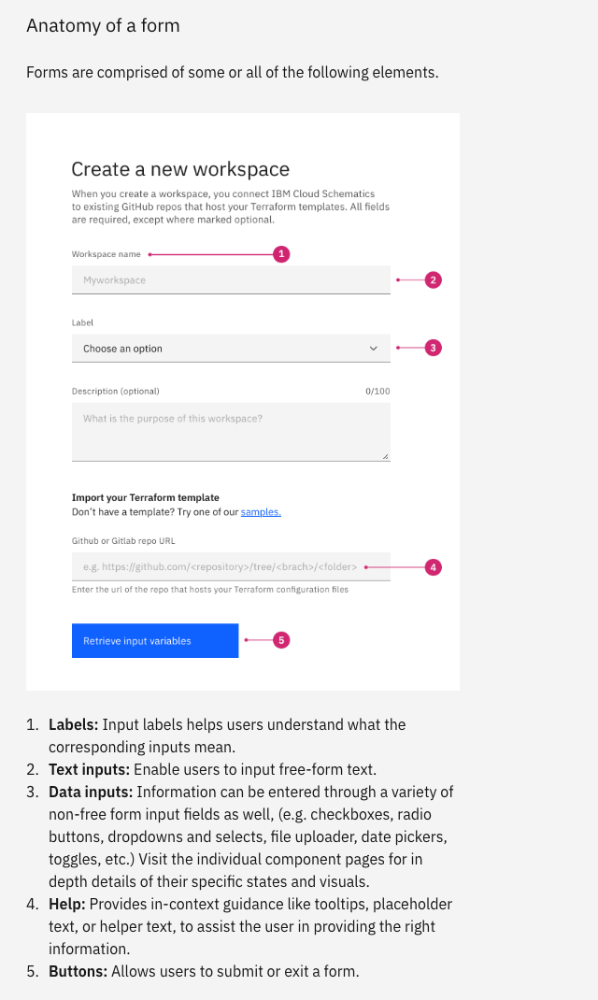

같은 버튼을 화면마다 새로 그리는 팀은 일관성보다 먼저 시간을 잃는다.

프로덕트가 커지면 같은 버튼인데 화면마다 크기, 색, 모서리가 달라지고, 같은 경고인데 어디서는 빨간색이고 어디서는 노란색이 됩니다. 사용자는 화면마다 규칙을 다시 배워야 합니다. 디자이너는 같은 버튼을 또 그리고, 개발자는 비슷한 컴포넌트를 또 한 벌 만들게 됩니다. 비일관성은 사용자에게는 인지 비용이고 팀에게는 중복 작업인 것입니다.

---

## 이 단계에서 풀어야 할 질문

[ep.13 인터랙션 디자인의 원칙: 피드백·되돌리기·마이크로인터랙션](/ux-guide-ep-13/)에서 버튼 하나의 상태, 피드백, 모션을 정했다면, 그 결정을 어디에 두어야 다음 화면에서 또다시 고민하지 않아도 되는지를 정해야 합니다. 그리고 결정을 내리기 전에 그 설계가 맞는지 확인하려면 무언가를 만들어 사용자 앞에 놓아야 하는데, 얼마나 정교하게 만들지에 따라 비용과 검증할 수 있는 것이 달라집니다.

그래서 이번 편의 질문은 "설계를 빠르게 반복하기 위해 무엇을 재사용하고, 무엇을 얼마나 정교하게 만들어 시험하는가"입니다.

---

## 디자인 시스템: 재사용 가능한 부품과 그 규칙

**디자인 시스템(design system)** 은 재사용 가능한 컴포넌트와 패턴으로 대규모 디자인을 관리하는 표준의 집합입니다. Nielsen Norman Group의 Therese Fessenden은 디자인 시스템이 중복을 줄이고 채널 전체에 공유 언어와 시각적 일관성을 만든다고 정의했습니다. 그리고 이 저장소에는 스타일 가이드, 컴포넌트 라이브러리, 패턴 라이브러리가 들어갑니다. UI 키트 파일 하나가 아니라 디자인과 개발이 같은 이름으로 같은 것을 가리키게 하는 기반이 되어야 합니다.

### 네 층의 구성

디자인 시스템은 아래에서 위로 네 가지 층으로 쌓습니다. 층마다 공개된 디자인 시스템에서 실제 예를 하나씩 가져왔습니다.

**토큰(design tokens)**: 색, 글자 크기, 간격, 그림자 같은 가장 작은 디자인 결정에 이름을 붙인 값입니다. Material Design 3는 토큰을 셋으로 나눕니다. 모든 값을 담은 참조 토큰, 그 값에 역할을 부여한 시스템 토큰(기본 색, 본문 글자 크기), 컴포넌트가 사용하는 컴포넌트 토큰입니다. 2025년 10월에는 W3C 디자인 토큰 커뮤니티 그룹이 5년 만에 첫 안정판 형식 명세를 냈고, Adobe, Figma, Google, Microsoft 등 40개가 넘는 조직이 참여했습니다. zeroheight의 2025년 보고서에서는 응답자 약 300명 중 디자인 토큰을 사용하는 비율이 전년 56%에서 84%로 올랐습니다.

실제 예로 [Material Design 3의 디자인 토큰 문서](https://m3.material.io/foundations/design-tokens/overview)에 나오는 `md.comp.fab.primary.container.color`는 플로팅 액션 버튼의 바탕색을 가리키는 컴포넌트 토큰입니다. Figma의 버튼 컴포넌트와 코드의 `background-color`가 같은 토큰 이름을 참조하므로, 브랜드 색을 바꿀 때 토큰 값 하나만 바꾸면 디자인 파일과 앱의 버튼 색이 함께 바뀝니다.

**컴포넌트(components)**: 토큰으로 조립한 재사용 단위입니다. 버튼, 입력 필드, 카드, 모달 등이 있고, 각 컴포넌트에는 변형(variant), 상태(state), 크기(size)가 정의됩니다. Brad Frost의 **아토믹 디자인(atomic design)** 은 이 층을 다시 원자(레이블, 입력, 버튼), 분자(레이블+입력+버튼으로 된 검색 폼), 유기체(헤더), 템플릿, 페이지로 나눕니다. 작은 것에서 큰 것으로 조립하는 사고 모델입니다.

IBM의 Carbon 디자인 시스템은 [버튼 문서](https://carbondesignsystem.com/components/button/usage/)에서 버튼 하나를 Primary, Secondary, Tertiary, Ghost, Danger 다섯 변형과 일곱 크기, 그리고 기본·호버·포커스·활성·비활성 상태로 정의합니다. 변형마다 용도가 적혀 있어서 삭제처럼 데이터를 지우는 동작에는 Danger를, 취소에는 Secondary를 고르면 됩니다. 코드에서도 `<Button kind="danger">`처럼 같은 변형 이름을 넘기므로 디자이너가 고른 변형과 개발자가 구현한 변형이 같은 이름으로 만납니다.

**패턴(patterns)**: 컴포넌트를 조합해 반복되는 문제를 푸는 방식입니다. 검색, 필터, 결과 목록의 조합, 폼 레이아웃, 에러 처리 흐름이 있습니다. Alla Kholmatova는 *Design Systems*에서 패턴을 버튼과 폼처럼 행동을 돕는 **기능 패턴(functional patterns)** 과 색, 타이포그래피, 모션처럼 브랜드를 느끼게 하는 **지각 패턴(perceptual patterns)** 으로 나눴습니다.

Carbon의 [폼 패턴 문서](https://carbondesignsystem.com/patterns/forms-pattern/)는 레이블, 텍스트 입력, 데이터 입력(체크박스, 드롭다운, 날짜 선택기), 도움말, 버튼 다섯 요소로 폼을 조립하는 방법을 정합니다. 레이블은 입력 위에 두는 것이 기본이고, 필드는 한 열로 쌓습니다. 필드 사이는 32px, 마지막 필드와 버튼 사이는 48px을 띄우고, 오류는 필드가 포커스를 잃는 순간 인라인으로 보여줍니다. 회원 가입 폼이든 설정 폼이든 이 패턴으로 조립하면 화면마다 폼의 생김새와 오류 표시가 같아집니다.

**가이드라인(guidelines)**: 언제 어떤 컴포넌트와 패턴을 사용할지를 정한 규칙입니다. "확인 버튼은 오른쪽, 취소는 왼쪽", "사용자의 즉각적인 결정이 필요하면 모달, 알려주기만 하면 토스트"처럼 사용합니다. Sparkbox의 2022년 설문에서 응답자 219명 중 컴포넌트 문서를 갖춘 비율은 85%였지만 콘텐츠 가이드라인이나 설계 원칙을 갖춘 비율은 절반이 안 됐습니다. 반면 사용하는 쪽에서 꼽은 가장 큰 어려움은 부실한 문서(39%)였습니다.

Carbon의 [모달 가이드라인](https://carbondesignsystem.com/components/modal/usage/)은 모달을 세 경우에만 사용하라고 정합니다. 사용자의 즉각적인 응답이 필요할 때, 진행 중인 작업에 관한 긴급한 정보를 알릴 때, 사용자의 결정을 확인할 때입니다. 그리고 되돌릴 수 없는 동작의 확인에는 Danger 변형을, 알리기만 할 때는 버튼이 없는 Passive 변형을 고르라고 변형별 용도까지 정해 두었습니다. 이런 가이드라인이 있으면 "이 알림을 모달로 띄울까, 토스트로 띄울까"를 화면마다 다시 논의하지 않아도 됩니다.

네 층은 같은 위계가 아닙니다. 토큰은 값이고, 컴포넌트는 그 값을 참조해 만든 부품이며, 패턴은 부품을 조합한 해법입니다. 가이드라인은 이 셋 위에 하나 더 쌓이는 부품이 아니라 컴포넌트와 패턴을 언제 쓰는지를 정하는 규칙입니다. 그래서 토큰 하나를 바꾸면 그 토큰을 참조하는 컴포넌트와 패턴이 함께 바뀌지만, 가이드라인을 바꾸면 부품은 그대로이고 어디에 쓰는지만 바뀝니다.

![디자인 시스템의 네 층과 그 관계를 그린 다이어그램. 왼쪽에 세 행이 아래에서 위로 쌓여 있다. 맨 아래 토큰 행(참조 토큰, 시스템 토큰, 컴포넌트 토큰)에는 color.primary, space.md, radius.sm 세 칩이 있고, 세 칩에서 나온 선이 하나로 모였다가 위의 컴포넌트 세 장(버튼, 입력 필드, 모달, 각각 변형 × 상태) 각각으로 화살표가 올라가며 '값을 참조합니다'라고 적혀 있다. 컴포넌트 세 장에서 나온 선이 다시 하나로 모여 맨 위 패턴 상자로 화살표 하나가 올라가고 '조합합니다'라고 적혀 있다. 패턴 상자에는 '폼 = 레이블 + 입력 필드 + 버튼', '검색 = 입력 + 필터 + 결과 목록', 기능 패턴(행동)과 지각 패턴(브랜드)이 적혀 있다. 오른쪽에는 점선 테두리의 가이드라인 상자가 패턴 행과 컴포넌트 행에 걸쳐 세로로 서 있고, '언제 쓰는가를 정합니다', '언제 모달, 언제 토스트', '확인은 오른쪽, 취소는 왼쪽'이 적혀 있으며, 상자에서 패턴과 컴포넌트로 화살표가 각각 들어간다. 하단 캡션은 토큰 하나를 바꾸면 그 토큰을 참조하는 컴포넌트와 패턴이 전부 같이 바뀐다고 설명한다.](ux-14-01-design-system-layers.svg)

### 팀 규모에 맞는 범위

디자인 시스템은 한 번에 완성되지 않고, 팀 규모에 맞는 범위에서 시작해야 합니다. Fessenden은 시작 방식을 셋으로 나눕니다. 공개된 시스템을 그대로 **채택**하거나, 가져와서 조직에 맞게 **적응**시키거나, 처음부터 **만드는** 것입니다. 처음부터 만드는 것은 공개 시스템으로 채울 수 없는 특별한 요구가 있을 때만 값어치가 있습니다. 만들려면 최소한 인터랙션 디자이너 한 명, 비주얼 디자이너 한 명, 개발자 한 명이 필요합니다.

누가 시스템을 만들고 결정하는지도 규모에 따라 다릅니다. EightShapes의 Nathan Curtis는 2015년에 팀 모델을 셋으로 정리했습니다. 한 프로덕트 팀이 자기 필요로 만든 것을 다른 팀도 가져다 쓰는 **단독형(solitary)**, 전담 팀이 만들어 여러 팀에 공급하는 **중앙형(central)**, 여러 프로덕트 팀의 디자이너가 함께 결정하는 **연합형(federated)** 입니다. Curtis는 나중에 성공하는 시스템은 중앙 팀과 연합 참여를 둘 다 가진다고 덧붙였습니다.

실무에서 흔히 밟는 단계는 다음과 같습니다. 어느 단계가 맞는지는 사람 수보다 "같은 컴포넌트를 몇 팀이 쓰는가"로 정해야 합니다.

| 단계 | 상태 | 맞는 상황 |
|---|---|---|
| 1 | 스타일 가이드(색, 글꼴, 간격 정의) | 디자이너 혼자이거나 둘 |
| 2 | 디자인 도구의 컴포넌트 라이브러리 | 디자이너 여럿이 한 프로덕트를 그림 |
| 3 | 코드 컴포넌트와 문서(Storybook 등) | 개발 팀이 여럿이고 같은 UI를 여러 벌 만듦 |
| 4 | 전담 팀, 버전 관리, 기여 절차 | 여러 프로덕트가 한 시스템을 공유 |

작은 팀이 4단계를 목표로 잡으면 시스템을 만드는 동안 프로덕트를 손볼 수 없습니다. 컴포넌트를 시스템에 넣는 기준도 보수적으로 잡는 것이 낫습니다. 소프트웨어 리팩터링의 **3의 법칙(rule of three)** 처럼 같은 것이 세 번째 필요해질 때 공통화하는 기준을 디자인 시스템에도 적용합니다. 한 팀만 사용할 컴포넌트는 그 팀 안에 두고, 세 팀이 필요로 할 때 시스템에 올리는 식입니다.

시스템을 만든 뒤에는 쓰게 하는 일이 어렵습니다. Sparkbox 설문에서 운영자가 꼽은 가장 큰 어려움은 채택(36%)이었습니다. 기여 절차에 만족한다는 운영자는 33%뿐이었고, 거버넌스 모델을 둔 곳은 44%, 지표를 추적하는 곳은 16%에 그쳤습니다. 만드는 일보다 쓰게 하고 기여받는 일이 어려운 것입니다.

---

## 프로토타이핑: 만들기 전에 시험하기

**프로토타입(prototype)** 은 최종 프로덕트를 흉내 낸 시뮬레이션으로, 실제로 작동하지 않아도 작동하는 것처럼 보여 사용자의 반응을 미리 확인하는 도구입니다. Bill Buxton은 *Sketching User Experiences*에서 스케치와 프로토타입을 한 연속선의 양 끝으로 보았습니다. 스케치는 빠르고 싸고 버릴 수 있으며 질문을 던지고, 프로토타입은 답을 제시합니다. 초기에는 올바른 디자인을 찾기 위해 스케치하고, 뒤에는 디자인을 올바르게 만들기 위해 프로토타입을 만드는 것입니다.

### 충실도의 세 차원: 상호작용·시각·콘텐츠

Nielsen Norman Group의 Kara Pernice는 프로토타입의 충실도를 세 차원으로 나눴습니다. 클릭하면 움직이는지의 **상호작용**, 색, 글꼴, 이미지가 실제와 같은지의 **시각**, 실제 문구와 메뉴 구조가 들어갔는지의 **콘텐츠와 내비게이션 위계**입니다. 2006년 CHI에서 McCurdy와 동료들이 제안한 **혼합 충실도(mixed fidelity)** 도 같은 생각으로, 어떤 차원은 높고 어떤 차원은 낮은 프로토타입이 가장 효율적일 때가 많습니다.

### 무엇을 검증하려는가

충실도는 "이 프로토타입으로 무엇을 확인하려 하는가"로 정합니다.

| 확인하려는 것 | 올릴 차원 | 맞는 형태 |
|---|---|---|
| 구조와 흐름이 맞는가 | 콘텐츠 위계만 | 종이 스케치, 회색 와이어플로 |
| 과업을 끝까지 할 수 있는가 | 상호작용, 콘텐츠 | 클릭 가능한 회색 프로토타입 |
| 인터랙션의 느낌이 맞는가 | 상호작용, 시각 | 모션이 들어간 하이파이 |
| 이해관계자 승인 | 시각, 콘텐츠 | 실제 데이터가 든 하이파이 |
| 기술이 되기 전에 가치를 확인 | 상호작용 | 오즈의 마법사 |

**오즈의 마법사(Wizard of Oz)** 는 자동화된 것처럼 보이는 화면 뒤에서 사람이 응답을 만들어 주는 기법입니다. 1973년 Don Norman과 Allen Munro가 공항 안내 단말을 시험하며 처음 사용했습니다. 이름은 Jeff Kelley가 1983년 논문에서 붙였습니다. 추천 알고리즘이나 챗봇처럼 만드는 데 오래 걸리는 기술의 가치를 만들기 전에 확인할 때 사용합니다. 예를 들어 Nielsen Norman Group이 소개한 한 팀은 전자제품 유통사의 고객 지원 챗봇을 만들기 전에 채팅창만 먼저 만들었습니다. 참가자가 질문을 치면 디자이너가 뒤에서 Figma 프로토타입을 즉석에서 고쳐 답을 내보내는 방식으로, 어떤 질문이 들어오고 어떤 답이 통하는지를 확인했습니다. Zappos의 창업자 Nick Swinmurn도 재고와 물류 시스템을 만들기 전에 주문이 들어오면 직접 신발을 사서 보내는 방식으로 온라인에서 신발을 살 사람이 있는지부터 확인했습니다.

로파이에는 비용 말고도 장점이 있습니다. Pernice는 로파이 프로토타입이 테스트 중에 바로 고칠 수 있고, 미완성으로 보이므로 참가자가 솔직하게 말하기 쉽다고 했습니다. 반대로 하이파이에는 함정이 있습니다. 1995년 Masaaki Kurosu와 Kaori Kashimura가 ATM 화면 26가지를 252명에게 평가하게 한 실험에서 보기 좋은 화면은 실제 사용성과 무관하게 쓰기 쉽다고 평가됐습니다. Nielsen Norman Group은 이 **미학-사용성 효과(aesthetic-usability effect)** 가 테스트에서 작은 문제를 가릴 수 있다고 경고합니다. 구조가 확정되기 전에 하이파이로 만들면, 구조를 바꾸게 되는 경우 여태 투자한 시간을 날리게 되고 예쁜 화면이 구조의 문제를 가리게 됩니다.

---

## 서로를 빠르게 하는 시스템과 프로토타입

디자인 시스템이 갖춰지면 프로토타입은 컴포넌트를 조립하는 일이 되고, 버튼을 새로 그릴 시간에 흐름을 하나 더 시험할 수 있습니다. Figma가 디자이너에게 같은 과업을 시킨 실험에서는 디자인 시스템이 있을 때 과업을 34% 빨리 끝냈습니다. 반대로 프로토타입에서 반복되는 조합은 시스템의 다음 패턴 후보가 됩니다. 일관성은 시스템의 결과물이고, 팀은 속도라는 가치를 체감하게 됩니다.

---

## 기획자·디자이너·개발자가 각각 가져갈 것

**기획자**: 프로토타입을 요청할 때 "무엇을 확인하려는지"를 함께 말해야 합니다. 흐름 검증이면 회색 프로토타입으로 충분하고, 그 요청에 하이파이 프로토타입을 받으면 시간을 낭비하고 있는 것입니다. 디자인 시스템에 넣을 컴포넌트를 정하는 회의에서는 "몇 팀이 쓰는가"를 묻는 역할을 맡아야 합니다.

**디자이너**: 새 화면을 그리기 전에 시스템에 있는 컴포넌트로 먼저 조립해 보고, 없는 것만 새로 그려야 합니다. 새로 그린 것이 세 번째 쓰이면 시스템에 올릴 후보로 기록해 두어야 합니다. 하이파이 테스트에서 참가자가 "예쁘다"고 말하는 순간을 사용성 통과로 해석하지 말아야 합니다.

**개발자**: 토큰을 코드의 단일 출처로 두어야 디자인에서 색 하나를 바꿨을 때 코드 전체에 반영됩니다. 컴포넌트 라이브러리에는 변형과 상태를 빠짐없이 구현하고 문서에 예시를 붙여야 합니다. 디자인 도구의 컴포넌트와 코드 컴포넌트의 이름을 맞추는 일이 핸드오프 비용을 가장 크게 줄입니다.

---

## 참고 자료

- Fessenden, T. (2021). Design Systems 101. Nielsen Norman Group. https://www.nngroup.com/articles/design-systems-101/
- Google. Design tokens. Material Design 3. https://m3.material.io/foundations/design-tokens
- Design Tokens Community Group. (2025). *Design Tokens Format Module 2025.10*. https://www.designtokens.org/tr/drafts/format/
- zeroheight. (2025). *Design Systems Report 2025*. https://zeroheight.com/how-we-document/
- Frost, B. (2016). *Atomic Design*. Brad Frost. https://atomicdesign.bradfrost.com/
- Kholmatova, A. (2017). *Design Systems: A Practical Guide to Creating Design Languages for Digital Products*. Smashing Magazine.
- Sparkbox. (2022). *The 2022 Design Systems Survey*. https://designsystemsurvey.sparkbox.com/2022/
- Curtis, N. (2015). Team Models for Scaling a Design System. EightShapes. https://medium.com/eightshapes-llc/team-models-for-scaling-a-design-system-2cf9d03be6a0
- Fowler, M. (1999). *Refactoring: Improving the Design of Existing Code*. Addison-Wesley.
- Buxton, B. (2007). *Sketching User Experiences: Getting the Design Right and the Right Design*. Morgan Kaufmann.
- Pernice, K. (2016). UX Prototypes: Low Fidelity vs. High Fidelity. Nielsen Norman Group. https://www.nngroup.com/articles/ux-prototype-hi-lo-fidelity/
- McCurdy, M., Connors, C., Pyrzak, G., Kanefsky, B., & Vera, A. (2006). Breaking the Fidelity Barrier: An Examination of Our Current Characterization of Prototypes and an Example of a Mixed-Fidelity Success. *Proceedings of CHI 2006*.
- Nielsen Norman Group. The Wizard of Oz Method in UX. https://www.nngroup.com/articles/wizard-of-oz/
- Kurosu, M., & Kashimura, K. (1995). Apparent Usability vs. Inherent Usability. *CHI '95 Conference Companion*, 292-293.
- Moran, K. (2017). The Aesthetic-Usability Effect. Nielsen Norman Group. https://www.nngroup.com/articles/aesthetic-usability-effect/
- IBM. Button. Carbon Design System. https://carbondesignsystem.com/components/button/usage/
- IBM. Forms. Carbon Design System. https://carbondesignsystem.com/patterns/forms-pattern/
- IBM. Modal. Carbon Design System. https://carbondesignsystem.com/components/modal/usage/
- Figma. Measuring the value of design systems. https://www.figma.com/blog/measuring-the-value-of-design-systems/

---

## 다음 편 예고

> [ep.15 - 세 시선: 디자인이 직무의 경계를 넘을 때](/ux-guide-ep-15/)

기획자가 버튼 색을 지정하고, 디자이너가 기능을 빼자고 하고, 개발자가 구현하기 쉬운 쪽으로 바꾸자고 하는 순간은 디자인 단계에서 가장 자주 옵니다. 경계를 넘는 것 자체는 좋은 일인데, 어디까지가 입력이고 어디부터가 결정인지를 다룹니다.
