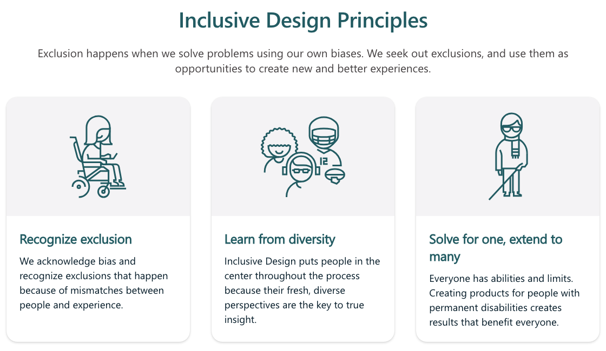

평균 사용자를 위해 설계하면 누구에게도 맞지 않는다.

1940년대 말 미 공군은 추락 사고가 잦은 원인을 조종석에서 찾고 있었습니다. 조종석은 1926년에 잰 조종사들의 평균 치수에 맞춰 만들어져 있었고, 공군은 조종사의 체격이 그 사이 커졌다고 생각했습니다. 1952년 Gilbert Daniels 중위가 조종사 4,063명의 키, 가슴둘레, 팔 길이 등 열 가지 치수를 재서 평균 범위(중간 30%)에 드는 사람을 세어 봤습니다. 열 가지 모두에서 평균 범위에 드는 조종사는 한 명도 없었습니다. 세 가지만 골라도 3.5%가 안 됐습니다. 공군은 평균에 맞는 조종석을 포기하고 좌석, 페달, 벨트를 조절할 수 있게 만들었고, 그 조절식 설계는 자동차 좌석으로 이어졌습니다. 화면도 같습니다. "보통 사용자"를 위해 그린 화면은 보통 사용자에게도 맞지 않습니다.

---

## 이 단계에서 풀어야 할 질문

[ep.16 프론트엔드가 책임지는 UX: 성능·상태·에러·로딩](/ux-guide-ep-16/)에서 시안에 없는 조건을 코드에서 구현해야 한다고 했다면, 조건의 목록에서 가장 자주 빠지는 것이 사용자의 몸과 상황입니다. 시안은 두 손이 자유롭고, 시력이 좋고, 조용한 곳에서 최신 기기로 화면을 보는 사람을 전제합니다. 그 전제에서 벗어난 사용자가 얼마나 되는지를 WHO는 2023년에 13억 명, 세계 인구의 16%로 추산했습니다. 여섯 명 중 한 명입니다.

그래서 이번 편의 질문은 "누구를 기준으로 설계해야 모든 사용자에게 맞는가"입니다. WCAG의 세부 기준과 구현 방법은 [앱·웹 접근성 실무 가이드](/a11y-guide-ep-00/) 시리즈에서 다루고 있습니다. 이번 편에서는 UX 관점에서 세 직무가 공유해야 할 사고방식과 최소 체크리스트에 집중합니다.

---

## 접근성과 포용적 디자인은 어떻게 다른가

**접근성(accessibility)** 은 장애가 있는 사람이 프로덕트를 사용할 수 있게 만드는 일입니다. 기준이 분명합니다. W3C의 **WCAG(Web Content Accessibility Guidelines)** 2.2는 2023년 10월에 인식 가능·조작 가능·이해 가능·견고라는 네 원칙 아래 성공 기준을 정해 두었습니다. 한국에서는 장애인차별금지법이 공공기관과 일정 규모 이상의 사업자에게 준수를 요구합니다. 법규와 기준의 구조는 [앱·웹 접근성 실무 가이드 ep.00 접근성: 다시 묻기](/a11y-guide-ep-00/)와 [앱·웹 접근성 실무 가이드 ep.01 WCAG 2.2 구조 완벽 정리](/a11y-guide-ep-01/)에서 다루고 있습니다.

**포용적 디자인(inclusive design)** 은 처음부터 다양한 사람을 전제하고 설계하는 사고방식입니다. 접근성이 기준을 충족했는지로 판정된다면, 포용적 디자인은 누가 배제되는지를 설계 초기에 묻습니다. Microsoft에서 포용적 디자인 프로그램을 이끈 Kat Holmes는 2018년에 *Mismatch*에서 배제를 "사람의 몸과 환경 사이의 어긋난 상호작용(mismatched interaction)"으로 정의했습니다. 왼손잡이에게 맞지 않는 마우스, 영어를 읽고 시력이 좋고 신용카드가 있는 사람만 쓸 수 있는 결제 키오스크 등이 있습니다. 이 정의에서 장애는 사람의 속성이 아니라 설계와 사람 사이의 관계가 됩니다. 그래서 배제는 설계로 만들어지고 설계로 줄일 수 있습니다.

둘은 대립하지 않습니다. 접근성은 출시 전에 통과해야 하는 기준이고, 포용적 디자인은 그 기준을 나중에 고치는 비용 대신 처음부터 배제를 줄이는 방법입니다.

---

## 스펙트럼으로서의 장애

Microsoft가 2016년에 공개한 포용적 디자인 툴킷은 장애를 영구적, 일시적, 상황적 세 층으로 봅니다. 한 팔이 없는 사람(영구적), 팔에 깁스를 한 사람(일시적), 아기를 안고 있는 부모(상황적)는 같은 순간에 같은 제약을 겪습니다. 툴킷은 미국 기준으로 영구적인 경우 2만 6천 명, 일시적인 경우 1,300만 명, 상황적인 경우 800만 명이라고 적었습니다. 한 팔로 쓸 수 있게 설계하면 세 집단이 모두 혜택을 받을 수 있습니다. 이 도구는 [페르소나 스펙트럼](https://inclusive.microsoft.design/)이라는 이름으로 툴킷 사이트에 공개되어 있습니다.

툴킷은 원칙 세 가지를 제시합니다. 항목마다 화면에서 나타나는 예와 대응을 함께 적습니다.

- **배제를 인식한다(recognize exclusion)**: 배제는 의도 없이 가정에서 생깁니다. "사용자는 두 손으로 조작한다"는 가정은 한 손으로 유아차를 미는 사람을, "한국어를 읽을 수 있다"는 가정은 이주 노동자를, "최신 스마트폰을 쓴다"는 가정은 보급형 기기 사용자를 배제합니다. 대응하려면 설계 문서의 전제를 적어 두고 각 전제가 누구를 빼는지 물어야 합니다.
- **다양성에서 배운다(learn from diversity)**: 평균 사용자에게 맞춘 설계는 누구에게도 맞지 않으므로, 제약이 가장 큰 사용자의 필요에서 출발합니다. 스크린 리더 사용자를 위해 버튼마다 이름을 붙이면 음성 비서로 화면을 조작하는 모든 사용자가 같은 이름을 사용하게 됩니다. 대응하려면 리서치 참가자에 제약이 가장 큰 사용자를 포함해야 합니다.
- **한 사람을 위해 풀고 많은 사람에게 확장한다(solve for one, extend to many)**: 한 집단의 제약을 푼 해법은 비슷한 제약을 겪는 다른 집단으로 확장됩니다. 연석 경사로, 자막, 음성 명령, 큰 글씨 옵션 등이 있습니다.

---

## 한 사람을 위한 해법이 확장되는 과정

연석의 경사로가 대표 사례입니다. 1970년대 초 캘리포니아 버클리의 장애인 운동가들이 휠체어가 다닐 수 있도록 연석에 시멘트를 부어 경사로를 만들었고, 시는 1972년에 첫 공식 경사로를 설치했습니다. 그 뒤 유아차를 미는 부모, 짐수레를 끄는 노동자, 캐리어를 끄는 여행자가 모두 그 경사로로 다녔습니다. Angela Glover Blackwell은 2017년에 이 현상을 **연석 경사로 효과(curb-cut effect)** 라고 부르며, 취약한 집단을 위한 설계가 사회 전체의 이익이 된다고 정리했습니다.

화면에서도 같은 확장이 반복됩니다.

자막은 청각 장애인을 위해 만들어졌습니다. 그런데 Verizon Media와 Publicis Media가 2019년에 미국 소비자 5,616명에게 물은 조사에서 69%가 공공장소에서 소리를 끄고 영상을 본다고 답했습니다. 80%는 자막이 있으면 영상을 끝까지 볼 가능성이 높다고 답했습니다. 음성 명령은 시각 장애인을 위해 시작됐지만 운전 중이거나 요리 중인 사람이 사용합니다. 큰 글씨 옵션은 저시력자를 위해 만들어졌지만 노안이 온 사람과 멀리서 화면을 보는 사람이 사용합니다. 다크 모드는 빛에 민감한 사람을 위해 시작됐지만 밤에 화면을 보는 모든 사람이 사용합니다. 제약이 가장 큰 사용자를 위한 기능은 결국 보통 사용자의 상황적 제약을 푸는 기능이 됩니다.

---

## UX 관점의 최소 체크리스트

WCAG 2.2의 성공 기준을 전부 챙기기 어렵다면, 실제로 가장 많이 지키지 못하는 항목부터 챙겨야 합니다. WebAIM이 2026년 2월에 상위 100만 개 홈페이지를 자동 검사한 결과 95.9%에서 WCAG 2 실패가 발견됐고, 페이지당 평균 56.1개였습니다. 실패의 96%가 여섯 유형에 몰려 있었습니다.

| 항목 | 기준 | 지키지 못한 비율 | 주로 챙기는 직무 |
|---|---|---|---|
| 텍스트와 배경의 명도비 4.5:1 이상 | WCAG 1.4.3 | 83.9% | 디자이너 |
| 모든 의미 있는 이미지에 대체 텍스트 | WCAG 1.1.1 | 53.1% | 기획자, 개발자 |
| 모든 입력 필드에 레이블 연결 | WCAG 1.3.1, 3.3.2 | 51.0% | 개발자 |
| 빈 링크 없음(링크에 텍스트나 이름) | WCAG 2.4.4 | 46.3% | 개발자 |
| 빈 버튼 없음(버튼에 텍스트나 이름) | WCAG 4.1.2 | 30.6% | 개발자 |
| 문서 언어 지정(`lang="ko"`) | WCAG 3.1.1 | 13.5% | 개발자 |
| 키보드만으로 모든 기능 사용, 포커스가 보임 | WCAG 2.1.1, 2.4.7 | 자동 검사 불가 | 디자이너, 개발자 |

여섯 유형은 자동 검사 도구가 찾아주는 것이라 고치기도 가장 쉽습니다. 일곱째 항목인 키보드 조작과 포커스 표시는 자동 검사로 잡히지 않아 표에서 빠지지만, 마우스를 쓸 수 없는 사용자에게는 가장 중요한 항목입니다. 탭 키만으로 가입부터 결제까지 끝내 보면 가장 적은 노력으로 검사할 수 있습니다. 터치 대상의 크기도 체크리스트에 넣을 만합니다. WCAG 2.2는 2.5.8에서 포인터 대상을 최소 24×24 CSS 픽셀로 정했고(AA), Apple의 Human Interface Guidelines는 44×44 포인트를 권장합니다. 구현 방법은 [앱·웹 접근성 실무 가이드 ep.02 기획 단계](/a11y-guide-ep-02/), [앱·웹 접근성 실무 가이드 ep.03 디자인 단계](/a11y-guide-ep-03/), [앱·웹 접근성 실무 가이드 ep.04 개발 단계](/a11y-guide-ep-04/)에서 다루고 있습니다.

---

## 시각 너머의 포용 범위

접근성 논의는 시각 장애와 스크린 리더에 집중되기 쉽지만, 배제는 네 영역에서 더 생깁니다.

- **언어**: 전문 용어와 긴 문장은 인지 부하가 큰 사용자와 한국어가 모국어가 아닌 사용자를 배제합니다. 안내 문구는 짧은 문장과 일상어로 쓰고, 성별·나이·가족 형태를 전제하는 표현("어머니께서", "자녀분")을 피해야 합니다.
- **입력 방식**: 마우스를 올려야만 보이는 정보는 터치 기기에서 보이지 않고, 드래그로만 되는 조작은 스위치나 음성으로 조작하는 사용자를 막습니다. 모든 조작에 호버 없이, 드래그 없이 되는 경로를 하나 더 두어야 합니다.
- **성능과 네트워크**: 느린 네트워크와 저사양 기기는 [ep.16 프론트엔드가 책임지는 UX: 성능·상태·에러·로딩](/ux-guide-ep-16/)에서 본 대로 성능의 문제이면서 포용의 문제입니다. 이미지가 로드되지 않을 때 대체 콘텐츠가 있고 데이터 절약 모드가 있어야 보급형 기기 사용자가 계속 사용할 수 있습니다.
- **문화**: 날짜·시간·통화 형식, 오른쪽에서 왼쪽으로 읽는 언어의 레이아웃, 색의 뜻(빨강이 위험인 문화와 행운인 문화)은 출시 지역마다 확인해야 합니다. 이름을 성과 이름 두 칸으로 나누는 폼은 한 단어 이름을 쓰는 사용자를 막습니다.

---

## 기획자·디자이너·개발자가 각각 가져갈 것

**기획자**: 요구사항에 전제를 적고, 그 전제가 누구를 배제하는지를 적어야 합니다. "사용자는 문자 인증을 받을 수 있다"는 전제는 해외 번호 사용자를 빼므로 대안 경로를 요구사항에 넣어야 합니다. 이미지의 대체 텍스트와 영상 자막은 콘텐츠이므로 기획 산출물에 포함해야 합니다.

**디자이너**: 명도비 4.5:1은 디자인 도구의 대비 검사로 시안 단계에서 확인해야 합니다. 상위 100만 홈페이지의 83.9%가 실패한 항목이고, 디자이너가 아니면 고칠 수 없는 항목입니다. 색만으로 상태를 구분하지 않도록 아이콘과 문구를 같이 두고, 포커스 상태를 컴포넌트의 상태 하나로 설계해야 합니다.

**개발자**: 시맨틱 HTML을 사용하면 체크리스트의 레이블, 빈 링크, 빈 버튼 항목이 대부분 저절로 해결됩니다. 자동 검사 도구를 CI에 넣어 여섯 유형이 새로 생기지 않게 막고, 키보드만으로 주요 흐름을 끝내 보는 검사를 출시 전 점검에 넣어야 합니다.

---

## 참고 자료

- Daniels, G. S. (1952). *The "Average Man"?* (Technical Note WCRD 53-7). Wright Air Development Center, U.S. Air Force.
- Rose, T. (2016). *The End of Average: How We Succeed in a World That Values Sameness*. HarperOne.
- World Health Organization. (2023). Disability and health (Fact sheet). https://www.who.int/news-room/fact-sheets/detail/disability-and-health
- W3C. (2023). *Web Content Accessibility Guidelines (WCAG) 2.2*. https://www.w3.org/TR/WCAG22/
- W3C. Understanding SC 2.5.8: Target Size (Minimum). https://www.w3.org/WAI/WCAG22/Understanding/target-size-minimum.html
- Holmes, K. (2018). *Mismatch: How Inclusion Shapes Design*. MIT Press.
- Microsoft. (2016). *Inclusive Design Toolkit*. https://inclusive.microsoft.design/
- Blackwell, A. G. (2017). The Curb-Cut Effect. *Stanford Social Innovation Review*, Winter 2017. https://ssir.org/articles/entry/the_curb_cut_effect
- Verizon Media & Publicis Media. (2019). Sound Off: Video Viewers Seek Captions (Forbes 보도). https://www.forbes.com/sites/tjmccue/2019/07/31/verizon-media-says-69-percent-of-consumers-watching-video-with-sound-off/
- WebAIM. (2026). *The WebAIM Million: The 2026 report on the accessibility of the top 1,000,000 home pages*. https://webaim.org/projects/million/
- Apple. Accessibility. Human Interface Guidelines. https://developer.apple.com/design/human-interface-guidelines/accessibility

---

## 다음 편 예고

> [ep.18 - 세 시선: 디자인-개발 핸드오프에서 깨지는 것들](/ux-guide-ep-18/)

디자이너는 "내가 만든 디자인이 아니다"라고 하고, 개발자는 "이걸 어떻게 구현하라는 건지"라고 하고, 기획자는 "내 의도가 어디로 갔는지"를 묻습니다. 시안이 코드가 되는 사이에 무엇이 빠지는지, 세 직무가 그 간극을 어떻게 막는지를 다룹니다.
