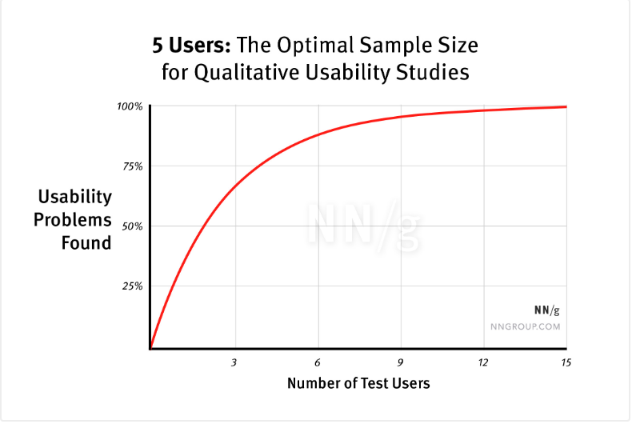

참가자가 "쉽네요"라고 말한 화면에서 그 참가자는 세 번 실수했고 2분이나 걸렸다.

테스트룸의 참가자가 배송지 변경 화면을 보며 "이건 쉽네요"라고 말합니다. 그런데 녹화를 돌려 보면 뒤로 가기를 세 번 눌렀고, 주소 검색 버튼 대신 입력창을 두 번 탭했으며, 과업을 끝내기까지 2분 12초가 걸렸습니다. 보고서에 "참가자가 쉽다고 평가함"이라고만 적으면 그 화면은 세 번 실수하고 2분이나 걸리는 채로 그대로 출시됩니다. 사용성 테스트는 참가자의 평가를 듣는 시간이 아니라 참가자의 행동을 지켜보는 시간이고, 문제는 평가가 아니라 행동에서 찾아야 합니다.

---

## 이 단계에서 풀어야 할 질문

[ep.18 세 시선: 디자인-개발 핸드오프에서 깨지는 것들](/ux-guide-ep-18/)까지 설계가 코드가 되었다면, 이제 그 화면이 실제 사용자에게 작동하는지를 확인하는 단계입니다. [ep.06 리서치 방법의 지도: 인터뷰·설문·관찰·로그, 언제 무엇을](/ux-guide-ep-06/)에서 사용성 테스트를 여섯 가지 방법 중 하나로 소개했다면, 이번에는 그 방법을 실행하는 절차를 다룹니다. 팀이 가장 먼저 묻는 것은 "몇 명이면 되는가"입니다. 그 답은 테스트로 무엇을 알아내려 하는지에 따라 다릅니다.

그래서 이번 편의 질문은 "만든 화면이 실제로 사용되는지를 몇 명에게, 어떻게 확인하는가"입니다.

---

## 사용성 테스트의 정의: 의견이 아닌 행동의 관찰

**사용성 테스트(usability testing)** 는 실제 사용자에게 과업을 주고 프로덕트를 사용하는 과정을 관찰해 문제를 찾는 방법입니다. 여기서 사용성은 ISO 9241-11이 정의한 대로 특정 사용자가 특정 맥락에서 목표를 달성하는 효과성, 효율성, 만족도를 뜻합니다. 세 가지 중 효과성(과업을 끝냈는가)과 효율성(얼마나 걸렸고 몇 번 실수했는가)은 관찰로 재고, 만족도만 물어서 잽니다. 그래서 테스트의 대부분은 참가자가 무엇을 하는지를 보는 일이고, 참가자가 무엇을 말하는지는 그 행동을 해석하는 보조 자료입니다.

관찰의 핵심 도구는 **생각을 소리 내어 말하기(thinking aloud)** 입니다. 참가자가 과업을 수행하면서 떠오르는 생각을 계속 말하게 하는 방법으로, Jakob Nielsen은 1993년 *Usability Engineering*에서 가장 가치 있는 사용성 공학 방법이라고 했습니다. 참가자는 말하는 것을 자주 잊어버리므로 진행자는 "계속 말씀해 주세요"라고 짧게 상기시키기만 해야 합니다. 질문을 덧붙이면 행동이 바뀌므로, 무언가를 유도한 부분은 기록에서 빼야 합니다. 앞의 배송지 변경 참가자가 입력창을 탭하며 "여기 치면 되는 거 아닌가"라고 말했다면, 주소 검색 버튼이 입력창처럼 보이지 않는다는 문제를 "쉽네요"라는 평가와 상관없이 찾을 수 있습니다.

---

## 5명이면 충분한가

Nielsen이 2000년에 쓴 글의 제목이 "5명만 테스트하면 되는 이유"였고, 그 뒤로 5명은 사용성 테스트의 통설이 되었습니다. 근거는 Nielsen과 Tom Landauer가 1993년에 제안한 모델입니다. 사용자 n명이 찾는 문제의 비율은 1 - (1 - L)n이고, L은 사용자 한 명이 찾는 문제의 비율로 여러 프로젝트의 평균값이 31%였습니다. 이 식에 넣어 보면 1명은 31%, 3명은 67%, 5명은 84%, 10명은 98%, 15명은 99.6%를 찾습니다. 5명이 85%쯤을 찾고 그 뒤로는 같은 문제를 다시 보는 비율이 커지므로, Nielsen은 15명을 한 번 테스트하는 대신 5명씩 세 번 테스트하라고 권했습니다. 첫 5명이 찾은 문제를 고친 뒤 다음 5명으로 고친 결과를 확인하는 편이 더 많은 문제를 잡기 때문입니다. 원문은 [Nielsen Norman Group의 글](https://www.nngroup.com/articles/why-you-only-need-to-test-with-5-users/)에서 볼 수 있고, [ep.06 리서치 방법의 지도: 인터뷰·설문·관찰·로그, 언제 무엇을](/ux-guide-ep-06/)에 발견율 곡선을 그려 두었습니다.

그런데 이 85%는 평균입니다. Laura Faulkner가 2003년에 60명을 테스트한 뒤 그중 5명씩을 무작위로 뽑아 다시 계산해 보니, 5명 집단의 평균은 85%였지만 가장 운이 나쁜 집단은 55%만 찾았습니다. 10명으로 늘리면 평균 95%, 최저 82%였습니다. 그러니 5명은 "대개 85%"이지 "항상 85%"가 아니고, 한 번의 5명 테스트에서 놓친 문제는 다음 5명이 잡아 주리라는 전제 위에서만 충분한 숫자입니다.

5명이 부족한 경우는 세 가지입니다.

- **사용자 집단이 여럿일 때**: 초보자와 전문가, 환자와 의료진처럼 서로 다른 문제를 겪는 집단이 있으면 집단마다 테스트해야 합니다. Nielsen은 집단이 둘이면 집단마다 3명에서 4명, 셋 이상이면 집단마다 3명을 권했습니다. 집단 사이에 겹치는 문제가 있어 집단당 5명까지는 필요 없다고 봤습니다.
- **수치를 비교하려 할 때**: A안과 B안의 완료 시간이나 성공률을 비교하려면 통계가 필요합니다. Nielsen은 2006년에 정량 연구에는 20명을 권했습니다. 개인차가 커서 20명을 테스트해도 평균의 오차 범위가 90% 신뢰 수준에서 약 ±19%이고, 그 정도면 두 설계의 차이가 그보다 큰 경우가 많아 판단에 충분하다는 계산입니다.
- **작은 차이를 재려 할 때**: 전환율 2%p 차이 같은 것은 20명으로도 잡히지 않습니다. 이런 비교는 사용성 테스트가 아니라 [ep.21 A/B 테스트와 데이터 기반 의사결정의 함정](/ux-guide-ep-21/)에서 다루는 실험의 영역입니다.

---

## 실행 절차 다섯 단계

사용성 테스트는 목표 정의, 모집, 과업 시나리오 작성, 진행, 분석의 다섯 단계로 진행합니다.

### 목표 정의

"이 프로덕트의 사용성을 테스트한다"는 목표로는 과업도 참가자도 정할 수 없습니다. 어떤 과업의 사용성을 확인할지, 어디서 문제가 있으리라 예상하는지, 결과로 어떤 결정을 내릴지를 먼저 적어야 합니다. 예를 들어 "배송지 변경 흐름에서 주소 검색을 발견하지 못할 것 같다. 5명 중 3명 이상이 못 찾으면 검색 버튼을 입력창 안으로 옮긴다"처럼 적으면, 테스트가 끝난 뒤 결정이 바로 나옵니다.

### 모집

참가자는 실제 사용자이거나 사용자에 가장 가까운 사람이어야 합니다. 내부 직원은 프로덕트를 이미 알고 있어 [ep.01 사용자 중심이 실제로 뜻하는 것: 가정 검증과 인간 중심 설계](/ux-guide-ep-01/)에서 본 지식의 저주가 그대로 작동하므로 피해야 합니다. 소정의 사례비는 참여율을 높이고 참가자가 시간을 온전히 쓰게 합니다.

### 과업 시나리오 작성

과업은 목표만 주고 경로는 주지 않아야 합니다. Nielsen Norman Group의 Marieke McCloskey가 2014년에 정리한 지침은 네 가지입니다.

- **현실적으로**: "오렌지색 나이키 러닝화를 구매하세요"보다 "4만 원 이하의 운동화를 한 켤레 사세요"가 낫습니다. 참가자가 자기 기준으로 비교하게 되므로 실제 사용에 가까워집니다.
- **행동하게**: "어디를 누르실지 말씀해 주세요"가 아니라 "일요일 오후에 볼 영화를 찾아 예매해 주세요"로 직접 하게 합니다. 어떻게 할지 설명하게 하면 행동이 아니라 말만 나옵니다.
- **단서 없이**: "로그인한 뒤 어디를 눌러 성적표를 받을지 말씀해 주세요"는 단계마다 힌트를 담고 있습니다. "중간고사 결과를 확인해 주세요"로 줄여야 합니다.
- **화면의 단어를 쓰지 않고**: 버튼이 "뉴스레터 구독"이면 과업에 "뉴스레터를 구독하세요"라고 적지 않고, "행사 소식을 정기적으로 이메일로 받을 방법을 찾아 주세요"로 적습니다. 같은 단어가 있으면 참가자는 화면에서 그 단어만 찾습니다.

배송지 변경 테스트라면 "상단 메뉴에서 마이페이지를 눌러 배송지를 바꾸세요"가 아니라 "이번 주문을 회사로 받고 싶습니다. 받는 곳을 바꿔 주세요"가 됩니다. 참가자가 스스로 경로를 찾는 과정에서 문제가 드러납니다.

### 진행

진행자가 지켜야 할 규칙은 세 가지입니다. 참가자가 막혀도 돕지 않고, "이 버튼은 보이세요?"처럼 유도하지 않으며, "좋은 방법이에요"나 "그건 아닌데요"처럼 판단하지 않습니다. 참가자가 막힌 채 1분을 넘기면 그 과업을 실패로 기록하고 다음 과업으로 넘깁니다. 기획자와 개발자는 가능하면 관찰자로 참석해야 합니다. 보고서의 "5명 중 3명이 검색 버튼을 찾지 못함"이라는 한 줄보다 참가자가 같은 입력창을 세 번 탭하는 장면을 직접 보는 쪽이 설계를 바꾸게 하는 힘이 훨씬 큽니다.

### 분석

관찰 기록에서 패턴을 찾습니다. 3명 이상이 같은 지점에서 막혔다면 구조의 문제이고, 특정 레이블을 이해하지 못했다면 용어의 문제이며, 특정 기능을 아예 발견하지 못했다면 발견성의 문제입니다. 찾은 문제는 Nielsen이 1994년에 제안한 심각도 척도로 분류합니다. 0은 문제가 아님, 1은 외관상의 문제, 2는 사소한 문제, 3은 큰 문제(높은 우선순위로 고침), 4는 치명적인 문제(고치기 전에는 출시 불가)입니다. 등급은 빈도(얼마나 많은 사용자가 겪는가), 영향(겪은 사용자가 얼마나 어려워하는가), 지속성(한 번 배우면 넘어가는가, 계속 겪는가) 세 요소로 정합니다.

---

## 시간이 없을 때의 선택지

사용성 테스트를 하지 않는 가장 흔한 이유는 시간입니다. 테스트는 1시간짜리부터 한 달짜리까지 선택할 수 있습니다.

| 방식 | 드는 시간 | 찾을 수 있는 것 |
|---|---|---|
| 게릴라 테스트(카페에서 지나가는 사람에게 5분 부탁) | 1시간에서 2시간 | 치명적인 문제 |
| 동료 테스트(프로덕트를 모르는 다른 팀 직원) | 반나절 | 큰 문제 |
| 원격 테스트(화상 통화로 진행, 또는 참가자 혼자 녹화) | 2일에서 1주 | 모집 범위가 넓어진 체계적인 문제 목록 |
| 정식 테스트(5명, 모집부터 분석까지) | 1주에서 2주 | 체계적인 문제 목록 |
| 정량 테스트(20명 이상) | 2주에서 4주 | 설계 사이의 수치 비교 |

Steve Krug는 2010년에 *Rocket Surgery Made Easy*에서 한 달에 한 번 오전 시간에 3명을 테스트하고 그날 오후에 고칠 것을 정하는 방식을 권했습니다. 발견한 문제를 전부 고치지 않고 가장 심각한 것부터 고치고 다음 달에 다시 테스트하므로, 전담 연구자가 없는 팀도 유지할 수 있습니다. 원격 테스트는 진행자가 화상으로 함께하는 방식과 참가자가 혼자 과업을 수행하며 녹화하는 방식으로 나뉩니다. 전자는 대면과 비슷한 깊이로 관찰할 수 있고, 후자는 많은 사람을 빠르게 모을 수 있지만 막힌 순간에 "왜"를 물을 수 없습니다. 어느 쪽이든 5분짜리 게릴라 테스트가 테스트를 하지 않는 것보다 훨씬 낫습니다. 치명적인 문제는 대개 첫 참가자에게서 드러납니다.

---

## 기획자·디자이너·개발자가 각각 가져갈 것

**기획자**: 테스트를 요청하기 전에 목표를 "어떤 과업에서 어떤 문제를 예상하고, 결과로 무엇을 결정할지"로 적어야 합니다. 참가자 수를 정할 때는 인원보다 사용자 집단의 수를 먼저 세어야 합니다. 집단이 둘이면 5명이 아니라 6명에서 8명이 필요합니다.

**디자이너**: 과업 시나리오에 화면의 단어를 쓰지 않도록 다른 사람에게 검토를 받아야 합니다. 시안을 그린 사람은 화면의 단어가 머릿속에 있어서 과업에 그대로 옮기기 쉽습니다. 테스트 중에 참가자가 "예쁘다"고 말해도 과업 성공과는 별개로 기록해야 합니다.

**개발자**: 관찰자로 참석해서 참가자가 막히는 장면을 직접 봐야 합니다. 그리고 테스트용 빌드에 실제와 비슷한 데이터를 넣어야 합니다. 상품이 세 개뿐인 빈 환경에서는 목록과 검색의 문제가 드러나지 않습니다. 심각도 4로 분류된 문제는 출시 전에 고치는 항목으로 일정에 넣어야 합니다.

---

## 참고 자료

- ISO. (2018). *ISO 9241-11:2018 Ergonomics of human-system interaction, Part 11: Usability: Definitions and concepts*.
- Nielsen, J. (1993). *Usability Engineering*. Academic Press.
- Nielsen, J. (2012). Thinking Aloud: The #1 Usability Tool. Nielsen Norman Group. https://www.nngroup.com/articles/thinking-aloud-the-1-usability-tool/
- Nielsen, J., & Landauer, T. K. (1993). A mathematical model of the finding of usability problems. *Proceedings of INTERCHI '93*, 206-213.
- Nielsen, J. (2000). Why You Only Need to Test with 5 Users. Nielsen Norman Group. https://www.nngroup.com/articles/why-you-only-need-to-test-with-5-users/
- Faulkner, L. (2003). Beyond the five-user assumption: Benefits of increased sample sizes in usability testing. *Behavior Research Methods, Instruments, & Computers*, 35(3), 379-383.
- Nielsen, J. (2006). Quantitative Studies: How Many Users to Test? Nielsen Norman Group. https://www.nngroup.com/articles/quantitative-studies-how-many-users/
- McCloskey, M. (2014). Turn User Goals into Task Scenarios for Usability Testing. Nielsen Norman Group. https://www.nngroup.com/articles/task-scenarios-usability-testing/
- Nielsen, J. (1994). Severity Ratings for Usability Problems. Nielsen Norman Group. https://www.nngroup.com/articles/how-to-rate-the-severity-of-usability-problems/
- Krug, S. (2010). *Rocket Surgery Made Easy: The Do-It-Yourself Guide to Finding and Fixing Usability Problems*. New Riders.

---

## 다음 편 예고

> [ep.20 - 애널리틱스로 UX 문제 진단하기](/ux-guide-ep-20/)

5명의 행동을 지켜보면 "왜"를 알 수 있지만, 5만 명이 어디서 떠나는지는 보여주지 못합니다. 과업 완료율, 이탈 지점, 에러율 같은 UX 지표와 퍼널·히트맵·세션 리플레이·코호트 분석으로 "무엇이 일어나고 있는지"를 찾고, 페이지뷰 같은 허영 지표를 경계하는 방법을 다룹니다.
