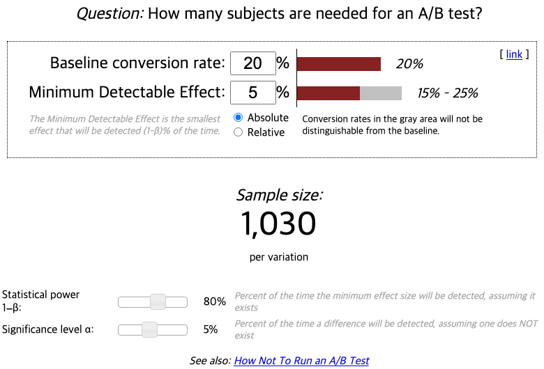

데이터는 의사결정의 재료이지 의사결정 그 자체가 아니다.

Bing의 한 직원이 검색 광고의 제목을 표시하는 방식을 조금 바꾸자고 제안했습니다. 우선순위가 낮다고 판단되어 몇 달 동안 밀려 있던 아이디어를 엔지니어 한 명이 A/B 테스트로 돌려 보기로 했습니다. 몇 시간 만에 새 버전의 매출이 비정상적으로 높다는 경고가 울렸습니다. 보통 이런 경고는 버그를 뜻하지만 이번에는 버그가 아니었습니다. 매출이 12% 올랐고, 미국에서만 연간 1억 달러가 넘는 금액이었으며, 사용자 경험 지표는 나빠지지 않았습니다. Ron Kohavi와 Stefan Thomke가 2017년에 *Harvard Business Review*에 소개한 이 사례는 Bing 역사상 가장 큰 매출 증가 아이디어였고, 테스트하지 않았다면 그대로 버려졌을 아이디어였습니다.

---

## 이 단계에서 풀어야 할 질문

[ep.20 애널리틱스로 UX 문제 진단하기](/ux-guide-ep-20/)에서 퍼널로 문제를 찾고 [ep.19 사용성 테스트: 5명이면 정말 충분한가](/ux-guide-ep-19/)에서 원인을 알았다면, 고친 설계가 정말 나은지는 아직 모릅니다. 5명이 더 쉽게 썼다고 해서 5만 명의 전환율이 오른다는 보장은 없습니다. 그 확인을 실험으로 하는 것이 A/B 테스트이고, 실험 결과를 어디까지 믿어야 하는지가 두 번째 문제입니다.

그래서 이번 편의 질문은 "어떤 변경을 실험으로 판단하고, 그 결과를 어디까지 믿어야 하는가"입니다.

---

## A/B 테스트의 정의와 맞는 조건

**A/B 테스트(A/B testing)** 는 두 가지 이상의 버전을 같은 기간에 무작위로 나눈 사용자 집단에게 보여주고 어느 버전의 지표가 더 나은지를 비교하는 온라인 통제 실험입니다. 기존 버전이 A(대조군), 바꾼 버전이 B(실험군)이고, 무작위 배분 때문에 두 집단의 차이는 버전의 차이로만 설명됩니다. "버튼 색을 바꾸면 전환율이 오를까"를 의견이 아니라 데이터로 답하는 도구입니다.

이 도구가 필요한 이유는 팀의 예측이 생각보다 자주 틀리기 때문입니다. Kohavi가 2009년에 Microsoft의 실험 플랫폼 결과를 정리했습니다. 지표를 개선하려고 만든 아이디어 중 실제로 그 지표가 개선된 것은 약 3분의 1뿐이었고, 오히려 나쁘게 만든 것도 약 3분의 1이었습니다. 나머지는 차이가 없었습니다. 만든 사람이 기대한 만큼 좋은 결과가 나오는 경우는 드물었습니다.

A/B 테스트를 수행하려면 네 가지 조건이 필요합니다. 전환율이나 완료율처럼 분명한 지표가 있어야 하고, 통계적으로 판단할 만큼 트래픽이 있어야 합니다. 한 번에 하나만 바꿔 변수를 통제할 수 있어야 하고, 결과에 따라 실제로 결정할 준비가 되어 있어야 합니다. A/B 테스트가 만능은 아닙니다. 트래픽이 적으면 차이가 있어도 잡아내지 못합니다. 전체 흐름을 바꾸는 큰 변경은 한 변수로 떨어지지 않습니다. 브랜드의 어조나 사용자의 감정처럼 정성적인 판단이 필요한 문제는 지표로 환원되지 않습니다.

---

## 실행 네 단계

### 가설 세우기

가설은 "무엇을 바꾸면 어떤 지표가 어떻게 될 것이다, 왜냐하면"의 형식으로 적습니다. "버튼을 초록색으로 바꿔 보자"에는 가설이 없습니다. "시작 버튼의 문구를 '시작하기'에서 '무료로 시작하기'로 바꾸면 클릭률이 오를 것이다. 사용성 테스트에서 참가자 5명 중 4명이 비용이 들지 않는지를 물었기 때문이다"처럼 적어야 결과가 어느 쪽이든 배울 것이 생깁니다. 왜냐하면 뒤의 근거는 [ep.19 사용성 테스트: 5명이면 정말 충분한가](/ux-guide-ep-19/)와 [ep.20 애널리틱스로 UX 문제 진단하기](/ux-guide-ep-20/)에서 나옵니다.

### 지표 정하기

무엇이 "더 나은" 것인지를 테스트 전에 정해야 합니다. 끝난 뒤에 지표를 고르면 원하는 결과를 뒷받침하는 지표를 고르게 됩니다. 주 지표는 하나로 두고, 주 지표가 오를 때 다른 중요한 지표가 내려가지 않는지를 감시하는 **가드레일 지표(guardrail metric)** 를 함께 둡니다. 전환율이 올랐는데 반품률도 올랐는지, 가입이 늘었는데 7일 재방문율은 줄었는지를 가드레일이 잡아냅니다.

### 표본 크기와 기간 정하기

필요한 표본 크기는 테스트를 시작하기 전에 계산합니다. 기준 전환율, 잡아내려는 최소 차이, 검정력, 유의 수준 네 값을 넣으면 버전당 필요한 사용자 수가 나옵니다. Evan Miller의 [표본 크기 계산기](https://www.evanmiller.org/ab-testing/sample-size.html)에 기준 전환율 20%, 최소 탐지 효과 5%p, 검정력 80%, 유의 수준 5%를 넣으면 버전당 1,030명이 나옵니다. 잡으려는 차이를 2%p로 줄이면 필요한 인원은 수천 명으로 늘어나므로, 트래픽이 적은 서비스에서는 작은 차이를 재는 실험을 할 수 없습니다.

기간은 요일에 따른 편차를 상쇄하도록 최소 1주에서 2주를 잡고, 계산한 표본이 찰 때까지 중간에 멈추지 않아야 합니다. 결과를 날마다 들여다보다가 유의해 보이는 순간 멈추는 **피킹(peeking)** 은 거짓 양성을 크게 늘립니다. Evan Miller가 2010년에 계산한 예에서는, 실제 차이가 없는 두 버전을 비교하면서 유의 수준 5%에 처음 닿는 순간 멈추자 26.1%가 차이가 있다고 잘못 판정됐습니다. 정해 둔 5%의 다섯 배가 넘는 수치입니다. 실험 중간에 열 번 들여다봤다면, 도구가 1%라고 보고한 유의 수준은 들여다볼 때마다 우연히 유의해 보일 기회가 쌓인 결과입니다. 그래서 실제로는 5%쯤으로 봐야 합니다.

### 결과 해석하기

통계적 유의성(보통 p < 0.05)은 출발점이지 결론이 아닙니다. 유의하지만 차이가 0.1%p라면 구현과 유지 비용을 들일 만한지 효과 크기를 따져야 합니다. 세그먼트별 결과도 봐야 합니다. 모바일과 데스크톱, 신규와 기존 사용자에서 반대 결과가 나오는 경우가 있습니다. 새 디자인은 낯설어서 처음 며칠 동안 클릭이 몰리는 신기 효과가 있습니다. 그래서 Kohavi는 2020년에 *Trustworthy Online Controlled Experiments*에서 기존 사용자와 신규 사용자의 결과를 나눠 보고, 효과가 시간이 지나도 유지되는지 확인하라고 했습니다. 결과가 너무 좋을 때도 의심해야 합니다. Bing의 사례에서 경고가 먼저 울린 것처럼, 큰 개선은 대개 측정 오류이고 진짜인 경우가 드뭅니다.

---

## 다섯 가지 함정

A/B 테스트를 잘 돌려도 데이터로 결정하는 일 자체에 함정이 있습니다. 항목마다 실제 사례와 대응을 함께 적습니다.

- **모든 것을 테스트하려는 것**: Google은 2009년에 링크 색으로 쓸 파란색 41가지를 테스트해 가장 클릭이 많은 색을 골랐고, 시각 디자인 책임자였던 Doug Bowman은 같은 해에 회사를 떠나며 "테두리가 3px인지 4px인지 5px인지를 두고 증명을 요구받았다"고 썼습니다. 세부는 데이터로 고를 수 있지만, 어떤 제품을 만들지 같은 큰 방향은 실험에서 나오지 않습니다. 실험의 범위를 정해 두는 것으로 대응합니다. 방향은 리서치와 판단으로 정하고, 그 방향 안의 세부를 실험으로 고릅니다.
- **단기 지표의 최적화**: 팝업을 띄우면 이메일 수집률이 오릅니다. 그런데 3개월 뒤 재방문율이 떨어졌다면 단기 지표가 장기 경험을 깎은 것입니다. 가드레일 지표로 대응합니다. 주 지표를 정할 때 그 지표가 올라도 내려가면 안 되는 지표를 같이 정하고, 실험이 끝난 뒤에도 몇 주 동안 추적합니다.
- **데이터의 과신**: 같은 숫자도 해석에 따라 반대 결론이 나옵니다. 체류 시간이 올랐다면 콘텐츠에 몰입한 것일 수도 있고 원하는 것을 찾지 못해 헤맨 것일 수도 있습니다. [ep.20 애널리틱스로 UX 문제 진단하기](/ux-guide-ep-20/)에서 본 대로 숫자는 무엇이 일어났는지만 말하므로, 결과를 해석하기 전에 세션 리플레이나 사용성 테스트로 왜를 확인해야 합니다.
- **지역 최적화**: 버튼 색, 문구, 위치를 조금씩 바꾸는 실험을 이어 가면 지표는 조금씩 오르지만, 그 화면이 애초에 필요한 화면인지는 묻지 않게 됩니다. 작은 언덕의 꼭대기에 서면 더 높은 산이 보이지 않는 것과 같습니다. 분기마다 한 번씩 실험 목록을 놓고 "이 화면을 없애면 어떻게 되는가" 같은 큰 질문을 던지는 것으로 대응합니다. 큰 변경은 실험이 아니라 [ep.14 디자인 시스템과 프로토타이핑: 충실도의 선택](/ux-guide-ep-14/)의 프로토타입과 사용성 테스트로 먼저 검증합니다.
- **윤리적 경계**: Facebook은 2014년에 사용자 689,003명의 뉴스피드에서 긍정적이거나 부정적인 글의 노출을 줄이는 실험을 하고 그 결과를 PNAS에 발표했습니다. 사용자는 실험에 참여한다는 사실을 몰랐고, PNAS는 같은 해에 동의 절차에 관한 우려를 공식으로 표명했습니다. 다크 패턴은 이런 윤리적 경계를 더 자주 침범합니다. 구독 해지 버튼을 작게 만들면 해지율이 떨어지지만 이는 사용자를 속인 결과입니다. Arunesh Mathur와 동료들이 2019년에 쇼핑 사이트 약 1만 1천 개를 조사했을 때 1,254개(11.1%)에서 1,818건의 다크 패턴이 발견됐고, 인기 있는 사이트일수록 더 많았습니다. 다크 패턴의 유형과 작동 원리는 [다크패턴 해부하기](/dark-pattern-anatomy-ep-00/) 시리즈에서 다루고 있고, Mathur의 분류는 [다크패턴 해부하기 ep.04 분류 지도 ②: Mathur의 실증 분류와 공정위 6유형](/dark-pattern-anatomy-ep-04/)에 정리되어 있습니다. 실험 전에 "이 변경이 사용자가 알면 화낼 일인가"를 물어봐야 합니다. 데이터가 모든 결과를 정당화하지는 못합니다.

---

## 실험 문화

A/B 테스트는 도구이고, 그 도구를 쓰는 팀의 습관이 결과를 정합니다. 가설을 세우고, 검증하고, 배운 것을 기록하는 주기를 팀의 일로 만들어야 합니다. 모든 변경에 "왜 이것이 더 나을 것이라 생각하는가"를 묻고, 결과가 예상과 다를 때 "왜"를 파고들며, 실패한 실험도 무엇을 배웠는지 적어 둡니다. Kohavi는 실험 문화의 반대편에 가장 높은 사람의 의견으로 결정하는 방식을 두고 HiPPO(highest paid person's opinion)라고 불렀습니다. 실험 플랫폼이 있어도 결과보다 직급이 결정을 좌우하면 3분의 1만 맞는 예측이 그대로 출시됩니다.

---

## 기획자·디자이너·개발자가 각각 가져갈 것

**기획자**: 실험 요청서에 가설, 주 지표, 가드레일 지표, 필요한 표본 크기를 적어야 합니다. 네 가지 중 하나라도 비어 있으면 실험이 아니라 출시입니다. 결과가 좋아도 가드레일을 확인하기 전에는 전체 적용을 결정하지 않아야 합니다.

**디자이너**: 실험으로 고를 세부와 판단으로 정할 방향을 구분해야 합니다. 버튼의 색과 문구는 실험에 맡기되, 화면의 구조와 흐름은 프로토타입과 사용성 테스트로 먼저 검증하고 그 결과를 들고 실험을 제안해야 합니다. 해지 흐름처럼 사용자의 선택을 막는 방향의 실험은 제안하지 않아야 합니다.

**개발자**: 무작위 배분이 실제로 무작위인지, 두 집단의 크기가 설계대로 나뉘었는지를 실험 시작 직후에 확인해야 합니다. 배분 비율이 어긋나 있으면 결과 전체를 믿을 수 없습니다. 실험 코드는 끝난 뒤에 지워야 합니다. 끝난 실험의 분기가 코드에 남으면 다음 실험의 변수가 통제되지 않습니다.

---

## 참고 자료

- Kohavi, R., & Thomke, S. (2017). The Surprising Power of Online Experiments. *Harvard Business Review*, September-October 2017. https://hbr.org/2017/09/the-surprising-power-of-online-experiments
- Kohavi, R., Crook, T., & Longbotham, R. (2009). Online Experimentation at Microsoft. *Third Workshop on Data Mining Case Studies and Practice Prize*.
- Kohavi, R., Tang, D., & Xu, Y. (2020). *Trustworthy Online Controlled Experiments: A Practical Guide to A/B Testing*. Cambridge University Press.
- Miller, E. (2010). How Not To Run an A/B Test. https://www.evanmiller.org/how-not-to-run-an-ab-test.html
- Miller, E. Sample Size Calculator. https://www.evanmiller.org/ab-testing/sample-size.html
- Bowman, D. (2009). Goodbye, Google. stopdesign. https://stopdesign.com/archive/2009/03/20/goodbye-google.html
- Kramer, A. D. I., Guillory, J. E., & Hancock, J. T. (2014). Experimental evidence of massive-scale emotional contagion through social networks. *Proceedings of the National Academy of Sciences*, 111(24), 8788-8790.
- Mathur, A., Acar, G., Friedman, M. J., Lucherini, E., Mayer, J., Chetty, M., & Narayanan, A. (2019). Dark Patterns at Scale: Findings from a Crawl of 11K Shopping Websites. *Proceedings of the ACM on Human-Computer Interaction*, 3(CSCW), Article 81.

---

## 다음 편 예고

> [ep.22 - AI 시대의 UX: 비결정성과 에이전트](/ux-guide-ep-22/)

지금까지의 원칙은 같은 입력에 같은 출력이 나온다는 전제 위에 있었습니다. 같은 질문에 다른 답이 나오는 시스템에서 신뢰, 통제감, 투명성을 어떻게 설계하는지, 그리고 지시·진행·검토·피드백으로 이어지는 에이전트 UX의 루프를 다룹니다.
